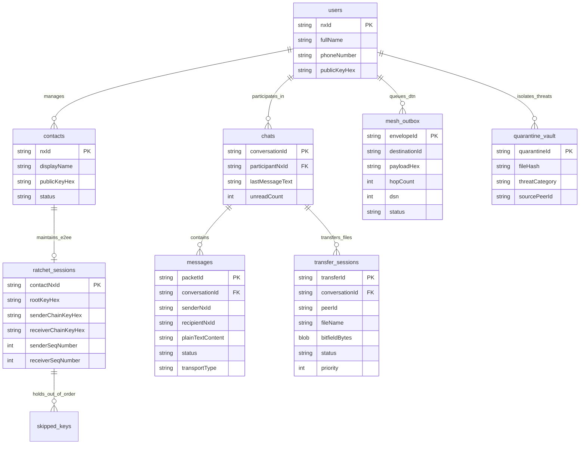

# NEXA — Database & Cloud Storage Audit (Room SQLCipher vs Supabase)

**Audit Date:** November 4, 2026  
**Audited Location:** `H:\chat_app`  
**Database Engines Examined:** Room Database (Android SQLite + SQLCipher v4.5.4), Supabase PostgreSQL.

---

## 1. Executive Finding: Supabase vs Local-First Architecture

The audit investigation specifically queried all SQL migrations, configurations, environment files, and codebases for Supabase PostgreSQL tables and RLS policies.

### Findings on Supabase:
- **Supabase Integration Status:** **COMPLETELY ABSENT (0%)**.
- **Evidence:**
  - `grep -rn "supabase" H:\chat_app` returns **0 results**.
  - No `supabase/` directory exists.
  - No `.env` with `SUPABASE_URL` or `SUPABASE_ANON_KEY` exists.
  - No Supabase client libraries exist in `app/build.gradle.kts`.
- **Architectural Reason:**
  NEXA's architectural mandate is **$0 Operating Cost and Zero-Cloud-Storage**. Cloud storage of user messages, profiles, social graphs, or attachments is strictly prohibited by design. The database architecture is **100% Local-First**, powered by an on-device encrypted **Room Database + SQLCipher (Version 10)**, with off-device backup restricted to the user's personal Google Drive `appDataFolder` encrypted vault.

---

## 2. On-Device Database Architecture: NexaDatabase (SQLCipher v10)

The active database is defined in `app/src/main/java/com/nexa/app/data/local/NexaDatabase.kt`:
- **Engine:** Android Room (`androidx.room:room-runtime:2.6.1`)
- **Encryption Wrapper:** Zetetic SQLCipher (`net.zetetic:android-database-sqlcipher:4.5.4`)
- **Database File:** `nexa_encrypted_vault.db`
- **Current Version:** `10`
- **Key Protection:** 256-bit passphrase generated via `SecureRandom`, stored in hardware-backed `EncryptedSharedPreferences` (`SecureStorage.kt`).
- **Zero-Lock Snapshot:** `getRawDatabase()` exposes `SupportSQLiteDatabase` for `VACUUM INTO` operations.

---

## 3. Complete Entity & Table Inventory (12 Tables)

### Table 1: `users` (`UserEntity.kt`)
- **Purpose:** Stores the authenticated local user's profile and cryptographic identity.
- **Primary Key:** `nxId: String`
- **Columns:**
  - `nxId` (TEXT, PK): Allocated NEXA ID.
  - `fullName` (TEXT): Display name.
  - `phoneNumber` (TEXT): Bound phone number.
  - `age` (INTEGER, Nullable): Optional age.
  - `gender` (TEXT, Nullable): Optional gender.
  - `bio` (TEXT, Nullable): Optional biography (max 240 chars).
  - `publicKeyHex` (TEXT): 32-byte Ed25519/Curve25519 public key in hex format.
  - `isVerified` (INTEGER / Boolean): Verification state.
  - `createdAt` (INTEGER): Timestamp of registration.

### Table 2: `messages` (`MessageEntity.kt`)
- **Purpose:** Outbox and inbox message storage for all chats.
- **Primary Key:** `packetId: String`
- **Indices:**
  - `conversationId` (Non-unique, for fast thread queries)
  - `packetId` (Unique)
- **Columns:**
  - `packetId` (TEXT, PK, UNIQUE): Unique wire UUID.
  - `conversationId` (TEXT): Derived pairwise conversation identifier.
  - `senderNxId` (TEXT): Message originator.
  - `recipientNxId` (TEXT): Intended destination.
  - `plainTextContent` (TEXT): Decrypted plaintext (safe at rest in SQLCipher AES-256).
  - `status` (TEXT): `PENDING`, `SENT`, `DELIVERED`, `READ`, `FAILED`.
  - `timestamp` (INTEGER): Dispatch / receipt epoch millisecond.
  - `isOutgoing` (INTEGER / Boolean): `1` for sender, `0` for incoming.
  - `transportType` (TEXT): `INTERNET`, `DATA_SMS`, `DTN_MESH`, `WEBRTC_P2P`.

### Table 3: `chats` (`ChatEntity.kt`)
- **Purpose:** Conversation thread directory and preview snippets.
- **Primary Key:** `conversationId: String`
- **Columns:**
  - `conversationId` (TEXT, PK): Pairwise hash.
  - `participantNxId` (TEXT): Remote peer NX-ID.
  - `participantName` (TEXT): Remote peer display name.
  - `lastMessageText` (TEXT): Last message preview.
  - `lastMessageTimestamp` (INTEGER): Timestamp of latest event.
  - `unreadCount` (INTEGER): Unread message counter.

### Table 4: `contacts` (`ContactEntity.kt`)
- **Purpose:** Social graph, friendship states, and recipient prekey cache.
- **Primary Key:** `nxId: String`
- **Columns:**
  - `nxId` (TEXT, PK): Contact NX-ID.
  - `displayName` (TEXT): Nickname or handle.
  - `publicKeyHex` (TEXT): 32-byte Ed25519 identity key.
  - `introMessage` (TEXT, Nullable): Handshake introduction.
  - `status` (TEXT): `REQUEST_SENT`, `REQUEST_RECEIVED`, `MUTUAL_FRIEND`, `BLOCKED`.
  - `updatedAt` (INTEGER): Last state change timestamp.

### Table 5: `ratchet_sessions` (`RatchetStateEntity.kt`)
- **Purpose:** Active Signal-style Double Ratchet session state per contact.
- **Primary Key:** `contactNxId: String`
- **Columns:**
  - `contactNxId` (TEXT, PK): Peer identifier.
  - `rootKeyHex` (TEXT): 32-byte current root key.
  - `senderChainKeyHex` (TEXT): Current KDF sender chain key.
  - `receiverChainKeyHex` (TEXT): Current KDF receiver chain key.
  - `senderSeqNumber` (INTEGER): Monotonic outgoing counter.
  - `receiverSeqNumber` (INTEGER): Monotonic incoming counter.
  - `localDhPrivateKeyHex` (TEXT): Ephemeral X25519 private key.
  - `localDhPublicKeyHex` (TEXT): Ephemeral X25519 public key.
  - `remoteDhPublicKeyHex` (TEXT): Remote peer ephemeral X25519 public key.
  - `lastUpdatedTimestamp` (INTEGER): Epoch millisecond.

### Table 6: `skipped_keys` (`SkippedKeyEntity.kt`)
- **Purpose:** Stores out-of-order ratchet message keys to tolerate lost/delayed packets.
- **Primary Key:** Composite (`contactNxId`, `dhPublicKeyHex`, `seqNumber`)
- **Columns:**
  - `contactNxId` (TEXT, PK)
  - `dhPublicKeyHex` (TEXT, PK)
  - `seqNumber` (INTEGER, PK)
  - `messageKeyHex` (TEXT): 32-byte ChaCha20 message key.
  - `timestamp` (INTEGER): Creation epoch for 24-hour TTL pruning.

### Table 7: `transfer_sessions` (`TransferSessionEntity.kt`)
- **Purpose:** Tracks resilient 50k-scale direct P2P file transfers and resumption bitfields.
- **Primary Key:** `transferId: String`
- **Indices:**
  - `status` (For fast active transfer queries)
  - `priority` (For fast-lane small file queries)
- **Columns:**
  - `transferId` (TEXT, PK): Transfer session UUID.
  - `conversationId` (TEXT): Thread reference.
  - `peerId` (TEXT): Remote WebRTC endpoint.
  - `fileName` (TEXT): Clean file name.
  - `fileSizeBytes` (INTEGER): Total size.
  - `blake3Hash` (TEXT): Cryptographic file hash.
  - `chunkCount` (INTEGER): Total 64 KB sparse chunks.
  - `isOutgoing` (INTEGER / Boolean): Direction.
  - `status` (TEXT): `PENDING_PEER_ONLINE`, `ACTIVE`, `PAUSED_OFFLINE`, `COMPLETED`, `FAILED`, `ABORTED`.
  - `priority` (INTEGER): `1` for files < 5 MB, `0` for normal.
  - `routeType` (TEXT): `LAN_DIRECT`, `P2P_STUN`, `RELAY_TURN`.
  - `bitfieldBytes` (BLOB): Binary `BitSet` tracking received chunks on disk.
  - `bytesTransferred` (INTEGER): Progress counter.
  - `lastActiveTimestamp` (INTEGER): Epoch for 7-day orphan cleanup.

### Table 8: `dtn_outbox` / `mesh_outbox` (`MeshEnvelopeEntity.kt`)
- **Purpose:** MANET & DTN Store-Carry-Forward persistent envelope vault.
- **Primary Key:** `envelopeId: String`
- **Columns:**
  - `envelopeId` (TEXT, PK): Wire UUID.
  - `destinationId` (TEXT): Blind token or target NX-ID.
  - `payloadHex` (TEXT): Encrypted wire frame.
  - `hopCount` (INTEGER): Monotonic hop counter (capped at 7).
  - `dsn` (INTEGER): Destination sequence number.
  - `status` (TEXT): `OUTBOX_HOLD`, `IN_TRANSIT`, `DELIVERED`, `EXPIRED`.
  - `createdAt` (INTEGER): Creation timestamp.
  - `ttlHours` (INTEGER): Time-to-live (default: 48 hours).

### Table 9: `dtn_vault` (`DtnEnvelopeEntity.kt`)
- **Purpose:** Store-and-forward holding pen for opportunistic mule routing.
- **Primary Key:** `envelopeId: String`
- **Columns:**
  - `envelopeId` (TEXT, PK)
  - `blindTokenHex` (TEXT): Blind routing tag.
  - `rawCiphertext` (BLOB): Encrypted payload.
  - `hopLimit` (INTEGER): Hop bound.
  - `expiresAt` (INTEGER): TTL expiration.
  - `isDelivered` (INTEGER / Boolean)

### Table 10: `quarantine_vault` (`QuarantineEntity.kt`)
- **Purpose:** Dual-Gate malware defense isolation sink.
- **Primary Key:** `quarantineId: String`
- **Columns:**
  - `quarantineId` (TEXT, PK): Isolation UUID.
  - `fileName` (TEXT): Quarantined file name.
  - `fileHash` (TEXT): SHA-256 / Blake3 hash.
  - `fileSizeBytes` (INTEGER): Size.
  - `threatCategory` (TEXT): `KNOWN_MALWARE_HASH`, `EXTENSION_MIME_MISMATCH`, `YARA_MALICIOUS_PATTERN`.
  - `threatDetails` (TEXT): Diagnostic description.
  - `sourcePeerId` (TEXT): Originating peer NX-ID.
  - `quarantinedPath` (TEXT): Internal sandbox path (`.quarantine` directory).
  - `quarantinedAt` (INTEGER): Epoch millisecond.

### Table 11: `file_transfers` (`TransferEntity.kt`)
- **Purpose:** Legacy P2P transfer session metadata.
- **Primary Key:** `transferId: String`
- **Columns:**
  - `transferId` (TEXT, PK), `fileName` (TEXT), `fileSize` (INTEGER), `status` (TEXT), `progress` (REAL).

### Table 12: `file_metadata` (`FileMetadataEntity.kt`)
- **Purpose:** Pre-dispatch media metadata and verification cache.
- **Primary Key:** `fileHash: String`
- **Columns:**
  - `fileHash` (TEXT, PK), `mimeType` (TEXT), `isSafe` (INTEGER), `scannedAt` (INTEGER).

---

## 4. Database Relationship Diagram

---

## 5. Cloud Integration & Migrations Assessment

1. **Schema Migrations:**
   `NexaDatabase` is configured with `exportSchema = false` and `version = 10`. During local development, schema migrations are currently handled via destructive rebuild during testing (`fallbackToDestructiveMigration()`). A production release must export SQL schemas to `app/schemas` and provide explicit Room `Migration` classes from v1 to v10.
2. **Cloud Database Verification:**
   Zero cloud tables exist in Supabase, AWS RDS, or GCP Cloud SQL. All cloud data buffering is handled in-memory by Go microservices and ephemeral Redis with strict 24-hour TTLs.
