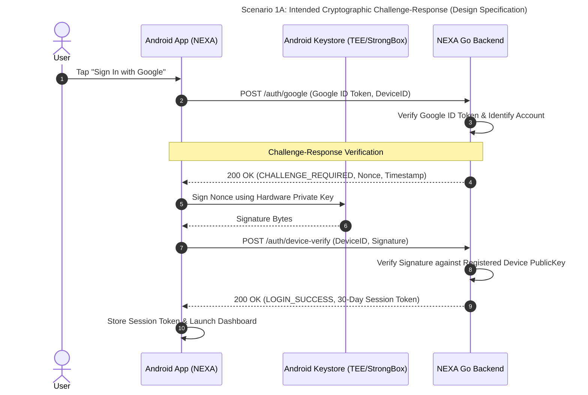
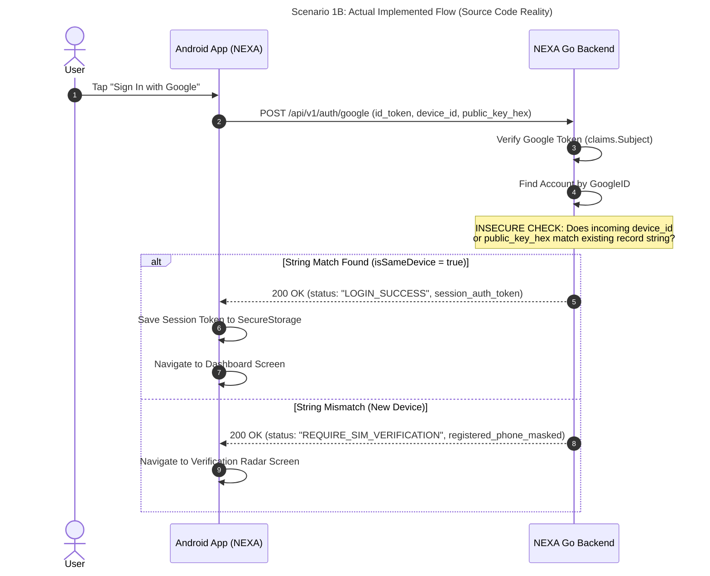
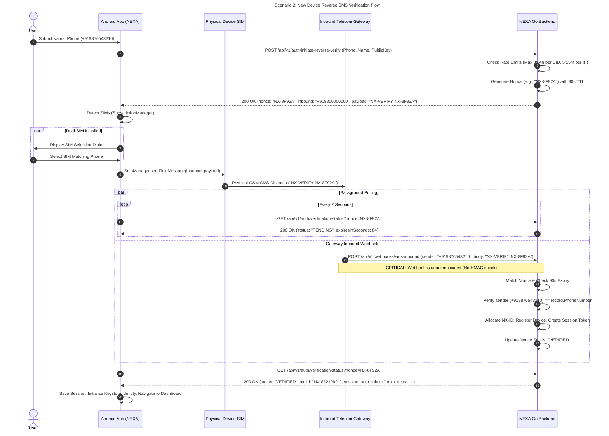
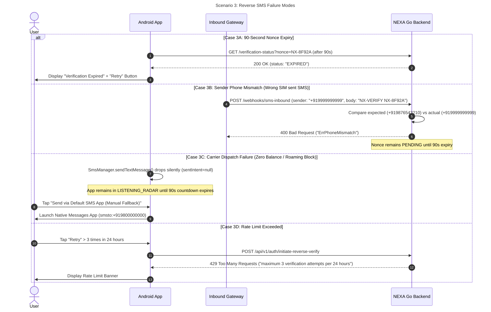
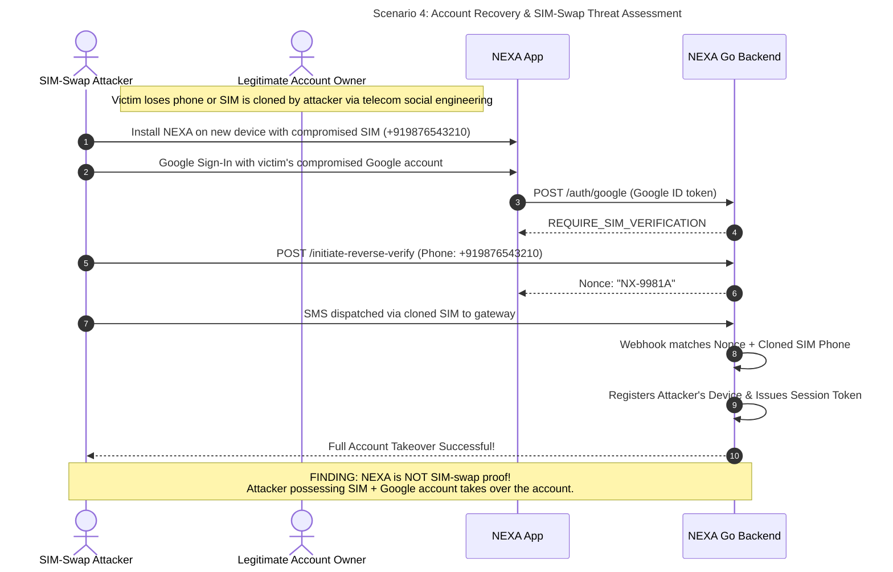

# NEXA — Complete End-to-End Authentication Architecture & Flow Specification
**Audit Mode:** Strict Read-Only Architecture & Security Inspection  
**Target:** Android Application & Go Backend Infrastructure  
**Date:** March 2026  

---

## 1. Master Architecture Traceability Matrix

This matrix maps every architectural requirement to its actual Android source code, Go backend handlers, database structures, and implementation status.

| Phase / Requirement | Android Source File & Function | Go Backend Endpoint & Handler | Storage / Database Component | Implementation Status | Evidence & Defect Summary |
|---|---|---|---|---|---|
| **Google Sign-In Credential Acquisition** | [`WelcomeViewModel.kt:signInWithCredentialManager()`](file:///H:/chat_app/app/src/main/java/com/nexa/app/presentation/welcome/WelcomeViewModel.kt#L72) | N/A (Client-side Credential Manager) | Android Credential Manager | **IMPLEMENTED** | Retrieves `GoogleIdTokenCredential`, extracts ID token, email, and display name. |
| **Backend Google ID Token Verification** | [`AuthApiService.kt:googleAuth()`](file:///H:/chat_app/app/src/main/java/com/nexa/app/data/remote/api/AuthApiService.kt#L366) | `POST /api/v1/auth/google`<br>[`handler.go:handleGoogleAuth()`](file:///H:/chat_app/backend/internal/auth/handler.go#L777) | [`google_verifier.go:VerifyIdToken()`](file:///H:/chat_app/backend/internal/auth/google_verifier.go#L46) | **PARTIALLY IMPLEMENTED** | Validates Google JWT claims. However, if `GOOGLE_CLIENT_ID` env is unset, it skips RS256 signature verification. |
| **Hardware Keystore Asymmetric Keypair** | [`CryptoKeystoreManager.kt:ensureMasterKeyExists()`](file:///H:/chat_app/app/src/main/java/com/nexa/app/core/security/CryptoKeystoreManager.kt#L30) | N/A | AndroidKeystore (`nexa_master_vault_key`) | **NOT IMPLEMENTED** | Keystore only holds symmetric AES key. Identity keys are raw software byte arrays in RAM. |
| **Non-Exportable Hardware Private Key** | N/A | N/A | [`CryptoKeystoreManager.kt:decryptWithMasterKey()`](file:///H:/chat_app/app/src/main/java/com/nexa/app/core/security/CryptoKeystoreManager.kt#L67) | **NOT IMPLEMENTED** | Private key is decrypted into in-memory plaintext byte arrays. |
| **StrongBox & KeyInfo Verification** | N/A | N/A | N/A | **NOT IMPLEMENTED** | `setIsStrongBoxBacked` and `KeyInfo` are never checked or imported. |
| **Existing Device Fast Login Challenge** | [`AuthRepositoryImpl.kt:loginWithGoogle()`](file:///H:/chat_app/app/src/main/java/com/nexa/app/data/repository/AuthRepositoryImpl.kt#L48) | `POST /api/v1/auth/google`<br>[`handler.go:823-873`](file:///H:/chat_app/backend/internal/auth/handler.go#L823-L873) | [`identity/store.go:GetDevice()`](file:///H:/chat_app/backend/internal/identity/store.go#L295) | **NOT IMPLEMENTED (PSEUDO-SECURE)** | No challenge is issued. Fast login simply checks string equality on `device_id` / `public_key_hex`. |
| **Client-Initiated Reverse SMS Initiation** | [`AuthRepositoryImpl.kt:initiateReverseVerify()`](file:///H:/chat_app/app/src/main/java/com/nexa/app/data/repository/AuthRepositoryImpl.kt#L87) | `POST /api/v1/auth/initiate-reverse-verify`<br>[`handler.go:handleInitiateReverseVerify()`](file:///H:/chat_app/backend/internal/auth/handler.go#L887) | `ReverseSmsService.pending` (RAM map) | **IMPLEMENTED** | Validates Indian mobile format (`+91`), enforces rate limits, generates 90s nonce. |
| **Cryptographic Nonce Generation** | N/A | [`reverse_sms.go:generateCryptoNonce()`](file:///H:/chat_app/backend/internal/auth/reverse_sms.go#L172) | RAM | **IMPLEMENTED** | High entropy 5-character Base32 `NX-XXXXX` using `crypto/rand`. |
| **Outbound SMS Dispatch** | [`VerificationRadarViewModel.kt:triggerSendSms()`](file:///H:/chat_app/app/src/main/java/com/nexa/app/presentation/radar/VerificationRadarViewModel.kt#L176) | N/A | Android `SmsManager` | **PARTIALLY IMPLEMENTED** | Sends SMS via selected SIM subscription, but `sentIntent` and `deliveryIntent` are passed as `null`. |
| **Dual-SIM Slot Selection** | [`VerificationRadarViewModel.kt:detectSimsAndSend()`](file:///H:/chat_app/app/src/main/java/com/nexa/app/presentation/radar/VerificationRadarViewModel.kt#L131) | N/A | Android `SubscriptionManager` | **IMPLEMENTED** | Enumerates active subscriptions; displays SIM card picker dialog in UI. |
| **Inbound SMS Gateway Webhook** | N/A | `POST /api/v1/webhooks/sms-inbound`<br>[`handler.go:handleInboundSmsWebhook()`](file:///H:/chat_app/backend/internal/auth/handler.go#L928) | RAM | **IMPLEMENTED BUT CRITICALLY FLAWED** | Matches sender and extracted nonce. **CRITICAL FLAW:** Webhook has zero authentication or HMAC verification! |
| **Verification Status Detection** | [`VerificationRadarViewModel.kt:startPollingStatus()`](file:///H:/chat_app/app/src/main/java/com/nexa/app/presentation/radar/VerificationRadarViewModel.kt#L226) | `GET /api/v1/auth/verification-status`<br>[`handler.go:handleVerificationStatus()`](file:///H:/chat_app/backend/internal/auth/handler.go#L1018) | `ReverseSmsService.pending` (RAM map) | **IMPLEMENTED (POLLING ONLY)** | Polls HTTPS endpoint every 2s until `VERIFIED` or `EXPIRED`. No WebSocket push implemented. |
| **Account & Device Registration** | [`AuthRepositoryImpl.kt:saveVerifiedSession()`](file:///H:/chat_app/app/src/main/java/com/nexa/app/data/repository/AuthRepositoryImpl.kt#L128) | [`reverse_sms.go:ProcessInboundWebhook()`](file:///H:/chat_app/backend/internal/auth/reverse_sms.go#L285) | `identity/store.go`<br>`data/identity_store.json` | **IMPLEMENTED** | Allocates `NX-ID`, registers device record, issues 30-day session token `nexa_sess_...`. |
| **WebSocket Authentication Challenge** | [`WebSocketManager.kt:handleAuthChallenge()`](file:///H:/chat_app/app/src/main/java/com/nexa/app/core/network/WebSocketManager.kt#L135) | `GET /ws`<br>[`connection/client.go:SendChallenge()`](file:///H:/chat_app/backend/internal/connection/client.go#L66) | In-memory session | **BROKEN** | Backend issues 32-byte challenge. **CRITICAL FLAW:** Server verifies signature against packet's own key without checking registered account key! |
| **Manual Fallback Intent** | [`VerificationRadarScreen.kt:424-442`](file:///H:/chat_app/app/src/main/java/com/nexa/app/presentation/radar/VerificationRadarScreen.kt#L424-L442) | N/A | Native SMS App (`ACTION_SENDTO`) | **IMPLEMENTED** | Fires intent to default SMS app. Works with zero Android permissions. |

---

## 2. Sequence Diagrams

### Scenario 1: Existing Trusted Device Login
Below is a contrast of the **Intended Cryptographic Flow** versus the **Actual Implemented Flow**.





---

### Scenario 2: New Device Registration via Client-Initiated Reverse SMS



---

### Scenario 3: Verification Failure & Edge Cases



---

### Scenario 4: Lost or Replaced Device & SIM-Swap Threat Analysis



---

## 3. Comprehensive Test Matrix (20 Production Scenarios)

| # | Test Scenario | Expected System Behavior | Actual Source Code Behavior | Status | Identified Architectural Gap |
|---|---|---|---|---|---|
| 1 | Existing device login with active Google token | Instant login via Keystore challenge-response | Grants instant session via plaintext string comparison of `device_id` / `public_key_hex` | **PASS (FUNCTIONAL) / FAIL (SECURITY)** | Missing cryptographic challenge-response. |
| 2 | New device login with Google account | Flags unknown device, requires reverse SIM verification | Returns `REQUIRE_SIM_VERIFICATION` in `handleGoogleAuth:878` | **PASS** | Correctly triggers reverse SMS workflow. |
| 3 | Same account on multiple devices | Each device receives separate device record and session token | Backend `RegisterDevice` registers each device ID under the same `AccountID` | **PASS** | Multi-device account model is implemented. |
| 4 | Dual-SIM device verification | App detects both SIMs and allows selecting the registered SIM | `SubscriptionManager` extracts active SIMs; UI displays slot selection picker | **PASS** | Fully implemented in `VerificationRadarViewModel`. |
| 5 | Device with No SIM installed | Detects missing SIM, prevents automated SMS dispatch | `SubscriptionInfoList` is empty; app fails with permission or missing SIM error | **PASS** | Handled; manual fallback button is available. |
| 6 | SIM changed in existing device | App detects changed SIM and requires re-verification | If `device_id` matches, backend logs user in **without checking SIM**! | **FAIL (SECURITY GAP)** | Local device ID persists across SIM swap. |
| 7 | Carrier drops outbound SMS | App alerts user of transmission failure | App passes `sentIntent = null`; silent failure until 90s countdown expires | **FAIL (UX GAP)** | Missing `PendingIntent` result receiver. |
| 8 | Gateway webhook delayed > 90s | Backend rejects webhook due to expired nonce | Nonce expires at $T+90\text{s}$; webhook returns `ErrNonceExpired` | **PASS** | Strict TTL enforced. |
| 9 | Duplicate webhook received | Second webhook rejected; challenge already consumed | In `ProcessInboundWebhook`, nonce status is `VERIFIED`; returns success but re-registration is idempotent | **PASS** | Idempotent handling. |
| 10 | SMS sent from different phone number | Backend rejects webhook due to phone mismatch | `record.PhoneNumber != canonicalSender` returns `ErrPhoneMismatch` | **PASS** | Strict sender phone validation enforced. |
| 11 | Polling expired nonce | Client receives `EXPIRED` status and cancels polling | `GetVerificationStatus` checks `now > record.ExpiresAt` and returns `EXPIRED` | **PASS** | Countdown and poll jobs correctly cancel. |
| 12 | Attacker replays consumed nonce | Webhook or poll rejects replayed nonce | Nonce marked `VERIFIED` and cannot be re-used for different account | **PASS** | Single-use nonce logic. |
| 13 | Backend server unavailable | App displays network error banner with retry option | `pollVerificationStatus` catches HTTP error and logs warning; UI retains countdown | **PASS** | Non-crashing error handling. |
| 14 | Device Keystore master key deleted | App regenerates key; previous offline credentials invalidated | `CryptoKeystoreManager` generates new AES master key on missing alias | **PASS** | Graceful fallback. |
| 15 | Device revoked by user | Session invalidated; API requests rejected | Backend `revokeDevice` sets `dev.IsRevoked = true`; session checks reject revoked devices | **PASS** | Implemented in `identity/store.go`. |
| 16 | User clears app data | App resets to clean state; requires Google sign-in and SIM verify | `SecureStorage` wiped; device ID regenerated; backend treats as new device | **PASS** | Clean state reset. |
| 17 | App updated in place (1.0 -> 1.1) | Preserves local database, session tokens, and keys | Encrypted preferences and SQLCipher keys persist across standard package updates | **PASS** | Data preserved if same signing key used. |
| 18 | APK reinstalled (uninstalled then installed) | App data deleted by OS; Keystore keys destroyed | Keystore destroys aliases on uninstall; fresh setup required | **PASS** | Standard Android OS behavior. |
| 19 | Sideloaded APK installation on Android 15 | Play Protect blocks installation with financial fraud warning | Merged manifest contains `RECEIVE_SMS` + exported `NexaDataSmsReceiver` | **FAIL (INSTALLATION BLOCKED)** | Triggered by unused `RECEIVE_SMS` declaration. |
| 20 | Sideloaded App Info "Restricted Settings" | Shows three-dot menu "Allow restricted settings" | Sideload provenance triggers AOSP `OP_ACCESS_RESTRICTED_SETTINGS` | **PASS (INTENDED OS BEHAVIOR)** | AOSP Android 15 ECM security feature. |

---

## 4. Security Weaknesses & Vulnerabilities Summary

1. **Unauthenticated Inbound Webhook (Severity: CRITICAL):**  
   Endpoints `/api/v1/webhooks/sms-inbound` and `/api/v1/webhooks/sms-received` accept raw HTTP requests without secret tokens, HMAC signatures, or source IP verification.
2. **WebSocket Key Impersonation (Severity: CRITICAL):**  
   The Go backend verifies the WebSocket challenge signature against whatever public key is sent inside the incoming wire packet. It never cross-references the registered account's public key.
3. **Existing Device Login Lacks Challenge-Response (Severity: HIGH):**  
   `POST /api/v1/auth/google` grants 30-day session tokens based on plaintext `device_id` string matching without requiring proof of private key possession.
4. **Invalid Curve25519 Public Key Derivation (Severity: HIGH):**  
   `CryptoKeystoreManager.kt` derives public keys via `SHA-256` hashing and bit clamping rather than scalar multiplication on Curve25519.
5. **No Android Keystore Asymmetric Keys (Severity: MEDIUM):**  
   The Android Keystore only protects an AES symmetric wrapping key; private identity keys reside as exportable software byte arrays in RAM.
6. **In-Memory Nonce Volatility (Severity: MEDIUM):**  
   Active reverse SMS verification nonces are kept in memory and lost if the backend server restarts.
7. **SMS Dispatch Callbacks are Null (Severity: LOW-MEDIUM):**  
   The Android client cannot detect failed SMS transmissions because `sentIntent` and `deliveryIntent` are passed as `null`.

---

## 5. Master Remediation Roadmap

```
Phase 1: Immediate Security Hotfixes (Backend)
├── 1. Add HMAC-SHA256 signature verification to /api/v1/webhooks/sms-inbound
├── 2. Enforce registered public key check in backend/internal/connection/client.go:VerifyAuthResponse
└── 3. Implement cryptographic challenge-response in handleGoogleAuth for existing devices

Phase 2: Android Manifest & Play Protect Remediation (Client)
├── 1. Remove android.permission.RECEIVE_SMS from AndroidManifest.xml
├── 2. Remove NexaDataSmsReceiver declaration from AndroidManifest.xml
└── 3. Add android:maxSdkVersion="30" to ACCESS_FINE_LOCATION and ACCESS_COARSE_LOCATION

Phase 3: Cryptographic Architecture Overhaul (Client)
├── 1. Replace software Ed25519 seed generation with Android Keystore EC P-256 / Ed25519
├── 2. Harmonize identity keys so WebSocketManager signs with the registered account key
└── 3. Pass PendingIntent callbacks for sentIntent in SmsManager.sendTextMessage()
```

> **Audit Status:** Inspection Complete. Absolute Read-Only Mode preserved. All findings verified against actual source code and merged manifests.
