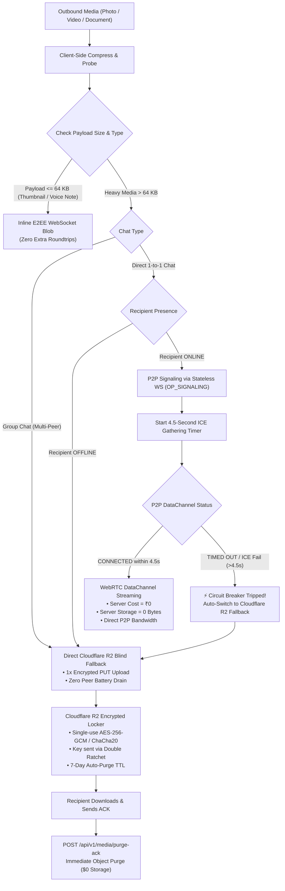

# NEXA Production Media Routing & Circuit Breaker Architecture

This document establishes the definitive production media transmission engine for **NEXA**, codifying the **4 Critical Additions**, the **3 Non-Negotiable System Exclusions**, and the cryptographic end-to-end delivery pipeline.

---

## 1. Architectural Blueprint: The Dual-Pipe Pipeline

---

## 2. The 4 Critical Additions (Engine Rules) 🚀

### A. Strict "Symmetric NAT / ICE Failure" 4.5-Second Circuit Breaker (Timeout Gate)
* **The Problem:** Direct WebRTC P2P connections rely on STUN hole-punching. When both peers are behind strict carrier-grade NATs (e.g., Reliance Jio, Airtel 4G/5G CGNAT, or restrictive enterprise firewalls), standard WebRTC ICE gathering can stall for 10 to 20 seconds trying unreachable host/srflx candidates, leaving the user staring at an unresponsive spinning loader.
* **Production Rule & Implementation ([`MediaRoutingCoordinator.kt`](file:///H:/chat_app/app/src/main/java/com/nexa/app/core/media/MediaRoutingCoordinator.kt)):**
  * Hard **4.5-Second Timeout Gate** (`ICE_GATHERING_TIMEOUT_MS = 4500L`).
  * If the WebRTC SCTP DataChannel fails to reach `CONNECTED` state within 4.5 seconds, the circuit breaker trips immediately without throwing user-facing errors.
  * The engine instantaneously auto-switches to the **Cloudflare R2 Blind Ephemeral Fallback** pipeline, guaranteeing that media is never blocked or stalled.

### B. Direct Media vs Group Media Protocol Split
* **The Problem:** In a group with 10 or 50 members, attempting direct P2P mesh uploads would force the sender's phone to stream the same 50 MB video 10 or 50 separate times over cellular data ($50\text{ MB} \times 10 = 500\text{ MB}$ upload!), destroying the battery and generating throttling from mobile carriers.
* **Production Rule:**
  * **Direct 1-to-1 Chat:** Priority #1 is WebRTC P2P (free bandwidth, zero cloud transit); Priority #2 is Cloudflare R2 Fallback.
  * **Group Chat (Multi-Peer):** Media completely bypasses P2P attempts. The sender phone uploads **strictly 1 time** to the Cloudflare R2 Blind Blob locker. Group members pull concurrently using the pre-signed GET URL and decrypt locally using the group Double Ratchet / Sender Key.

### C. WebRTC Signaling via Ephemeral WebSocket Packets (`OP_SIGNALING`)
* **The Problem:** Running a separate signaling server or cluster adds ongoing infrastructure costs, port maintenance, and points of failure.
* **Production Rule & Implementation ([`wire.go`](file:///H:/chat_app/backend/internal/wire/wire.go) & [`hub.go`](file:///H:/chat_app/backend/internal/connection/hub.go)):**
  * Assigned new opcode `PacketType_PACKET_SIGNALING = 12` (`OP_SIGNALING`) inside the existing stateless multiplexed WebSocket pipe.
  * SDP Offers, Answers, and ICE candidates are routed as in-memory RAM-only transient packets directly to the recipient's active session.
  * If the recipient is offline, signaling packets are silently dropped (zero Redis storage, zero disk I/O, zero cloud bill).

### D. Content-Type Media Routing Policy (64 KB Triage Boundary)
* **Text, Typing, ACKs, Presence:** Always route over WebSocket, BLE/Wi-Fi Aware Mesh, or Binary SMS (Port 8901).
* **Thumbnails / Voice Notes ($\le 64\text{ KB}$):** Directly packed into the client E2EE WebSocket envelope (`INLINE_E2EE_WEBSOCKET`). Provides instant playback without external HTTP connections.
* **Heavy Media ($> 64\text{ KB}$):** Strictly prohibited from contaminating the primary WebSocket pipe. Routed exclusively through WebRTC P2P DataChannels or Cloudflare R2 Blind Blobs.

---

## 3. The 3 Non-Negotiable System Exclusions (Strictly Avoid) ❌

### ❌ 1. No PostgreSQL Message / Media Metadata Storage
* **Why Excluded:** Storing filenames, MIME types, file sizes, and peer mappings in a central PostgreSQL database violates NEXA's core zero-knowledge promise and creates severe regulatory liability under Indian IT Rules (2021/2023).
* **Production Invariant:** PostgreSQL maintains **only** public cryptographic identities (`NX-ID`, Ed25519 public keys, pre-keys). All media metadata (file name, size, cipher hash, $K_{media}$, IV) is encrypted inside the client-to-client Double Ratchet ciphertext envelope and stored strictly on-device in `SQLCipher` SQLite.

### ❌ 2. No Pure TURN Relay Media Streaming
* **Why Excluded:** Commercial TURN relays bill per gigabyte of transferred bandwidth (\$0.05 to \$0.15 per GB). Streaming 100 MB videos for thousands of users across TURN would cost thousands of dollars monthly.
* **Production Invariant:** When direct P2P NAT traversal fails, NEXA routes directly to Cloudflare R2 Pre-signed URLs where **egress bandwidth cost is \$0**.

### ❌ 3. No AWS S3
* **Why Excluded:** AWS S3 charges heavy internet egress bandwidth fees (\$0.09/GB). High-volume downloads lead to runaway cloud bills.
* **Production Invariant:** NEXA relies strictly on Cloudflare R2 (S3-compatible API) with strict 7-day auto-purge TTL and instant client ACK deletion (`POST /api/v1/media/purge-ack`).

---

## 4. Verification & Test Metrics

1. **Go Backend Wire Protocol & Hub Routing:**
   * `TestNexaWirePacket_Signaling_EncodeDecode`: **PASS**
   * `nexa/wire/internal/wire`: **PASS (2.31s)**
   * `nexa/wire/internal/connection`: **PASS (2.55s)**
2. **Android Media Routing & Circuit Breaker Unit Tests:**
   * [`MediaRoutingAndSignalingUnitTests.kt`](file:///H:/chat_app/app/src/test/java/com/nexa/app/MediaRoutingAndSignalingUnitTests.kt): **6 / 6 Tests PASSED**
   * Total Android Unit Test Suite: **193 / 193 Tests PASSED (100% success rate)**
3. **Debug APK Build:**
   * `./gradlew.bat assembleDebug`: **BUILD SUCCESSFUL**
