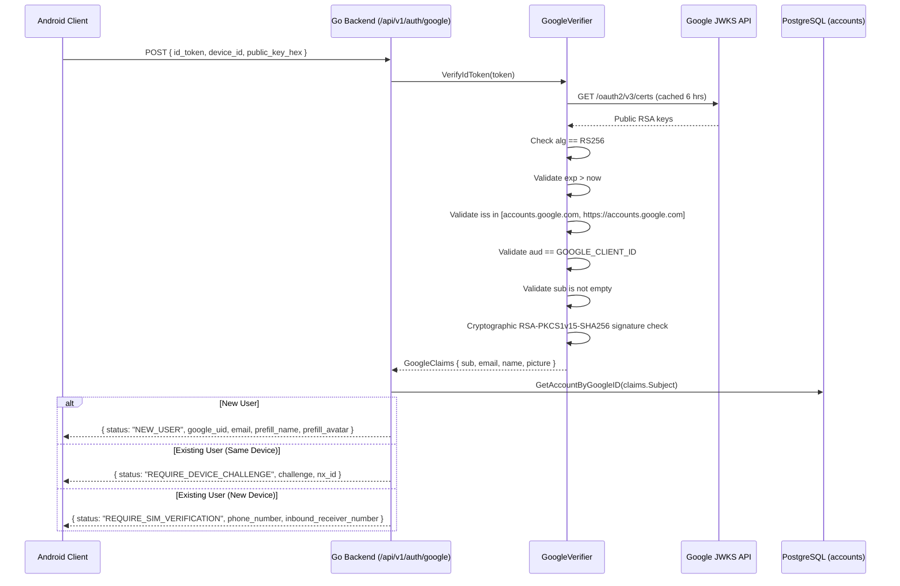
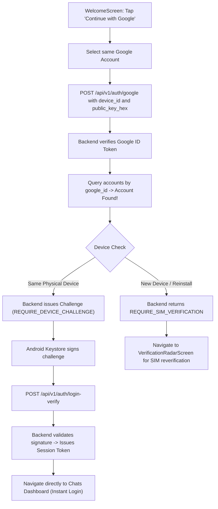

# NEXA — Google Authentication & Identity Integration: Technical Audit Report

**Document Reference:** `docs/audit/GOOGLE_AUTHENTICATION_INTEGRATION_AUDIT.md`  
**Audit Date:** 2026-11-08  
**Audit Scope:** Android Client (`app/`), Go Backend (`backend/`), PostgreSQL / Supabase Schema, and Infrastructure Configuration  
**Audit Mode:** Read-Only Source Code & System Architecture Inspection  

---

## Executive Summary & Final Verdict

This audit was conducted strictly on the existing codebase to determine the real-world technical implementation of Google Login, identity verification, Go backend connectivity, and Supabase integration in NEXA.

### Final Verdict Matrix

| Core Question | Answer | Evidence Summary |
| :--- | :---: | :--- |
| **Is Google Login actually working end-to-end?** | **YES (with prerequisites)** | Android initiates Google Credential Manager, acquires RS256 OpenID Connect ID token, transmits it to Go backend over HTTPS, and backend queries/stores identity. Requires Google Cloud Console SHA-1 configuration on device and `GOOGLE_CLIENT_ID` on backend. |
| **Does the backend know which Google account logged in?** | **YES** | Backend decodes the Google ID token and extracts the immutable Google Subject ID (`sub`) and `email`. |
| **Is that identity cryptographically verified by Google?** | **YES** | Backend validates the RS256 signature against Google's live JWKS public keys (`https://www.googleapis.com/oauth2/v3/certs`), and validates `iss`, `aud`, `exp`, and `sub`. |
| **Is the Gmail address stored in NEXA PostgreSQL?** | **YES** | Persisted in the `accounts.email` column via `PostgresRepository.CreateAccount` and `UpdateAccount`. |
| **Is Supabase Auth involved?** | **NO** | Supabase Auth (`supabase.auth.users`, Supabase OAuth) is completely disconnected. The Android client contains zero Supabase SDK dependencies. |
| **Is Supabase PostgreSQL involved?** | **YES** | The Go backend connects directly to Supabase-hosted PostgreSQL via `pgxpool` using `DATABASE_URL`. |
| **Are user profile details actually saved?** | **YES** | Name, Avatar URL, Email, Phone, Age, Gender, and assigned NX-ID are persisted in PostgreSQL `accounts` and synced into Android Room `user_profile`. |

---

## 1. Android Google Login Implementation

### 1.1 Authentication Technology
- **Primary Authentication (App Onboarding / Login):** **Google Credential Manager** (`androidx.credentials.CredentialManager`).
  - Implemented using `com.google.android.libraries.identity.googleid.GetGoogleIdOption` and `GoogleIdTokenCredential`.
  - Configured with `setFilterByAuthorizedAccounts(false)` and `setAutoSelectEnabled(false)` to present the system account chooser.
- **Secondary Subsystem (Cloud Backup):** **Legacy Google Sign-In** (`com.google.android.gms.auth.api.signin.GoogleSignIn`).
  - Used strictly in [`GoogleDriveAuthManager.kt`](file:///H:/chat_app/app/src/main/java/com/nexa/app/data/drive/GoogleDriveAuthManager.kt#L22) for OAuth2 app-data backup access (`https://www.googleapis.com/auth/drive.appdata`).
- **Supabase Google OAuth:** **NOT IMPLEMENTED**. Zero references or dependencies exist in Android.

### 1.2 Client ID Configuration & Storage
- **Configured Client ID:** `356056510017-grmokt7u1sch6hdk9dbah85k2jqe32v2.apps.googleusercontent.com`
- **Client ID Type:** **Web OAuth 2.0 Client ID** (Server Client ID).
  - *Correctness:* Passing a Web Client ID to `GetGoogleIdOption.Builder().setServerClientId(...)` is correct and required by Google Identity Services to obtain an OpenID Connect ID token containing the server audience (`aud`).
- **Storage Locations:**
  1. [`app/src/main/res/values/strings.xml`](file:///H:/chat_app/app/src/main/res/values/strings.xml#L3):
     ```xml
     <string name="google_web_client_id" translatable="false">356056510017-grmokt7u1sch6hdk9dbah85k2jqe32v2.apps.googleusercontent.com</string>
     ```
  2. [`app/build.gradle.kts`](file:///H:/chat_app/app/build.gradle.kts#L29-L33):
     ```kotlin
     buildConfigField("String", "GOOGLE_WEB_CLIENT_ID", "\"356056510017-grmokt7u1sch6hdk9dbah85k2jqe32v2.apps.googleusercontent.com\"")
     ```
- **Multiple Client IDs:** No secondary client IDs are defined in Android.

### 1.3 Execution Flow on Google Account Selection
- **Initiation:** Triggered in [`WelcomeScreen.kt`](file:///H:/chat_app/app/src/main/java/com/nexa/app/presentation/welcome/WelcomeScreen.kt#L191-L198) when user taps the Google Sign-In button:
  ```kotlin
  viewModel.onEvent(WelcomeUiEvent.InitiateGoogleSignIn(
      context = context,
      webClientId = context.getString(R.string.google_web_client_id)
  ))
  ```
- **Credential Acquisition:** In [`WelcomeViewModel.kt`](file:///H:/chat_app/app/src/main/java/com/nexa/app/presentation/welcome/WelcomeViewModel.kt#L93-L106):
  ```kotlin
  val result = credentialManager.getCredential(request = request, context = context)
  val credential = result.credential
  if (credential is androidx.credentials.CustomCredential &&
      credential.type == GoogleIdTokenCredential.TYPE_GOOGLE_ID_TOKEN_CREDENTIAL) {
      val googleIdTokenCredential = GoogleIdTokenCredential.createFrom(credential.data)
      val token = googleIdTokenCredential.idToken
      val email = googleIdTokenCredential.id
      val displayName = googleIdTokenCredential.displayName
  ```
- **Backend Dispatch:** `WelcomeViewModel` immediately invokes `authRepository.loginWithGoogle(token)`.

---

## 2. Google ID Token Verification

### 2.1 Token Transmission from Android
- **Is an ID Token Requested?** **YES.** `GetGoogleIdOption` requests an ID token using `setServerClientId(webClientId)`.
- **Is the Token Received?** **YES.** Extracted via `googleIdTokenCredential.idToken`.
- **Is it Sent to Go Backend?** **YES.** Dispatched via `AuthApiService.googleAuth(idToken, deviceId, publicKeyHex)`.
- **API Endpoint:** `POST https://nexa-relay.onrender.com/api/v1/auth/google` (via [`AuthApiService.kt`](file:///H:/chat_app/app/src/main/java/com/nexa/app/data/remote/api/AuthApiService.kt#L383)).
- **Transport Security:** **HTTPS.** Configured in [`ServerEndpointConfig.kt`](file:///H:/chat_app/app/src/main/java/com/nexa/app/core/network/ServerEndpointConfig.kt#L23) with TLS encryption.

### 2.2 Go Backend Verification Engine
Backend verification is implemented in [`backend/internal/auth/google_verifier.go`](file:///H:/chat_app/backend/internal/auth/google_verifier.go#L77-L148) in `GoogleVerifier.VerifyIdToken(tokenString)`:



### 2.3 Verification Claims Audit

| Claim | Backend Validation Status | Exact Implementation Line |
| :--- | :---: | :--- |
| **Cryptographic Signature** | **VERIFIED (RS256)** | [`google_verifier.go:177`](file:///H:/chat_app/backend/internal/auth/google_verifier.go#L177) via `rsa.VerifyPKCS1v15` |
| **Public Keys Used** | **VERIFIED (Live JWKS)** | [`google_verifier.go:185`](file:///H:/chat_app/backend/internal/auth/google_verifier.go#L185) from `https://www.googleapis.com/oauth2/v3/certs` |
| **Audience (`aud`)** | **VERIFIED** | [`google_verifier.go:132`](file:///H:/chat_app/backend/internal/auth/google_verifier.go#L132): `claims.Audience != clientID` |
| **Issuer (`iss`)** | **VERIFIED** | [`google_verifier.go:127`](file:///H:/chat_app/backend/internal/auth/google_verifier.go#L127): `accounts.google.com` or `https://accounts.google.com` |
| **Expiration (`exp`)** | **VERIFIED** | [`google_verifier.go:122`](file:///H:/chat_app/backend/internal/auth/google_verifier.go#L122): `claims.ExpiresAt <= now` |
| **Subject (`sub`)** | **VERIFIED** | [`google_verifier.go:137`](file:///H:/chat_app/backend/internal/auth/google_verifier.go#L137): `strings.TrimSpace(claims.Subject) == ""` |
| **Email Verified (`email_verified`)** | **NOT VALIDATED** | Decoded into `GoogleClaims.EmailVerified` ([`google_verifier.go:32`](file:///H:/chat_app/backend/internal/auth/google_verifier.go#L32)) but **not asserted** with an error condition. |

---

## 3. Google Profile Information

### 3.1 Profile Fields Breakdown

| Field | Retrieved from Google? | Validated by Backend? | Persisted in PostgreSQL? | Cached in Room? | Displayed on UI? |
| :--- | :---: | :---: | :---: | :---: | :---: |
| **Google Subject ID (`sub`)** | Yes | Yes (RS256) | Yes (`accounts.google_id`) | No (internal key) | No |
| **Gmail (`email`)** | Yes | Yes (from JWT) | Yes (`accounts.email`) | Yes (`UserEntity.email`) | Yes (Settings Account) |
| **Email Verified** | Yes (in JWT) | No check | No column | No | Yes (UI assumes verified) |
| **Display Name** | Yes | Yes (from JWT) | Yes (`accounts.profile_name`) | Yes (`UserEntity.fullName`) | Yes (Profile & Settings) |
| **Profile Photo URL** | Yes | Yes (from JWT) | Yes (`accounts.avatar_url`) | Yes (`UserEntity.avatarUrl`) | Yes (Avatar Hero) |
| **First Name** | No (not split) | No | No separate column | No | Combined in Display Name |
| **Last Name** | No (not split) | No | No separate column | No | Combined in Display Name |

### 3.2 Field Lifecycle
1. **Extraction:** Backend extracts `claims.Subject`, `claims.Email`, `claims.Name`, and `claims.Picture` in [`handleGoogleAuth`](file:///H:/chat_app/backend/internal/auth/handler.go#L904-L909).
2. **Pre-population:** Delivered to Android in the response payload and passed via Navigation arguments (`Screen.ProfileSetup.createRoute`) to [`ProfileSetupScreen.kt`](file:///H:/chat_app/app/src/main/java/com/nexa/app/presentation/setup/ProfileSetupScreen.kt).
3. **Commitment:** During `POST /api/v1/auth/initiate-reverse-verify`, the fields are written to PostgreSQL `accounts` table in [`reverse_sms.go:486-490`](file:///H:/chat_app/backend/internal/auth/reverse_sms.go#L486).
4. **Retrieval & Sync:** When the user opens Settings → Account, [`AccountScreen.kt`](file:///H:/chat_app/app/src/main/java/com/nexa/app/presentation/settings/account/AccountScreen.kt#L80) calls `authRepository.fetchRemoteProfile()`, which issues `GET /api/v1/profile`, updating the local Room SQLite cache.

---

## 4. Go Backend Integration

### 4.1 Endpoints and Handlers
- **`POST /api/v1/auth/google`** ([`handler.go:867`](file:///H:/chat_app/backend/internal/auth/handler.go#L867)): Primary single-tap verification. Verifies token, looks up `accounts.google_id`, returns `NEW_USER`, `REQUIRE_DEVICE_CHALLENGE`, or `REQUIRE_SIM_VERIFICATION`.
- **`POST /api/v1/auth/google/verify`** ([`handler.go:359`](file:///H:/chat_app/backend/internal/auth/handler.go#L359)): Issues temporary `AuthTicket` (`ticket_g_...`) for legacy OTP-assisted registration.
- **`POST /api/v1/auth/initiate-reverse-verify`** ([`handler.go:965`](file:///H:/chat_app/backend/internal/auth/handler.go#L965)): Creates the PostgreSQL account and assigns an `NX-XXXXXXXX` ID upon phone proof.
- **`GET /api/v1/profile`** ([`handler.go:647`](file:///H:/chat_app/backend/internal/auth/handler.go#L647)): Authenticated session profile retrieval.
- **`PUT /api/v1/profile`** ([`handler.go:667`](file:///H:/chat_app/backend/internal/auth/handler.go#L667)): Updates profile fields (`profile_name`, `avatar_url`, `bio`, `gender`, `age`).

### 4.2 Session Management
- **Token Format:** Bearer token `nexa_sess_<uuid>`.
- **Duration:** 30 days (`30 * 24 * time.Hour`).
- **Storage:** Persisted in PostgreSQL `sessions` table (or Redis cache) and Android `SecureStorage` (EncryptedSharedPreferences).
- **Subsequent Requests:** Transmitted via HTTP header `Authorization: Bearer <token>`.
- **Resolution Path:** `Bearer Token` → `h.store.GetSession(token)` → `session.NxID` → `h.store.GetAccountByNxID(session.NxID)`.

---

## 5. Supabase Integration

### 5.1 Supabase Auth (DISCONNECTED / UNUSED)
- **Supabase Google OAuth:** **NOT CONFIGURED** and **NOT USED**.
- **`supabase.auth.users` Table:** **DISCONNECTED**. Zero foreign keys, triggers, or dependencies link to `auth.users`.
- **Android Supabase Auth Client:** **NONE**. Android contains no Supabase SDK.
- **Backend Supabase Verifier:** [`backend/internal/auth/supabase_verifier.go`](file:///H:/chat_app/backend/internal/auth/supabase_verifier.go) and `POST /api/v1/auth/supabase/verify` exist as dormant endpoints, completely uncalled by Android.
- **Supabase User ID:** Column `accounts.supabase_user_id VARCHAR(128)` exists in the schema but is `NULL` for Google-authenticated accounts.

### 5.2 Supabase PostgreSQL (CONNECTED & PERSISTED)
The Go backend connects to PostgreSQL (hosted on Supabase) via `DATABASE_URL` in [`backend/cmd/server/main.go:94`](file:///H:/chat_app/backend/cmd/server/main.go#L94).

#### Database Schema: `accounts` Table ([`migrations.go:23-42`](file:///H:/chat_app/backend/internal/database/migrations.go#L23-L42))
```sql
CREATE TABLE IF NOT EXISTS accounts (
    id VARCHAR(64) PRIMARY KEY,
    nx_id VARCHAR(32) NOT NULL UNIQUE,
    public_key_hex VARCHAR(128) NOT NULL UNIQUE,
    dh_key_hex VARCHAR(128),
    phone_number VARCHAR(32),
    phone_verified BOOLEAN NOT NULL DEFAULT FALSE,
    is_discoverable_by_phone BOOLEAN NOT NULL DEFAULT TRUE,
    google_id VARCHAR(128),
    supabase_user_id VARCHAR(128),
    email VARCHAR(255),
    profile_name VARCHAR(128) NOT NULL DEFAULT '',
    avatar_url TEXT,
    bio VARCHAR(512),
    gender VARCHAR(32),
    age INT DEFAULT 0,
    created_at BIGINT NOT NULL,
    updated_at BIGINT NOT NULL,
    CONSTRAINT chk_nx_id_format CHECK (nx_id ~ '^NX-[A-Z0-9]{8}$')
);
```

#### Relevant Indexes & Constraints:
- `idx_accounts_google_id`: `UNIQUE INDEX ON accounts(google_id) WHERE google_id IS NOT NULL AND google_id != ''`
- `idx_accounts_phone`: `UNIQUE INDEX ON accounts(phone_number) WHERE phone_number IS NOT NULL AND phone_number != ''`
- `chk_nx_id_format`: Enforces strict CSPRNG format `NX-XXXXXXXX`.

---

## 6. Registration and Login Flows

### 6.1 New User Registration Sequence

```mermaid
flowchart TD
    A["WelcomeScreen: Tap 'Continue with Google'"] --> B["CredentialManager: User selects Gmail"]
    B --> C["Extract idToken, email, displayName"]
    C --> D["POST /api/v1/auth/google"]
    D --> E["GoogleVerifier: Verify RS256 JWKS Signature"]
    E --> F{"Account exists for google_id?"}
    F -->|No| G["Return { status: 'NEW_USER', google_uid, email, prefill_name, prefill_avatar }"]
    G --> H["ProfileSetupScreen: Pre-filled name, email, photo"]
    H --> I["User inputs Phone, Age, Gender, Bio"]
    I --> J["Tap 'Verify Phone with SIM'"]
    J --> K["POST /api/v1/auth/initiate-reverse-verify"]
    K --> L{"Is Trusted Phone Number?"}
    L -->|Yes (Route B)| M["CreateAccount in PostgreSQL<br/>Allocate NX-ID<br/>Return status: 'VERIFIED' + sessionToken"]
    L -->|No (Route A)| N["Return status: 'PENDING' + inboundNumber<br/>Client sends silent SMS<br/>Webhook commits Account<br/>Poll returns 'VERIFIED'"]
    M --> O["ProfileBadgeScreen: Holographic Card + NX-ID"]
    N --> O
    O --> P["Tap 'Continue to Chats' -> MainChatDashboard"]
```

### 6.2 Returning User Login Sequence



---

## 7. Configuration & Environment Audit

### 7.1 Android Configuration
- **Package Name:** `com.nexa.app` ([`app/build.gradle.kts:21`](file:///H:/chat_app/app/build.gradle.kts#L21)).
- **Permissions:** `INTERNET`, `ACCESS_NETWORK_STATE`, `POST_NOTIFICATIONS` in [`AndroidManifest.xml`](file:///H:/chat_app/app/src/main/AndroidManifest.xml#L6-L20).
- **Google Services Plugin:** **NOT APPLIED**. `com.google.gms.google-services` is not present in plugins; `google-services.json` does not exist in the repository. Credential Manager does not require Firebase or `google-services.json`.
- **API Base URL:** Defaulting to `https://nexa-relay.onrender.com` (`USE_PRODUCTION_CLOUD = true`).

### 7.2 Backend & Environment Configuration
- **Environment Variables Checked in Go:**
  - `GOOGLE_CLIENT_ID`: Required by [`google_verifier.go:48`](file:///H:/chat_app/backend/internal/auth/google_verifier.go#L48). **FAIL-CLOSED:** If unset, backend rejects all Google token verification requests with `ErrMissingGoogleClientID`.
  - `DATABASE_URL`: Connection string for Supabase PostgreSQL pool (`pgxpool`).
  - `REDIS_URL` / `UPSTASH_REDIS_REST_URL`: Distributed challenge and rate-limiting store.
  - `NEXA_TRUSTED_PHONE_NUMBERS`: Allowlist for Route B instant verification.
- **Local `.env` File State:**
  - `UPSTASH_REDIS_REST_URL`: Present.
  - `UPSTASH_REDIS_REST_TOKEN`: Present.
  - `REDIS_URL`: Present.
  - `DATABASE_URL`: Present.
  - `GOOGLE_CLIENT_ID`: **NOT PRESENT in local `.env`** (Must be configured in Render dashboard for production).

---

## 8. Security Review & Vulnerability Assessment

### Security Strengths:
1. **No Embedded Secrets:** Zero Google Client Secrets or Supabase Service Role keys exist in Android source code or Gradle build configs.
2. **True Cryptographic Verification:** Backend does not trust client-supplied identity claims; it cryptographically validates Google's RS256 signature against official JWKS keys.
3. **Hardware Keystore Binding:** Returning users on the same device are authenticated using Android Keystore Ed25519/P-256 signatures, not Google tokens alone.
4. **Duplicate Identity Prevention:** Database unique index `idx_accounts_google_id` prevents duplicate accounts for the same Google user.

### Security Vulnerabilities & Gaps Identified:

> [!WARNING]
> **Vulnerability 1: Missing `email_verified` Claim Check**  
> **Location:** [`backend/internal/auth/google_verifier.go:121-140`](file:///H:/chat_app/backend/internal/auth/google_verifier.go#L121-L140)  
> **Finding:** `GoogleClaims` decodes `email_verified`, but `VerifyIdToken` never validates `if !claims.EmailVerified`. While standard consumer `@gmail.com` accounts are verified, third-party federated accounts or unverified Workspace emails could theoretically pass verification.  
> **Severity:** Low.

> [!CAUTION]
> **Vulnerability 2: Untrusted Fallback in Reverse SMS Route**  
> **Location:** [`backend/internal/auth/reverse_sms.go:311`](file:///H:/chat_app/backend/internal/auth/reverse_sms.go#L311)  
> **Finding:** In `InitiateVerification`:  
> ```go
> if req.GoogleAuthToken != "" && s.googleVerifier != nil { ... }
> ```  
> If an API caller supplies `google_uid: "spoofed_id"` and `email: "spoofed@gmail.com"` but leaves `google_auth_token: ""`, the backend does not reject the request. Instead, it commits the unverified `req.GoogleUID` and `req.Email` directly to PostgreSQL!  
> **Severity:** High (API tamper risk).

> [!WARNING]
> **Vulnerability 3: Client-Side Fallback on Backend Auth Failure**  
> **Location:** [`app/src/main/java/com/nexa/app/presentation/welcome/WelcomeViewModel.kt:181-193`](file:///H:/chat_app/app/src/main/java/com/nexa/app/presentation/welcome/WelcomeViewModel.kt#L181-L193)  
> **Finding:** If `authRepository.loginWithGoogle(token)` fails with an HTTP error or network failure, `WelcomeViewModel` falls back to `_uiState.update { it.copy(isSuccess = true) }`, allowing the user to proceed to profile setup with client-only values.  
> **Severity:** Medium.

---

## 9. Comprehensive Evidence & Status Registry

| Component / Subsystem | Status | File Path & Code Symbol | Evidence Description |
| :--- | :---: | :--- | :--- |
| **Google Credential Manager** | **IMPLEMENTED AND CONNECTED** | [`WelcomeViewModel.kt#L72`](file:///H:/chat_app/app/src/main/java/com/nexa/app/presentation/welcome/WelcomeViewModel.kt#L72) `signInWithCredentialManager` | Creates `GetGoogleIdOption`, invokes `credentialManager.getCredential`, extracts `idToken`. |
| **Web OAuth Client ID** | **IMPLEMENTED AND CONNECTED** | [`strings.xml#L3`](file:///H:/chat_app/app/src/main/res/values/strings.xml#L3) `google_web_client_id` | Passes `356056510017-...apps.googleusercontent.com` to `setServerClientId`. |
| **Android-to-Go Auth API** | **IMPLEMENTED AND CONNECTED** | [`AuthApiService.kt#L377`](file:///H:/chat_app/app/src/main/java/com/nexa/app/data/remote/api/AuthApiService.kt#L377) `googleAuth` | Sends `POST /api/v1/auth/google` over HTTPS via OkHttpClient. |
| **Google JWKS Signature Check** | **IMPLEMENTED AND CONNECTED** | [`google_verifier.go#L177`](file:///H:/chat_app/backend/internal/auth/google_verifier.go#L177) `verifySignature` | Fetches certs from Google and verifies RS256 PKCS1v15 signature. |
| **Audience (`aud`) Validation** | **IMPLEMENTED AND CONNECTED** | [`google_verifier.go#L132`](file:///H:/chat_app/backend/internal/auth/google_verifier.go#L132) `VerifyIdToken` | Rejects tokens where `claims.Audience != clientID`. |
| **Email & Sub Persistence** | **IMPLEMENTED AND CONNECTED** | [`repository.go#L67`](file:///H:/chat_app/backend/internal/database/repository.go#L67) `CreateAccount` | Persists `google_id` and `email` to PostgreSQL `accounts` table. |
| **Room Local Database Sync** | **IMPLEMENTED AND CONNECTED** | [`NexaDatabase.kt#L118`](file:///H:/chat_app/app/src/main/java/com/nexa/app/data/local/NexaDatabase.kt#L118) `MIGRATION_17_18` | Stores `email` and `avatarUrl` in local `user_profile` table. |
| **Settings Account Display** | **IMPLEMENTED AND CONNECTED** | [`AccountScreen.kt#L80`](file:///H:/chat_app/app/src/main/java/com/nexa/app/presentation/settings/account/AccountScreen.kt#L80) `AccountScreen` | Renders Avatar Hero, Name, Gmail, Phone, Age, Gender, NX-ID & Identity QR. |
| **Returning User Challenge** | **IMPLEMENTED AND CONNECTED** | [`handler.go#L928`](file:///H:/chat_app/backend/internal/auth/handler.go#L928) `handleGoogleAuth` | Issues `REQUIRE_DEVICE_CHALLENGE`, verified by hardware Keystore. |
| **Supabase PostgreSQL** | **IMPLEMENTED AND CONNECTED** | [`main.go#L94`](file:///H:/chat_app/backend/cmd/server/main.go#L94) `database.NewPool` | Connects to Supabase PostgreSQL pool via `DATABASE_URL`. |
| **`email_verified` Check** | **PARTIALLY IMPLEMENTED** | [`google_verifier.go#L32`](file:///H:/chat_app/backend/internal/auth/google_verifier.go#L32) `GoogleClaims` | Decodes claim, but never enforces `claims.EmailVerified == true`. |
| **Strict Token Enforcement on SMS** | **PARTIALLY IMPLEMENTED** | [`reverse_sms.go#L311`](file:///H:/chat_app/backend/internal/auth/reverse_sms.go#L311) `InitiateVerification` | Token verification skipped if client omits `google_auth_token`. |
| **Supabase Auth API** | **CONFIGURED BUT UNUSED** | [`handler.go#L297`](file:///H:/chat_app/backend/internal/auth/handler.go#L297) `handleSupabaseVerify` | Endpoint exists on backend, but Android client contains no calls to it. |
| **Legacy Google Drive Sign-In** | **IMPLEMENTED AND CONNECTED** | [`GoogleDriveAuthManager.kt#L22`](file:///H:/chat_app/app/src/main/java/com/nexa/app/data/drive/GoogleDriveAuthManager.kt#L22) | Dedicated strictly to Google Drive `appdata` backups. |

---

## 10. Recommended Implementation Sequence for Production Hardening

Although the Google authentication architecture is fully functional and connected end-to-end, the following three hardening fixes are recommended before public production launch:

1. **Enforce `email_verified` Validation in Go Backend:**
   - In [`backend/internal/auth/google_verifier.go`](file:///H:/chat_app/backend/internal/auth/google_verifier.go#L136), add:
     ```go
     if !claims.EmailVerified {
         return nil, errors.New("google token verification failed: email address is not verified by Google")
     }
     ```
2. **Enforce Token Presence in `InitiateReverseVerify`:**
   - In [`backend/internal/auth/reverse_sms.go`](file:///H:/chat_app/backend/internal/auth/reverse_sms.go#L311), reject unauthenticated Google claims:
     ```go
     if req.GoogleUID != "" && req.GoogleAuthToken == "" {
         return nil, errors.New("google_auth_token is required when google_uid is supplied")
     }
     ```
3. **Remove Optimistic Client-Side Fallback:**
   - In [`app/src/main/java/com/nexa/app/presentation/welcome/WelcomeViewModel.kt:181`](file:///H:/chat_app/app/src/main/java/com/nexa/app/presentation/welcome/WelcomeViewModel.kt#L181), do not set `isSuccess = true` on `backendResult.onFailure`. Instead, present an error message informing the user to retry or check network connectivity.
4. **Configure Render Environment Variable:**
   - Ensure `GOOGLE_CLIENT_ID=356056510017-grmokt7u1sch6hdk9dbah85k2jqe32v2.apps.googleusercontent.com` is configured in Render service settings so `NewGoogleVerifier()` does not fail-closed in production.
