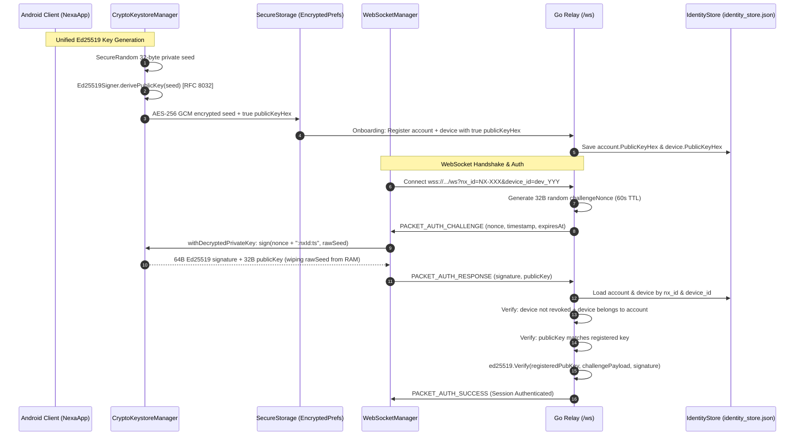

# NEXA — Phase B Identity Implementation Report: Ed25519 Alignment & Cryptographic Integrity

**Date:** November 6, 2026  
**Status:** IMPLEMENTED & TESTED  
**Scope:** Android Client Key Architecture & Go Backend Cryptographic Alignment  

---

## 1. Original Issue & Verified Root Cause

### Original Issue
Mobile clients experienced persistent WebSocket connection drops (`4001 Unauthorized`) immediately following reverse SMS verification. Authenticated sessions could not establish live WebSocket communication.

### Verified Root Cause
1. **Cryptographic Algorithm Split in Public-Key Derivation:**
   - In `CryptoKeystoreManager.kt`, `derivePublicKeyBytes()` took a 32-byte private key seed, hashed it with SHA-256, and applied Curve25519 scalar bit-clamping (`publicKey[0] and 248`, `publicKey[31] and 127`, `publicKey[31] or 64`). This produced a 32-byte array that was **not an Ed25519 public key**.
   - This invalid clamped SHA-256 hash was persisted in `SecureStorage` as `KEY_IDENTITY_PUBLIC_KEY` and transmitted to the backend as `publicKeyHex` during account registration and reverse SMS verification.
2. **Dual-Key Disconnect in Android Application:**
   - In `NexaApplication.kt` lines 230–259, `webSocketManager.setIdentitySigner` generated and stored a completely separate, independent Ed25519 keypair in `nexa_handshake_keys` (`sign_priv_enc`, `sign_priv_iv`, `sign_pub`), derived using BouncyCastle's true RFC 8032 `Ed25519Signer.derivePublicKey()`.
   - When the backend issued an `AUTH_CHALLENGE`, `WebSocketManager` signed the challenge using the `nexa_handshake_keys` key and sent its public key.
3. **Backend Public Key Mismatch:**
   - In `backend/internal/connection/client.go` (`VerifyAuthResponse`), the server compared `resp.PublicKey` against `account.PublicKeyHex` stored during registration.
   - Because registration stored the SHA-256 clamped hash from `CryptoKeystoreManager` while the WebSocket presented the BouncyCastle-derived public key from `nexa_handshake_keys`, `bytes.Equal(resp.PublicKey, expectedPubBytes)` **failed 100% of the time**.

---

## 2. Key Ownership & Data Flow Architecture

---

## 3. Implementation Details & Files Changed

### 3.1 Android Client Key Alignment
- [`CryptoKeystoreManager.kt`](file:///H:/chat_app/app/src/main/java/com/nexa/app/core/security/CryptoKeystoreManager.kt):
  - Replaced legacy `derivePublicKeyBytes()` with standard `com.nexa.app.core.crypto.Ed25519Signer.derivePublicKey()`.
  - Added seamless legacy key migration in `getOrCreateIdentityKeyPair()`: if a previously stored public key does not match `derivePublicKeyBytes(decryptedSeed)`, `SecureStorage` updates `publicKeyHex` automatically without altering the user's private seed.
  - Added `withDecryptedPrivateKey()` helper: decrypts the private key seed inside a try-finally block and immediately zeroes out memory via `Arrays.fill(raw, 0.toByte())`.
- [`NexaApplication.kt`](file:///H:/chat_app/app/src/main/java/com/nexa/app/NexaApplication.kt):
  - Rewrote `webSocketManager.setIdentitySigner` to use the authoritative identity key from `keystoreManager.getOrCreateIdentityKeyPair(secureStorage)`.
  - Added transparent synchronization of the authoritative key to `nexa_handshake_keys` (`sign_priv_enc`, `sign_priv_iv`, `sign_pub`) so that QR code sync, contact discovery, and WebSocket authentication all use the exact same key.
- [`AuthRepositoryImpl.kt`](file:///H:/chat_app/app/src/main/java/com/nexa/app/data/repository/AuthRepositoryImpl.kt):
  - Updated `verifyOtpAndRegister` to use `getOrCreateIdentityKeyPair(secureStorage)` rather than generating orphaned keys.

### 3.2 Backend Cryptographic Verification
- [`backend/internal/connection/client.go`](file:///H:/chat_app/backend/internal/connection/client.go):
  - Enforced fail-closed behavior: rejects authentication immediately if `identityStore` is unavailable (prevents arbitrary client key trust).
  - Validates `c.DeviceId` against `identityStore.GetDevice(c.DeviceId)`. Rejects unknown devices, revoked devices, and cross-account device impersonation.
  - Verifies that `resp.PublicKey` matches the authoritative public key in `identityStore` (`account.PublicKeyHex` or `device.PublicKeyHex`).
  - Consumes `c.ChallengeNonce` immediately to guarantee single-use anti-replay defense.
  - Gated all application message routing behind `c.Authenticated`.
