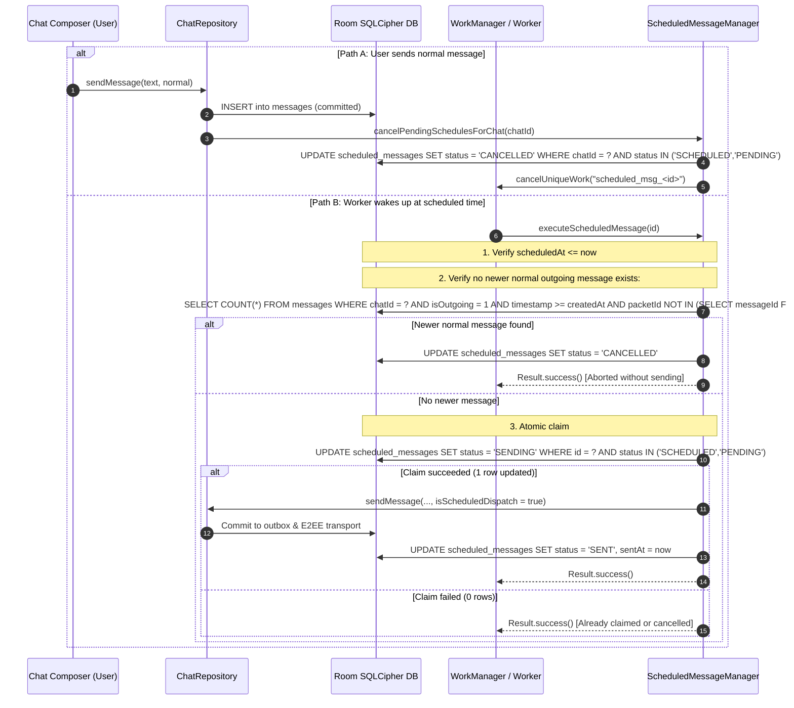

# NEXA — Scheduled Message Feature: Implementation Impact Report & Architecture Audit

**Author:** Senior Android, Database & Security Engineering Team  
**Date:** 2026-11-10  
**Scope:** Architecture Audit, Room SQLCipher Database Migration v22, Persistent Scheduling Engine (WorkManager), Two-Tier Atomic Auto-Cancellation, Chat UI & Composer Integration.  
**Status:** AUDIT COMPLETE — PROCEEDING TO IMPLEMENTATION

---

## 1. Audit of Existing Implementation & Gap Analysis

### 1.1 Existing Codebase Inspection
A comprehensive audit across `app/src/main/java` and `backend/` confirmed:
1. **WorkManager Infrastructure:** NEXA actively utilizes WorkManager for several persistent background tasks (`ScheduledBackupWorker`, `RequestSyncWorker`, `RuleSyncWorker`, `OrphanCleanupWorker`, `DtnSyncWorker`).
2. **Scheduled Messages Gap:** No existing `ScheduledMessage` entity, DAO, worker, or UI component previously existed in the project.
3. **Outbox & Transport Reuse:** `ChatRepositoryImpl.sendMessage` implements an atomic outbox pattern inserting into Room (`MessageEntity` with `status = PENDING`), followed by Double Ratchet ChaCha20-Poly1305 encryption and WebSocket/SMS/DTN dispatch. This existing pipeline will be 100% reused for scheduled message execution, ensuring zero code duplication, zero server plaintext leakage, and complete E2EE preservation.
4. **Service Locator:** `NexaApplication` provides dependency injection and service locator access to the SQLCipher database, crypto keystore, network monitor, and repository layers.

---

## 2. Reused Components vs. New Components

| Component | Status | Role in Scheduled Messaging |
| :--- | :---: | :--- |
| `DoubleRatchetEngine` | **REUSE** | End-to-end encryption for scheduled message payloads |
| `NexaDatabase` | **EXTEND** | Bump to v22, register `ScheduledMessageEntity` & `MIGRATION_21_22` |
| `ChatRepositoryImpl` | **EXTEND** | Message outbox persistence, delivery acknowledgement, auto-cancel hook |
| `NetworkMonitor` | **REUSE** | Connectivity state detection and link transitions |
| `NexaGlassSurface` | **REUSE** | Liquid Glass styling for scheduling dialogs and status banners |
| `ScheduledMessageEntity` | **NEW** | Local Room entity tracking schedule ID, timestamps, status, content |
| `ScheduledMessageDao` | **NEW** | Queries, atomic claim (`claimForSending`), race-prevention checks |
| `ScheduledMessageManager` | **NEW** | High-level orchestrator for schedule creation, cancellation, reconciliation |
| `ScheduledMessageWorker` | **NEW** | Android `CoroutineWorker` executing at scheduled instant via WorkManager |
| `ScheduleMessageDialog` | **NEW** | Date & Time picker UI with future validation and local formatting |
| `ScheduledMessagesSheet` | **NEW** | UI management sheet to inspect and cancel pending scheduled messages |

---

## 3. Database Schema & Migration Strategy (v21 → v22)

### 3.1 Entity Design: `ScheduledMessageEntity`
- `id: String` (UUID Primary Key)
- `messageId: String` (Unique UUID for the generated message entity)
- `chatId: String` (Indexed `conversationId`)
- `senderId: String` (Active user's NX-ID)
- `recipientId: String` (Peer's NX-ID)
- `messageType: String` (`TEXT`, `IMAGE`, `VIDEO`, etc.)
- `content: String` (Sanitized text content or payload)
- `attachmentReference: String?` (Local URI or cached file path)
- `scheduledAt: Long` (Indexed UTC epoch milliseconds)
- `createdAt: Long` (UTC epoch milliseconds when scheduled)
- `status: String` (Indexed enum: `SCHEDULED`, `PENDING`, `SENDING`, `SENT`, `CANCELLED`, `FAILED`)
- `sentAt: Long?` (UTC epoch milliseconds when sent)
- `cancelledAt: Long?` (UTC epoch milliseconds when cancelled)
- `replyToMessageId: String?` (Optional reply reference)
- `replyToSenderNxId: String?`
- `replyToSnippet: String?`
- `transportType: String` (`INTERNET`, `DATA_SMS`, `DTN_MESH`)
- `destinationPhone: String?`
- `failureReason: String?`

### 3.2 Non-Destructive Migration `MIGRATION_21_22`
The migration creates the `scheduled_messages` table and its associated indexes (`chatId`, `status`, `scheduledAt`, `messageId`) safely using SQLCipher DDL commands without impacting any existing tables.

---

## 4. Critical Product Rule: Scheduled Message Must Remain the Last Message

### 4.1 Specification
A scheduled message is valid **only while no subsequent normal outgoing message has been created in that same chat**.
If a user schedules a message for 6:00 PM, but sends "How are you?" at 4:00 PM, the scheduled message must be automatically cancelled.

### 4.2 Two-Tier Concurrency & Race-Condition Defense
To handle the critical race condition where a worker executes at the exact instant the user sends a normal message:

This two-tier architecture guarantees:
1. **Proactive Invalidation:** Immediate cancellation and worker unregistration when a normal message is sent.
2. **Defensive Verification:** Atomic claim and timestamp verification immediately before dispatch prevents any worker from sending an outdated message.

---

## 5. UI & Interaction Design
1. **Schedule Message Dialog (`ScheduleMessageDialog.kt`):**
   - Clean Liquid Glass dialog with Date Picker, Time Picker, Local format preview (`d MMMM yyyy, hh:mm a`), future-time validation, Confirm, and Cancel.
   - Long-press on composer Send button when text is present opens `ScheduleMessageDialog`.
   - Also accessible from chat overflow menu.
2. **Scheduled Messages Sheet (`ScheduledMessagesSheet.kt`):**
   - Displays all active scheduled messages for the conversation.
   - Shows preview text, scheduled time, status pill, and one-tap cancellation button.
   - If scheduled messages exist in the active chat, a subtle composer indicator informs the user.

---

## 6. Execution Plan
1. Create domain models (`ScheduledMessage.kt`, `ScheduledMessageStatus`).
2. Create Room entity (`ScheduledMessageEntity.kt`) and DAO (`ScheduledMessageDao.kt`).
3. Update `NexaDatabase.kt` to version 22 with `MIGRATION_21_22`.
4. Implement `ScheduledMessageWorker.kt` (WorkManager `CoroutineWorker`).
5. Implement `ScheduledMessageManager.kt` and `ScheduledMessageManagerImpl.kt`.
6. Integrate auto-cancellation in `ChatRepositoryImpl.kt` and `NexaApplication.kt`.
7. Author UI components (`ScheduleMessageDialog.kt`, `ScheduledMessagesSheet.kt`).
8. Wire ViewModel and Screen events in `ChatViewModel.kt`, `ChatScreen.kt`, and `NexaMessageComposer.kt`.
9. Create comprehensive unit tests (`ScheduledMessageUnitTests.kt`).
10. Verify full test suite passing with 0 failures and update documentation.
