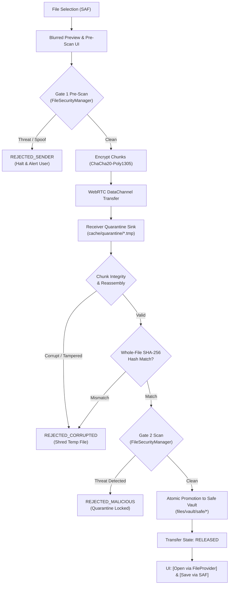

# NEXA — Secure File Sharing & Malware Protection Pipeline: Implementation Impact Report

**Date:** 2026-11-10  
**Status:** AUDIT COMPLETE — PROCEEDING TO IMPLEMENTATION  
**Target:** Android App (`com.nexa.app`)  
**Scope:** Secure File Sharing Pipeline, Zero-Trust Dual-Gate Architecture, On-Device Quarantine Sandbox, File Integrity & Cryptographic AEAD Verification, Jetpack Compose UI, Android Keystore & Safe Storage  

---

## 1. Audit of Existing Implementation & Architecture

### 1.1 Existing Security Primitives Discovered
1. **`NexaFileSecurityEngine.kt`:**
   - Detects magic bytes across common formats (`JPEG`, `PNG`, `PDF`, `WebP`, `GIF`, `ZIP`, `MP4`).
   - Identifies banned dangerous executable headers (`DEX`, `PE MZ`, `Linux ELF`, `Shebang #!`).
   - Maintains strict blacklist of dangerous executable extensions (`apk`, `dex`, `so`, `exe`, `sh`, `bat`, `cmd`, `js`, `vbs`, `html`, `htm`, `svg`, `jar`, `bin`, `elf`, `scr`, `msi`, `com`, `ps1`, `vbe`, `wsf`, `wsh`, `dll`).
   - Anti-spoofing header verification prevents disguised binaries.
2. **`DualScanEngine.kt`:**
   - Implements two-gate coordinator:
     - Gate 1 (Sender Pre-Dispatch): Validates extension, magic bytes, SHA-256 hash, O(1) Offline Threat Bloom Filter, and native LibYARA bytecode signatures.
     - Gate 2 (Receiver Post-Delivery Quarantine): Validates payload existence, SHA-256 hash match against authenticated envelope, magic bytes on reassembled payload, and LibYARA deep inspection.
3. **`ArchiveSanitizer.kt`:**
   - Pre-scans ZIP archives without full disk decompression.
   - Enforces 1:10 decompression ratio gate.
   - Enforces 100 MB uncompressed ceiling, 1000 max entry count (inode bomb protection), and 50 MB single-file limit.
   - Blocks Zip-Slip path traversal attacks (`..`, `/`, `\`).
   - Blocks nested archives (max recursion depth = 1).
   - Blocks banned executable binaries within archives.
4. **`ChunkEncryptor.kt`:**
   - ChaCha20-Poly1305 AEAD per-chunk encryption and authentication for 64 KB slices.
5. **`QuarantineSandboxSink.kt`:**
   - Provides internal cache quarantine sink (`cache/quarantine/{transferId}.tmp`) and safe vault destination (`files/vault/safe`).
   - Handles incremental chunk writing, atomic promotion, and zero-fill shredding.

### 1.2 Discovered Implementation Gaps
1. **Unenforced Sender Pre-Dispatch Gate:**
   - In `P2PTransferRepositoryImpl.initiateTransfer`, files selected via SAF were hashed and offered directly over WebRTC signaling without running Gate 1 security validation or presenting a pre-dispatch scanning preview to the user.
2. **Missing Isolated Quarantine Sink in P2P Transfer Repository:**
   - In `P2PTransferRepositoryImpl.finalizeIncomingFile`, completed streams were copied directly into `getExternalFilesDir("NEXA_Transfers")` without prior quarantine isolation, whole-file SHA-256 verification against the offer envelope, or Gate 2 security inspection.
3. **No FileProvider Integration in Manifest:**
   - Neither `androidx.core.content.FileProvider` nor `file_paths.xml` was declared in `app/src/main/AndroidManifest.xml`, leaving no secure, permission-scoped mechanism to open verified files in external viewer applications.
4. **Missing Controlled Release Actions in UI:**
   - `TransferProgressCard.kt` rendered a simple static checkmark on completion without providing `[Open]` (scoped `FileProvider` URI) or `[Save to Device]` (SAF export) buttons.
   - Inconclusive or malicious scan results did not display an actionable threat warning card or an option to shred quarantined payloads.
5. **Unified Manager Facade Missing:**
   - No single `FileSecurityManager` tied together `NexaFileSecurityEngine`, `DualScanEngine`, `ArchiveSanitizer`, `ThreatBloomFilter`, `YaraNativeBridge`, and file size limits into a clean, testable contract.

---

## 2. Fail-Closed Security Pipeline Specification

The end-to-end transfer flow strictly adheres to the fail-closed sequence:
```text
SELECT FILE -> BLURRED PREVIEW -> LOCAL PRE-SHARE SCAN (Safe? No->Reject) -> ENCRYPT FILE -> CHUNK FILE -> P2P TRANSFER -> RECEIVER QUARANTINE -> CHUNK INTEGRITY CHECK -> REASSEMBLE FILE -> WHOLE-FILE INTEGRITY CHECK -> FINAL RECEIVER SCAN (Safe? No->Reject) -> RELEASE -> AVAILABLE IN NEXA -> [OPEN] [SAVE TO DEVICE]
```

### 2.1 Sender-Side Pipeline
1. **File Selection:** User picks a file via Storage Access Framework (`OpenDocument`).
2. **Blurred Preview & Pre-Share UI:**
   - UI displays file metadata (name, size, extension) with a blurred preview thumbnail/placeholder and a pulsating "Scanning for threats..." progress indicator.
3. **Gate 1 Pre-Dispatch Scan (`FileSecurityManager.scanOutbound`):**
   - **Extension Gate:** Banned executable extensions rejected immediately.
   - **Magic Byte Inspection:** Inspects stream header for disguised executables (PE MZ, ELF, DEX, Shebang) and spoofed MIME types.
   - **Archive Inspection:** If ZIP, inspects compression ratios, entry count, Zip-Slip patterns, nested archives, and contained executable files.
   - **Cryptographic Hash:** Calculates SHA-256 digest.
   - **Threat Bloom Filter:** Verifies hash does not match known threat database.
   - **LibYARA Static Inspection:** Verifies bytecode contains no malicious signatures.
4. **Gate 1 Decision:**
   - If ANY check fails: Transition to `REJECTED_SENDER`, abort transfer, display warning to user, send nothing over network.
   - If Clean: Proceed to encryption, chunking (64 KB), and WebRTC transfer offer broadcast.

### 2.2 In-Flight Transport & Receiver Quarantine
1. **Encrypted Streaming:** Slices streamed over WebRTC DataChannel (DTLS-SRTP transport encryption + optional ChaCha20-Poly1305 AEAD per-chunk auth tag).
2. **Quarantine Containment:** Receiver streams chunks strictly into app-private isolated quarantine storage (`context.cacheDir/quarantine/<transferId>.tmp`). Chunks are NEVER written to external storage, Downloads, or MediaStore.
3. **Chunk Integrity Verification:** Each incoming slice validates chunk index, sequence ordering, buffer length, and AEAD authentication tag. Corrupt or out-of-order chunks trigger error or resume request.

### 2.3 Post-Delivery Integrity & Gate 2 Quarantine Scan
1. **Reassembly in Quarantine:** Receiver reassembles the complete payload within the quarantine sandbox.
2. **Whole-File Integrity Check:** Computes SHA-256 digest of reassembled file and compares against the pre-shared `fileHash` from the authenticated offer envelope. Mismatch immediately triggers `REJECTED_CORRUPTED` and cryptographic shredding.
3. **Gate 2 Post-Delivery Inspection (`FileSecurityManager.scanInboundQuarantine`):**
   - Re-inspects magic bytes on the reassembled binary.
   - If ZIP, runs complete archive decompression ratio and Zip-Slip safety validation.
   - Runs deep static LibYARA scan.
4. **Promotion to Safe Vault:**
   - ONLY when hash matches AND Gate 2 scan returns Clean, atomically promote file to `files/vault/safe/<fileHash>_<fileName>`.
   - Update transfer status to `COMPLETED` / `RELEASED`.
   - If flagged malicious, status transitions to `REJECTED_MALICIOUS`. Payload remains locked in quarantine; user is alerted with option to shred.

### 2.4 Controlled Consumption
1. **`[Open]` Button:**
   - Accessible ONLY after file is in `COMPLETED` / `RELEASED` state in the safe vault.
   - Dispatches `Intent.ACTION_VIEW` using `FileProvider.getUriForFile` with `FLAG_GRANT_READ_URI_PERMISSION`.
   - Direct filesystem paths are NEVER exposed to external applications.
2. **`[Save to Device]` Button:**
   - Allows user to safely export the verified file from the safe vault to external storage using SAF or user-selected folder.

---

## 3. Database Schema & Migration Assessment

- **Table:** `file_transfers` (`TransferEntity`)
- **Primary Key:** `transferId: Long`
- **Existing Fields:** `conversationId: String`, `fileName: String`, `fileSizeBytes: Long`, `localUri: String`, `fileHash: String`, `chunksCompleted: Int`, `totalChunks: Int`, `status: String`, `isIncoming: Boolean`, `timestamp: Long`.
- **Schema Modification Required:** **NONE.**
  - `status` is a `String` column, flexibly storing all lifecycle states: `PRE_SCANNING`, `REJECTED_SENDER`, `OFFERED`, `CONNECTING`, `TRANSFERRING`, `QUARANTINED`, `VERIFYING`, `SCANNING_QUARANTINE`, `REJECTED_MALICIOUS`, `REJECTED_CORRUPTED`, `RELEASED`, `COMPLETED`, `PAUSED`, `FAILED`, `CANCELLED`.
  - `localUri` stores the source URI on sender and the safe vault path on receiver upon release.
  - Room database version remains at **22**; no migrations required.

---

## 4. Architectural Modifications & Component Layout



---

## 5. Verification Plan

1. **Unit Tests (`SecureFileSharingUnitTests.kt`):**
   - Gate 1 outbound scanning for safe files (PNG, JPEG, PDF).
   - Gate 1 blocking of dangerous executable extensions (`.apk`, `.exe`, `.dex`, `.sh`, `.bat`).
   - Gate 1 blocking of disguised binaries (PE MZ disguised as `.jpg`, ELF disguised as `.pdf`).
   - Gate 1 archive sanitization (Zip-Slip `../`, Zip-Bomb ratio > 1:10, nested archives).
   - Gate 1 Bloom filter known malware hash detection.
   - Gate 2 inbound quarantine scanning: hash verification, tampering detection, and LibYARA threat detection.
   - Quarantine isolation: unreleased files cannot be opened or accessed externally.
   - Controlled release promotion to safe vault and FileProvider URI generation.
2. **Full Regression Suite:**
   - Execute `.\gradlew.bat testDebugUnitTest` (all 509+ tests must pass).
   - Execute Go backend test suite (`go test ./...` in `backend/`).
3. **Artifacts & Documentation:**
   - `docs/audit/SECURE_FILE_SHARING_ARCHITECTURE_AND_VERIFICATION.md`
   - Update `IMPLEMENTATION_STATUS.md`.
