# NEXA Backup & Restore — Complete Existing System Audit & Gap Analysis

**Document Version:** 1.0.0  
**Audit Date:** November 23, 2026  
**Application:** NEXA Android Messenger (`com.nexa.app`)  
**Scope:** Part 1 of 9 — Comprehensive System Audit & Architectural Gap Analysis  
**Status:** AUDIT COMPLETE — AWAITING USER REVIEW & AUTHORIZATION BEFORE PART 2  

---

## 1. Executive Summary

NEXA's Backup & Restore subsystem was thoroughly audited across architecture, security, cryptography, local persistence, background automation, and user interface.

### Summary of System State:
- **Core Cryptographic Infrastructure is Sound:** The vault uses streaming **AES-256-GCM** encryption with PBKDF2 key derivation (65,536 iterations) and an authenticated 71-byte binary header (`NXVAULT`). The database encryption key is securely wrapped using a 66-byte dual-layer Key Envelope (`NXKE` v2) with HKDF-SHA256, guaranteeing zero disk exposure of SQLCipher secrets.
- **Critical Architectural Disconnections Exist:**
  1. **WorkManager Disconnection (Silent Failure of Automation):** When the user modifies backup frequency, toggles automatic backup, or toggles Wi-Fi/charging constraints in `BackupSettingsScreen`, only SharedPreferences are updated. `WorkManager` is **never notified or rescheduled**, meaning user configuration changes have zero operational effect in the background.
  2. **Monolithic Single-Vault Remote Overwrite:** Google Drive remote backup is hardcoded to a single file (`nx_secure_backup.vault`). Each backup overwrites the remote file, with no version history, no retention policy (such as the proposed 7 restore points), and zero point-in-time recovery.
  3. **Category Selection Leaks Unselected Database Tables:** `VaultBundlePackager` executes an unconditional SQLite `VACUUM INTO` snapshot of the active database (`nexa_master_snapshot.db`). If a user unchecks "Chats" or "Contacts", the entire SQLite database—containing all messages and contacts—is still fully packaged into the backup archive.
  4. **Media Vault Disconnected from External Storage:** Following the recent Storage & Data architecture update where user media is stored in `/Android/media/com.nexa.app/NEXA/Media/`, `VaultBundlePackager` only scans internal `context.filesDir/media_vault`, completely missing all saved pictures, videos, voice notes, and documents.
  5. **Restore is Destructive Atomic Overwrite:** Restoration currently performs an all-or-nothing replacement of `nexa_encrypted_vault.db`. There is no selective merge restore, no conflict resolution for newer local messages, and no incremental restore capability.
  6. **Backup Modes and Chat Priority Do Not Exist:** The proposed 3 modes (*Scheduled*, *Chat Priority*, *Manual Only*) and the granular per-conversation priority selection system do not exist in the data model, Room schema, DAOs, or UI.

---

## 2. Project Documentation Reviewed

The following architectural and design documents were analyzed:

| Document Path | Original Intent / Scope | Findings & Discrepancies |
|---|---|---|
| `docs/fundamentals/backup system.md` | Outlines Phase 4 zero-knowledge Google Drive backup architecture, hidden `appDataFolder`, 2-key lock, 12-word BIP-39 mnemonic, smart triggers, and delta backup. | Delta backup was documented as a requirement but never implemented in code. Argon2id was cited in the spec, but PBKDF2-HMAC-SHA256 was implemented. |
| `docs/done/backup.md` | Documents REST v3 `appDataFolder`, `VACUUM INTO` live SQLite snapshot, HTTP 308 resumable upload, and GZIP compression. | Accurately describes the basic upload pipeline, but lacks multi-file retention, versioning, and table-level category filtering. |
| `docs/audit/LOCAL_PRODUCTION_INFRASTRUCTURE_AUDIT/PHASE_8_EXISTING_GOOGLE_DRIVE_BACKUP_AUDIT.md` | Complete 13-question audit from prior Phase 8 covering zero-disk leaks, chunk size (256 KB), rollback journal, and UI flows. | Accurately noted that `appDataFolder` is completely isolated from Google Drive UI, but failed to address the single-file overwrite risk. |
| `docs/audit/LOCAL_PRODUCTION_INFRASTRUCTURE_AUDIT/PHASE_8_GOOGLE_DRIVE_BACKUP_ARCHITECTURE.md` | Formal specification of wire layout, 71-byte header, 66-byte `NXKE` key envelope, HKDF-SHA256 KEK derivation, and atomic rollback staging. | Matches `BackupCryptoEngine.kt` and `KeyEnvelopeEngine.kt`, but reveals that `VaultStreamEncryptor.kt` (39-byte header) is redundant dead code. |
| `docs/Zero-Risk E2EE Backup, Exact-State Restoration & Multi-Layer Defensive Security.md` | High-level defensive security blueprint for client-side encryption and exact-state restoration. | Mentions XChaCha20-Poly1305 which was incorrectly copied into `BackupDiscoveryScreen.kt:246` UI label, creating user confusion. |

---

## 3. Complete Existing Code Inventory

| File Path | Lines | Primary Class / Component | Responsibilities | Current Status |
|---|---|---|---|---|
| `data/drive/GoogleDriveAuthManager.kt` | 182 | `GoogleDriveAuthManager` | OAuth 2.0 via `GoogleSignInClient`, requests `Scopes.DRIVE_APPFOLDER`, fetches access token via `GoogleAuthUtil.getToken()`, handles sign out. | **PARTIALLY IMPLEMENTED** (Lacks account picker, account switching, and `UserRecoverableAuthException` UI resolution). |
| `data/drive/DriveAppDataService.kt` | 364 | `DriveAppDataService` | Direct OkHttp REST calls to Google Drive API v3: searches `appDataFolder`, initiates resumable upload session, downloads with byte ranges, deletes files. | **PARTIALLY IMPLEMENTED** (Hardcoded to single file query `name = 'nx_secure_backup.vault'`, no multi-file history support). |
| `data/drive/DriveResumableUploader.kt` | 173 | `DriveResumableUploader` | Chunked 256 KB upload handler with HTTP 308 recovery, byte range querying (`Content-Range: bytes */*`), exponential backoff. | **IMPLEMENTED & VERIFIED** (Stable, tested). |
| `domain/repository/DriveBackupRepository.kt` | 64 | `DriveBackupRepository` (interface) | Contract for backup creation, scanning, restoration, integrity verification, deletion, and silent execution. | **PARTIALLY IMPLEMENTED** (Missing multi-backup history, retention APIs, mode selection). |
| `data/repository/DriveBackupRepositoryImpl.kt` | 426 | `DriveBackupRepositoryImpl` | Pipeline coordinator: gathers categories, packages archive, compresses, encrypts, uploads, downloads, decrypts, and restores. | **PARTIALLY IMPLEMENTED** (Single-file overwrite, unverified external storage sync, atomic DB replacement only). |
| `core/backup/BackupCategoryConfig.kt` | 112 | `BackupCategoryConfig` | Data class with 13 boolean flags for selective categories, serialization to JSON. | **PARTIALLY IMPLEMENTED** (Flags exist, but DB packaging ignores them during `VACUUM INTO`). |
| `core/backup/VaultBundlePackager.kt` | 432 | `VaultBundlePackager` | Packages SQLite snapshot (`VACUUM INTO`), SharedPreferences JSON, `key_envelope.bin`, `manifest.json`, and internal media. | **PARTIALLY IMPLEMENTED** (Leaks full SQLite DB when categories unchecked; misses external storage media). |
| `core/backup/BackupCryptoEngine.kt` | 278 | `BackupCryptoEngine` | Encrypts/decrypts vault bundles with PBKDF2 (65,536 iterations), AES-256-GCM, and 71-byte header (`NXVAULT`). | **IMPLEMENTED & VERIFIED** (Cryptographically sound). |
| `core/backup/BackupVaultHeader.kt` | 98 | `BackupVaultHeader` | 71-byte binary header serializer/deserializer (`NXVAULT` + version + salt + IV + SHA-256). | **IMPLEMENTED & VERIFIED**. |
| `core/backup/crypto/KeyEnvelopeEngine.kt` | 137 | `KeyEnvelopeEngine` | 66-byte dual-layer key envelope (`NXKE` v2) using HKDF-SHA256 to seal SQLCipher passphrase in RAM. | **IMPLEMENTED & VERIFIED**. |
| `core/backup/crypto/VaultStreamEncryptor.kt` | 154 | `VaultStreamEncryptor` | Alternate streaming encryptor with 39-byte header. | **REDUNDANT / INCONSISTENT** (Unused by repository, conflicts with 71-byte `BackupCryptoEngine`). |
| `core/backup/Bip39PassphraseHelper.kt` | 424 | `Bip39PassphraseHelper` | 12-word BIP-39 mnemonic generator, checksum validator, wordlist parser, and normalizer. | **IMPLEMENTED & VERIFIED** (Only supports 12 words; does not support custom passwords). |
| `core/backup/BackupCompressor.kt` | 94 | `BackupCompressor` | GZIP stream compression and decompression for backup payloads. | **IMPLEMENTED & VERIFIED**. |
| `data/local/preferences/BackupPrefs.kt` | 223 | `BackupPrefs` | SharedPreferences storage for backup flags, frequency, last backup timestamp/size, remote file ID, category config. | **PARTIALLY IMPLEMENTED** (Missing backup modes, chat priority lists, retention policy, custom password hashes). |
| `data/worker/ScheduledBackupWorker.kt` | 124 | `ScheduledBackupWorker` | WorkManager `CoroutineWorker` running silent backups with Wi-Fi and charging constraints. | **DISCONNECTED FROM UI** (Worker is never rescheduled when user edits settings in the UI). |
| `presentation/backup/BackupViewModel.kt` | 421 | `BackupViewModel` | UI ViewModel managing state for manual backup, restore, Drive authorization, scanning, and settings updates. | **PARTIALLY IMPLEMENTED** (Does not reschedule WorkManager; lacks history, priority chats, and password flows). |
| `presentation/backup/BackupSettingsScreen.kt` | 831 | `BackupSettingsScreen` | Composable screen with Google Account card, Status card, Progress card, Category checkboxes, Automation toggles, Mnemonic card. | **PARTIALLY IMPLEMENTED** (Only 6 sections instead of proposed 12; missing modes, priority selector, history list). |
| `presentation/backup/RestoreBackupScreen.kt` | 459 | `RestoreBackupScreen` | Recovery screen with backup scanning, category checkboxes, 12-word input grid, and restore trigger. | **PARTIALLY IMPLEMENTED** (Selective checkboxes don't filter DB tables; restore is destructive atomic replacement). |
| `presentation/backup/BackupDiscoveryScreen.kt` | 346 | `BackupDiscoveryScreen` | Post-onboarding migration screen offering "Restore Chats" or "Skip". | **PARTIALLY IMPLEMENTED** (Contains incorrect encryption label "XChaCha20-Poly1305"). |
| `presentation/backup/components/BackupProgressCard.kt` | 85 | `BackupProgressCard` | Progress indicator card showing phase name and progress bar. | **IMPLEMENTED & VERIFIED**. |
| `presentation/backup/components/MnemonicInputGrid.kt` | 178 | `MnemonicInputGrid` | 12-box mnemonic entry grid with focus cycling and paste splitting. | **IMPLEMENTED & VERIFIED**. |
| `app/src/test/.../GoogleDriveBackupUnitTests.kt` | 350 | Unit Tests | Tests header serialization, BIP-39 words, GZIP compression, AES-GCM roundtrip, tampering, chunk constants. | **PASSING (28/28 tasks up-to-date, 0 failures)**. |
| `app/src/test/.../KeyEnvelopeAndSelectiveBackupUnitTests.kt` | 255 | Unit Tests | Tests `KeyEnvelopeEngine` seal/unseal, tampering rejection, bad magic rejection, category config serialization. | **PASSING**. |
| `app/src/test/.../BackupRestoreNavigationUnitTests.kt` | 76 | Unit Tests | Tests navigation route mapping, BIP-39 seed determinism, restore routing contract. | **PASSING**. |

---

## 4. Google Drive Integration Audit

### 4.1 OAuth Scope and Client Implementation
- **Current Scope:** `https://www.googleapis.com/auth/drive.appdata` (`Scopes.DRIVE_APPFOLDER`).
- **Isolation Guarantee:** Verified. The app uses exclusively the Google Drive `appDataFolder`. Files stored here are invisible to the user's Google Drive web UI and mobile app, preventing accidental user deletion or modification.
- **Client Implementation:** Built via `GoogleSignIn.getClient()` with `GoogleSignInOptions.DEFAULT_SIGN_IN` and `Scope(Scopes.DRIVE_APPFOLDER)`.
- **Token Acquisition:** Uses `GoogleAuthUtil.getToken(context, account, "oauth2:https://www.googleapis.com/auth/drive.appdata")`.

### 4.2 Gaps and Vulnerabilities in Drive Auth:
1. **No Account Switcher / Account Picker:** When the user connects their Google Account, `GoogleSignInClient.signInIntent` re-authenticates the cached default Google Account automatically without displaying the system Google account chooser. Disconnecting and reconnecting immediately re-selects the old account unless Google Play Services cache is cleared.
2. **Missing `UserRecoverableAuthException` Flow:** If the OAuth token expires, is revoked, or requires user re-consent, `GoogleAuthUtil.getToken()` throws `UserRecoverableAuthException`. In `GoogleDriveAuthManager.kt:133-138`, this exception is caught as a generic `Exception` and returns `null`, causing the backup to fail silently without prompting the user to grant permission via the intent.
3. **No Proactive Token Expiration Check:** The access token is retrieved synchronously immediately prior to network calls, but there is no token expiry timestamp cache, leading to redundant IPC calls to Google Play Services.

### 4.3 Upload & Download Mechanics
- **Resumable Upload (`DriveResumableUploader.kt`):**
  - Chunk size: strictly 256 KB (`DriveResumableUploader.CHUNK_SIZE = 262144`).
  - Session initiation: `POST https://www.googleapis.com/upload/drive/v3/files?uploadType=resumable`.
  - Resumption protocol: Correctly handles HTTP `308 Resume Incomplete`, queries byte progress with `Content-Range: bytes */TOTAL`, and resumes from the returned `Range` header.
  - Backoff: Exponential backoff with jitter (1s, 2s, 4s, 8s, 16s).
- **Download (`DriveAppDataService.kt`):**
  - Uses `GET https://www.googleapis.com/drive/v3/files/{fileId}?alt=media`.
  - Supports HTTP `206 Partial Content` Range requests for resuming interrupted downloads.
- **Single-File Monolithic Query:**
  - `findLatestBackupFile()` searches for `name = 'nx_secure_backup.vault' and trashed = false` and orders by `modifiedTime desc`.
  - **Severe Limitation:** Google Drive search returns only one file ID. There is no query capability for listing historical backup snapshots, version tags, or metadata manifests.

---

## 5. Backup Engine Audit

### 5.1 Data Gathering & Snapshot Isolation
- **SQLite Database Snapshot:**
  - Implemented in `VaultBundlePackager.kt:111`:
    ```kotlin
    val rawDb = (database.openHelper.writableDatabase as? FrameworkSQLiteDatabase)
    rawDb?.execSQL("VACUUM INTO '$snapshotPath'")
    ```
  - **Safety Assessment:** `VACUUM INTO` creates a clean, fully checkpointed, non-WAL SQLite copy while the active database is open and being read/written. This is ACID-compliant and prevents database corruption during backup.
- **Preferences Gathering:**
  - Serializes `nexa_appearance_preferences`, `nexa_notification_preferences`, `nexa_chat_privacy_preferences`, `nexa_conversation_preferences`, and `nexa_settings` to JSON files in the bundle's `preferences/` directory.

### 5.2 Critical Deficiencies in Data Gathering:
1. **Unconditional Full Database Export:**
   - Although `BackupCategoryConfig` provides `includeChats`, `includeGroups`, `includeContacts`, etc., `VaultBundlePackager.kt` copies the **entire master database** using `VACUUM INTO` without filtering.
   - If the user explicitly unchecks "Chats & Messages", the full SQLite database containing all private messages is still placed in the vault archive.
2. **External Media Directory Ignored:**
   - In NEXA's recent Storage & Data architecture, media is organized into `/Android/media/com.nexa.app/NEXA/Media/` (Images, Video, Audio, Documents).
   - `VaultBundlePackager.kt:144` only collects media from internal storage `context.filesDir/media_vault`.
   - **Result:** 100% of user photos, videos, and received documents stored in external storage are omitted from backups.
3. **Delta / Incremental Backup Missing:**
   - Every backup packs and compresses the complete database and all media files from scratch.
   - There is no change-block tracking, no SQLite CDC (Change Data Capture) or high-watermark timestamp tracking, resulting in massive bandwidth and battery consumption on large vaults.

---

## 6. Encryption & Security Audit

### 6.1 Cryptographic Architecture
- **Symmetric Encryption:** AES-256 in Galois/Counter Mode (GCM) with 128-bit authentication tag.
- **Key Derivation (KDF):** PBKDF2 with HMAC-SHA256, 65,536 iterations, 16-byte random salt.
- **Dual-Layer Key Envelope (`KeyEnvelopeEngine.kt`):**
  - The SQLCipher database encryption key (32 bytes) is never stored in plaintext on disk.
  - An envelope key encryption key (KEK) is derived from the vault master key via HKDF-SHA256 (`info = "NEXA-SQLCIPHER-ENVELOPE-v2"`).
  - The DB passphrase is encrypted using AES-256-GCM into a 66-byte envelope:
    `[4B Magic "NXKE"] [2B Version] [12B IV] [32B Encrypted Passphrase] [16B GCM Tag]`.
  - When unpacked during restore, the envelope is unsealed **exclusively in RAM** and delivered directly to the SQLCipher database open helper.

### 6.2 Header Structure (`BackupVaultHeader.kt`):
- Total Header Length: strictly **71 Bytes**.
- Wire layout:
  - Offset `0..6` (7 bytes): ASCII `"NXVAULT"`.
  - Offset `7..10` (4 bytes): Version (Integer `1`).
  - Offset `11..26` (16 bytes): PBKDF2 Salt.
  - Offset `27..38` (12 bytes): AES-GCM Initialization Vector (IV/Nonce).
  - Offset `39..70` (32 bytes): SHA-256 Checksum of ciphertext payload.

### 6.3 Cryptographic Gaps:
1. **Redundant Parallel Encryptor (`VaultStreamEncryptor.kt`):**
   - The codebase contains a second, conflicting encryptor (`VaultStreamEncryptor.kt`) with a **39-byte header**. It is tested in unit tests but unused by `DriveBackupRepositoryImpl`. This creates maintenance confusion and format incompatibility risks.
2. **Argon2id Spec Discrepancy:**
   - Architecture documentation specifies Argon2id, but PBKDF2-HMAC-SHA256 is implemented. While PBKDF2 with 65,536 rounds is secure, Argon2id provides superior resistance to GPU/ASIC brute-force attacks on mnemonics.
3. **No Key Scraping / Memory Scrubbing:**
   - Key byte arrays in `KeyEnvelopeEngine.kt` and `BackupCryptoEngine.kt` are not overwritten with zeros (`java.util.Arrays.fill(bytes, 0.toByte())`) after use, leaving keys subject to RAM extraction via memory dumps before garbage collection.

---

## 7. Backup Category Audit

### Comparison: Proposed Categories vs. Existing Implementation

| Proposed Category | Existing Implementation in `BackupCategoryConfig.kt` | Actual Behavior in `VaultBundlePackager.kt` | Audit Assessment |
|---|---|---|---|
| **1. Chats & Messages** | `includeChats: Boolean = true` | Ignored. Full SQLite database is exported via `VACUUM INTO` regardless of toggle. | **BROKEN / PRIVACY LEAK** |
| **2. Media Vault** | `includeAttachments: Boolean = true`, `includeImages: Boolean = true`, `includeVideos: Boolean = true` | Only copies internal `filesDir/media_vault`. Ignores external storage directory `/Android/media/com.nexa.app/NEXA/Media/`. | **INCOMPLETE / DATA LOSS** |
| **3. Voice Notes & Audio** | `includeAudio: Boolean = true` | Checks internal directory only; external voice notes are not collected. | **INCOMPLETE** |
| **4. Documents & Files** | `includeDocuments: Boolean = true`, `includeOtherFiles: Boolean = true` | Checks internal directory only; external documents are not collected. | **INCOMPLETE** |
| **5. Contacts & Keys** | `includeContacts: Boolean = true` | Ignored. `contacts` table in SQLite DB is packaged unconditionally inside the DB snapshot. | **BROKEN / PRIVACY LEAK** |
| **6. App & Privacy Settings** | `includeAppSettings: Boolean = true`, `includeUserPrefs: Boolean = true`, `includeDeviceSettings: Boolean = true` | Copies JSON dumps of SharedPreferences into `preferences/`. Works as expected. | **IMPLEMENTED** |
| **7. Call Logs & History** | Not defined in `BackupCategoryConfig.kt`. | `calls` table (if present) is swept into the raw database snapshot. | **MISSING AS CATEGORY** |

---

## 8. Backup Modes Audit

### Proposed Modes vs. Existing Codebase:

| Proposed Backup Mode | Existing Codebase State | Status |
|---|---|---|
| **Mode 1: Scheduled** (Daily at user-selected time, Weekly on specific day + time, Monthly on specific date + time) | Only flat enum `BackupFrequency { DAILY, WEEKLY, MONTHLY }` exists in `BackupPrefs.kt`. Time-of-day selection, day-of-week selection, and day-of-month selection do not exist. | **MISSING** |
| **Mode 2: Chat Priority** (Only conversations flagged as priority are backed up automatically. Non-priority chats are skipped or kept local-only). | Does not exist in any entity, DAO, preferences, or repository. | **MISSING** |
| **Mode 3: Manual Only** (Disables all automatic background execution, cancels WorkManager jobs, backups execute strictly on user press). | Setting `autoBackupEnabled = false` in `BackupPrefs` exists in SharedPreferences, but **fails to cancel the active WorkManager job**. | **BROKEN / MISSING** |

---

## 9. Chat Priority Audit

### Findings:
1. **No Entity Support:** `ChatEntity.kt` contains 41 columns including `isPinned`, `isArchived`, `isMuted`, and `hasManualUnread`, but contains **zero columns for priority backup status** (e.g., `isPriorityBackup: Boolean`, `backupMode: String`).
2. **No Preference Support:** Neither `ConversationPreferences.kt` nor `ChatPrivacyPrefs.kt` contains any methods to read or write per-chat priority backup state.
3. **No Filtering Engine in Packager:** `VaultBundlePackager` has no SQL query engine or database sanitization step to export only priority conversations and their associated messages/media while stripping non-priority conversations.
4. **UI Missing:** The proposed two-section UI (Personal Chats section, Group Chats section, with priority toggle switches and counter) is completely missing from `BackupSettingsScreen.kt`.

---

## 10. Individual Conversation Policy Audit

### Findings:
1. **Global vs. Per-Chat Policy:** Currently, backup policy is strictly 100% global via `BackupPrefs.kt`.
2. **Missing Per-Chat Controls:** Users cannot override settings for individual chats (e.g., "Back up text only, exclude media for Chat X", "Never back up Chat Y to cloud").
3. **Conversation Settings Missing:** In chat conversation details screens, there is no option or dialog to configure backup behavior for that specific conversation.

---

## 11. Automation & WorkManager Audit

### 11.1 WorkManager Implementation (`ScheduledBackupWorker.kt`)
- Class: `ScheduledBackupWorker : CoroutineWorker(context, params)`
- Work Name: `com.nexa.app.data.worker.ScheduledBackupWorker.WORK_NAME = "nexa_scheduled_cloud_backup"`
- Execution Method: Calls `driveBackupRepository.performSilentBackup(passphrase)`
- Existing Constraint Support:
  - Network: Checks `prefs.backupOverWifiOnly` -> sets `NetworkType.UNMETERED` or `NetworkType.CONNECTED`.
  - Battery: Checks `prefs.backupWhenCharging` -> sets `setRequiresCharging(true)`.
  - Repeat Interval: Fixed 24 hours (`PeriodicWorkRequestBuilder<ScheduledBackupWorker>(24, TimeUnit.HOURS)`).

### 11.2 Critical Bugs & Flaws in Automation:
1. **UI Disconnection (Silent Non-Operation):**
   - In `BackupSettingsScreen.kt:506-573`, when the user toggles `autoBackupEnabled`, switches frequency (Daily/Weekly/Monthly), or toggles Wi-Fi/Charging switches:
   - `BackupViewModel` updates `BackupPrefs` in SharedPreferences.
   - **`BackupViewModel` NEVER calls WorkManager.** `WorkManager.getInstance(context).enqueueUniquePeriodicWork()` is never invoked!
   - As a result, changing backup settings has **zero effect** on the scheduled worker.
2. **Hardcoded 24-Hour Schedule in Bootstrapping:**
   - In `NexaApplication.kt:656`, `ScheduledBackupWorker.scheduleNightlyBackup(this)` is called once at app launch.
   - It always schedules a 24-hour periodic request regardless of whether the user selected `WEEKLY` or `MONTHLY`.
3. **Passphrase Delivery Failure in Background:**
   - `performSilentBackup()` requires the 12-word recovery mnemonic to derive the encryption key.
   - The mnemonic is stored in `BackupPrefs.kt` as an encrypted string. If the user has not viewed or persisted the mnemonic, the worker fails with `IllegalStateException("No recovery passphrase configured")`.
4. **No Notification Channels for Backup:**
   - `ScheduledBackupWorker` has no foreground service notification or completion/failure notifications, violating Android 14+ background execution visibility requirements.

---

## 12. Backup Queue & Live Progress Audit

### Current Progress Implementation:
- Handled via `DriveResource.Progress(phase: String, percent: Float)` in Kotlin `StateFlow`.
- `DriveBackupRepositoryImpl.kt` emits progress updates through 7 discrete phases:
  1. `Initializing...` (0%)
  2. `Exporting database snapshot...` (10%)
  3. `Packaging media files...` (25%)
  4. `Compressing archive...` (40%)
  5. `Encrypting zero-knowledge vault...` (55%)
  6. `Uploading to Google Drive...` (70% - 95% via chunk callbacks)
  7. `Verifying cloud integrity...` (98%)
  8. `Success` (100%)

### Deficiencies:
- **No Upload Speed or Time Remaining:** Progress only emits a raw float `0.70f..0.95f`. It does not calculate upload speed (e.g. `1.8 MB/s`), elapsed time, or estimated time remaining.
- **Cancellation is Incomplete:** If the user presses "Cancel" during resumable upload, the network request is aborted, but intermediate files in `cacheDir/backup_staging/` are not systematically scrubbed.

---

## 13. Backup History & Retention Audit

### Findings:
1. **Single File Limitation:**
   - Remote backup is strictly hardcoded to a single file named `nx_secure_backup.vault`.
   - When a new backup is uploaded, `DriveAppDataService.findLatestBackupFile()` searches for this single file. During upload, if the file exists, it is overwritten or replaced.
2. **No 7-Restore-Point Retention:**
   - The proposed requirement to retain **the last 7 verified restore points** is 100% missing.
   - There is no file naming convention (e.g. `nx_backup_<epoch>_<hash>.vault`), no metadata tags on Drive files, and no retention pruning worker to delete backups beyond the 7th restore point.
3. **No Backup History UI:**
   - The user cannot view past backups, cannot see the device that created them, cannot inspect included categories of past backups, and cannot select a specific restore point to restore from.

---

## 14. Restore System Audit

### 14.1 Existing Restoration Mechanics (`DriveBackupRepositoryImpl.kt:205-320`)
1. Downloads `nx_secure_backup.vault` to temporary cache file.
2. Reads 71-byte `BackupVaultHeader`, derives master key from 12-word mnemonic, decrypts payload with AES-256-GCM.
3. Decompresses GZIP archive to `cacheDir/restore_staging/`.
4. Validates `manifest.json`.
5. Unseals 66-byte `KeyEnvelope` in RAM to extract database encryption key.
6. **Atomic Rollback Staging:** Copies active `nexa_encrypted_vault.db` to `nexa_encrypted_vault.db.rollback_bak`.
7. Replaces active database with unpacked `nexa_master_snapshot.db`.
8. Verifies database integrity via `PRAGMA integrity_check`. If integrity fails, restores `nexa_encrypted_vault.db.rollback_bak`.

### 14.2 Deficiencies in Restore System:
1. **Destructive Overwrite (No Merge Capability):**
   - The entire database is wiped and overwritten with the backup snapshot.
   - If the user received messages between the backup timestamp and the restore timestamp, **all those newer messages are permanently erased**.
   - No selective merge (importing messages/contacts from the backup into the existing database) exists.
2. **Selective Category Restore is Fake/Non-Functional:**
   - `RestoreBackupScreen.kt` displays checkboxes for "Chats & Messages", "Group Conversations", "Contacts", etc.
   - However, when the user clicks "Decrypt & Restore Vault", `VaultBundlePackager.unpackAndRestoreBundle()` simply copies the entire database snapshot file over the active database file!
   - Toggling the checkboxes has **zero effect on what tables are restored**.

---

## 15. Backup Password & Recovery Audit

### Findings:
1. **12-Word Mnemonic Exclusivity:**
   - The entire encryption infrastructure is locked to a 12-word BIP-39 mnemonic (`Bip39PassphraseHelper.kt`).
   - The proposed requirement for **custom user passwords** (with strength meter, confirmation, and Argon2id hashing) does not exist.
2. **No Password Change / Re-Encryption Flow:**
   - There is no mechanism to change the backup password. Changing the passphrase requires decrypting the entire cloud vault and re-encrypting/re-uploading the entire payload.
3. **Mnemonic UI Exposure:**
   - `BackupSettingsScreen.kt:601-650` renders the 12 words with a toggle-to-reveal button. However, it does not require biometric authentication or device PIN entry before revealing the secret mnemonic.

---

## 16. UI Audit

### Comparison: Proposed 12-Section Architecture vs. Existing UI

| Proposed Section | Existing Component in `BackupSettingsScreen.kt` | Status & Missing Elements |
|---|---|---|
| **1. Overview & Cloud Status Card** | Partially present in Section B (`Backup Overview & Storage Summary`). | Missing last backup status pill (Success/Failed/In Progress), missing next scheduled backup timer. |
| **2. Google Account Card** | Present in Section A (`Google Account & Cloud Connection`). | Missing account switcher/picker button, missing storage quota gauge (used vs total Google Drive space). |
| **3. Backup Mode Selector** | Completely missing. | Missing 3-option selector (Scheduled, Chat Priority, Manual Only) with descriptive subtext and badges. |
| **4. Chat Priority Management Card** | Completely missing. | Missing dynamic two-section divider, conversation search, priority toggles, and priority item counter. |
| **5. Backup Schedule Configuration Card** | Partially present (basic Daily/Weekly/Monthly chips). | Missing time-of-day picker, day-of-week picker, and day-of-month picker. |
| **6. Backup Categories Selection Card** | Partially present (13 basic checkboxes). | Should be streamlined to 7 structured categories with dynamic storage calculation for each. |
| **7. Conditions & Smart Triggers Card** | Partially present (Wi-Fi, Charging, Notifications switches). | Missing low battery prevention threshold (e.g. abort below 20%), missing cellular roaming block. |
| **8. Password & Encryption Security Card** | Partially present (12-word mnemonic box). | Missing custom password setup/change button, missing biometric authentication gate before reveal. |
| **9. Backup History & Restore Points Card** | Completely missing. | Missing list of last 7 restore points, point-in-time selection, file sizes, and restore trigger. |
| **10. Cloud Storage Usage Breakdown Card** | Completely missing. | Missing visual category breakdown bar chart (Messages %, Media %, Attachments %, Settings %). |
| **11. Manual Backup Action Bar** | Present (Simple "Back Up Now" button). | Missing secondary actions ("Verify Cloud Vault", "Estimate Backup Size"). |
| **12. Danger Zone & Account Disconnect** | Present (Disconnect & Delete buttons). | Functional, but needs standard destructive styling consistent with other NEXA settings. |

---

## 17. Database, Settings & Migrations Audit

### 17.1 Local Persistence Files:
1. `data/local/preferences/BackupPrefs.kt`:
   - Uses SharedPreferences `nexa_backup_preferences`.
   - Keys: `auto_backup_enabled`, `backup_frequency`, `backup_wifi_only`, `backup_charging_only`, `backup_notifications`, `last_backup_timestamp`, `last_backup_size`, `remote_backup_file_id`, `category_config_json`.
   - **Gaps:** Needs new keys for `backup_mode` (`SCHEDULED`, `CHAT_PRIORITY`, `MANUAL_ONLY`), `scheduled_time_hour`, `scheduled_time_minute`, `scheduled_day_of_week`, `scheduled_day_of_month`, `priority_conversations_json`, `backup_password_hash`, `backup_password_salt`.
2. `data/local/entity/ChatEntity.kt` & `ChatDao.kt`:
   - Table `chats`.
   - **Gaps:** Lacks column `isPriorityBackup: Boolean = false`.
   - **Migration Required:** Room schema migration to add `isPriorityBackup` column with default value `0` to table `chats`, plus DAO queries `getPriorityChats()` and `setPriorityBackup(conversationId, isPriority)`.

---

## 18. Testing & Build Audit

### Test Suite Execution:
- Command executed: `./gradlew testDebugUnitTest --tests "com.nexa.app.*Backup*" --tests "com.nexa.app.GoogleDriveBackupUnitTests"`
- Execution Result: **BUILD SUCCESSFUL in 19s** (28 actionable tasks, 0 failures).
- Passing Test Cases:
  - Header serialization/deserialization (71 bytes strictly).
  - Magic byte rejection and truncated header handling.
  - BIP-39 mnemonic generation, 12-word dictionary validation, and checksum verification.
  - GZIP compression/decompression roundtrip.
  - Zero-knowledge AES-256-GCM encryption/decryption roundtrip.
  - Authentication tag failure on incorrect passphrase (`AEADBadTagException`).
  - SHA-256 pre-decryption payload integrity verification.
  - 66-byte Key Envelope (`NXKE` v2) seal and unseal.
  - Split-brain conflict detection logic.
  - Screen route navigation contracts.

---

## 19. Feature Status Matrix

| Feature | Status | Evidence / Notes |
|---|---|---|
| Google Drive OAuth `appDataFolder` | **IMPLEMENTED & VERIFIED** | Direct OkHttp client with `Scopes.DRIVE_APPFOLDER`. |
| Resumable Chunked 256 KB Upload | **IMPLEMENTED & VERIFIED** | `DriveResumableUploader.kt` handles HTTP 308, chunk offsets, and backoff. |
| Zero-Knowledge AES-256-GCM Encryption | **IMPLEMENTED & VERIFIED** | `BackupCryptoEngine.kt` uses 71-byte header, PBKDF2 65,536 iterations. |
| Dual-Layer SQLCipher Key Envelope | **IMPLEMENTED & VERIFIED** | `KeyEnvelopeEngine.kt` seals DB key in 66-byte envelope; zero disk leak. |
| BIP-39 12-Word Mnemonic Generation | **IMPLEMENTED & VERIFIED** | `Bip39PassphraseHelper.kt` handles standard 2048-word dictionary. |
| Atomic Rollback Staging on Restore | **IMPLEMENTED & VERIFIED** | Restores `.rollback_bak` if decrypted DB fails `PRAGMA integrity_check`. |
| Google Drive Multi-Account Picker | **MISSING** | Defaults to cached Google account; no account chooser dialog. |
| Google Drive Re-auth Resolution | **MISSING** | `UserRecoverableAuthException` is ignored; fails silently. |
| WorkManager UI Rescheduling | **BROKEN / DISCONNECTED** | ViewModel updates SharedPreferences but never calls WorkManager. |
| Backup Modes (Scheduled / Priority / Manual) | **MISSING** | No mode selector, no mode state machine, no mode-specific execution. |
| Chat Priority Selection & Storage | **MISSING** | No Room columns, no DAO queries, no preference lists, no UI selector. |
| Table-Level Category Filtering | **MISSING / PRIVACY LEAK** | `VACUUM INTO` unconditionally copies entire SQLite database. |
| External Storage Media Backup | **MISSING / DATA LOSS** | Does not collect files from `/Android/media/com.nexa.app/NEXA/Media/`. |
| 7 Restore Points Retention Policy | **MISSING** | Hardcoded to single file `nx_secure_backup.vault`. No version chain. |
| Point-in-Time Restore History UI | **MISSING** | No history list, no version inspection, no multi-backup restore. |
| Non-Destructive Merge Restore | **MISSING** | Restore completely overwrites active database; newer messages erased. |
| Custom User Password Support | **MISSING** | Only 12-word mnemonic is supported; no custom password strings. |
| Biometric Gate for Mnemonic Reveal | **MISSING** | Mnemonic reveals immediately on tap without PIN/Biometric auth. |
| Detailed Upload Velocity & Time Remaining | **MISSING** | Progress emits coarse percentage only; no KB/s or countdown timer. |

---

## 20. P0–P3 Findings (Prioritized Risk Ledger)

### P0 — Critical Risks (Data Loss & Security Vulnerabilities)
1. **P0-1: Monolithic Remote Vault Overwrite:**
   - Single file `nx_secure_backup.vault` is overwritten on every backup. If a backup fails mid-stream or uploads corrupted data, the previous good backup is permanently lost.
2. **P0-2: Unconditional Database Export Leaks Unchecked Categories:**
   - Unchecking "Chats" or "Contacts" has no effect on SQLite database packaging. All conversations and contacts are exported regardless of user selection.
3. **P0-3: Complete Omission of External User Media:**
   - Photos, videos, and documents stored in `/Android/media/com.nexa.app/NEXA/Media/` are completely omitted from the backup archive.
4. **P0-4: Destructive Restore Overwrites Newer Messages:**
   - Restoring a backup destroys all local messages received between the backup date and restore date without offering a merge option.

### P1 — High Priority Architectural Disconnections
1. **P1-1: WorkManager Automation Disconnected from UI Toggles:**
   - User changes to frequency, auto-backup, Wi-Fi, or charging in settings are never passed to WorkManager.
2. **P1-2: Complete Absence of 3 Backup Modes:**
   - Scheduled (custom time/day), Chat Priority, and Manual Only modes are not implemented.
3. **P1-3: Absence of Chat Priority Data Pipeline:**
   - No Room schema support, DAO queries, or filtering pipeline for priority conversations.
4. **P1-4: Auth Token Expiry Silent Failure:**
   - `UserRecoverableAuthException` is swallowed without launching the user consent resolution flow.

### P2 — Medium Priority Functional Deficiencies
1. **P2-1: Lack of 7 Restore Points Retention System:**
   - No multi-file management, timestamps, or pruning on Google Drive.
2. **P2-2: Missing Account Switching / Chooser:**
   - Inability to select or change Google Drive accounts without clearing app data.
3. **P2-3: Missing Biometric Authentication Gate:**
   - The 12-word recovery phrase can be viewed by anyone holding an unlocked phone without PIN/fingerprint challenge.
4. **P2-4: Redundant Parallel Encryptor (`VaultStreamEncryptor.kt`):**
   - Inconsistent 39-byte header implementation left in codebase.

### P3 — Low Priority UI Polish & Presentation Gaps
1. **P3-1: Settings Screen Needs 12-Section Restructuring:**
   - Redesign layout to match the unified NEXA GlassSurface design system.
2. **P3-2: Technical Label Inaccuracy:**
   - Fix "XChaCha20-Poly1305" label in `BackupDiscoveryScreen.kt` to "AES-256-GCM".
3. **P3-3: Detailed Progress Metrics:**
   - Add live throughput (KB/s, MB/s) and estimated time remaining to `BackupProgressCard`.

---

## 21. Data-Loss & Security Risks Detailed Analysis

```mermaid
flowchart TD
    subgraph Current Vulnerable Architecture
        A["User Initiates Backup"] --> B["VACUUM INTO Full Master DB"]
        B --> C["Ignores Unchecked Categories (Leaking Chats/Contacts)"]
        B --> D["Only Scans Internal FilesDir (Missing External Media)"]
        C & D --> E["Compresses & Encrypts (71-byte Header)"]
        E --> F["Overwrites 'nx_secure_backup.vault' on Google Drive"]
        F --> G["Previous Remote Backup Permanently Destroyed"]
    end
    
    subgraph Proposed Resilient Architecture
        H["User / Scheduled Trigger"] --> I{"Backup Mode Check"}
        I -->|"Chat Priority"| J["Sanitize DB Snapshot (Filter Only Priority Chats)"]
        I -->|"Full / Scheduled"| K["Selective Table / Media Scraper"]
        K --> L["Include External Storage (/Android/media/.../Media)"]
        J & L --> M["Dual-Layer Key Envelope + AES-256-GCM"]
        M --> N["Upload as Versioned Point-in-Time Vault"]
        N --> O["Prune to Retain Last 7 Verified Restore Points"]
    end
```



---

## 22. Proposed Implementation Roadmap for Parts 2–9

### Part 2: Architecture & Foundation Refactoring
- Add `BackupMode` enum (`SCHEDULED`, `CHAT_PRIORITY`, `MANUAL_ONLY`).
- Add Room migration for `ChatEntity.isPriorityBackup` column.
- Update `ChatDao` with priority query methods.
- Expand `BackupPrefs.kt` with mode, schedule, and priority keys.
- Remove/deprecate conflicting `VaultStreamEncryptor.kt`.

### Part 3: Selective Data Engine & External Storage Packaging
- Refactor `VaultBundlePackager.kt` to perform table-level data sanitization when categories are excluded.
- Add external media scanning from `/Android/media/com.nexa.app/NEXA/Media/` (Images, Video, Audio, Documents).
- Add live per-category size estimation engine.

### Part 4: Google Drive Multi-Backup & Retention Engine
- Implement versioned file naming: `nexa_vault_<timestamp>_<version>.nxvault`.
- Update `DriveAppDataService.kt` to list all backups, extract metadata, and support multiple restore points.
- Implement retention policy worker to automatically prune remote files beyond the 7 most recent verified restore points.
- Enhance `GoogleDriveAuthManager.kt` with account picker and `UserRecoverableAuthException` handling.

### Part 5: Chat Priority System Implementation
- Build conversation priority filtering in `DriveBackupRepositoryImpl`.
- Implement priority chat backup logic (exports only messages, media, and keys associated with priority conversations).
- Add priority chat querying in `BackupViewModel`.

### Part 6: Automation & WorkManager Rescheduling Engine
- Connect `BackupViewModel` to `WorkManager`. Reschedule or cancel periodic work immediately whenever user changes toggles or frequency.
- Support exact schedule configuration (time of day, day of week, day of month).
- Add foreground notification channels for backup status and background errors.

### Part 7: Non-Destructive & Selective Restore Engine
- Refactor `VaultBundlePackager.unpackAndRestoreBundle()` to support non-destructive merge restore.
- Allow selective category restoration (restore only preferences, restore only contacts, or restore specific chats).
- Retain atomic rollback safety journal.

### Part 8: Security Hardening & Authentication
- Implement biometric/PIN authentication gate before revealing the 12-word mnemonic.
- Add memory scrubbing (`Arrays.fill(0)`) for sensitive key arrays.
- Fix UI encryption label in `BackupDiscoveryScreen.kt`.

### Part 9: Complete UI Redesign (12-Section Architecture) & Comprehensive Verification
- Rebuild `BackupSettingsScreen.kt` into the complete 12-section layout using `NexaGlassSurface`.
- Implement live upload throughput (KB/s) and time remaining in `BackupProgressCard.kt`.
- Run complete test suite and end-to-end verification.

---

## 23. Dependencies & Prerequisites
- **AndroidX WorkManager:** Already present (`androidx.work:work-runtime-ktx`).
- **Google Play Services Auth:** Already present (`play-services-auth:20.7.0`).
- **SQLCipher:** Already present (`net.zetetic:android-database-sqlcipher`).
- **Room Database:** Already present (`androidx.room:room-runtime`).
- **AndroidX Biometric:** Already present in project dependencies.

---

## 24. Verification Strategy for Every Proposed Feature

1. **Automation Rescheduling Test:** Change frequency from Daily to Weekly in ViewModel; assert `WorkManager.getWorkInfosForUniqueWork` reflects new interval and constraints.
2. **Category Leakage Test:** Create test DB with 50 messages and 10 contacts. Export with `includeChats = false`. Verify exported SQLite database contains 0 messages.
3. **External Media Test:** Place dummy images in `/Android/media/com.nexa.app/NEXA/Media/NEXA Images/`. Pack bundle and verify files are present in `media_vault/`.
4. **Retention Policy Test:** Mock upload of 10 backups. Verify oldest 3 are deleted and exactly 7 latest remain in Drive `appDataFolder`.
5. **Merge Restore Test:** Insert 5 new local messages. Restore an older backup. Verify the 5 new messages are preserved and not destroyed.

---

## 25. Final Recommendations & Pre-Implementation Checklist

> [!IMPORTANT]
> **Audit Status:** Part 1 audit is **COMPLETE**. No source code has been altered.
> All unit tests are green.
> **DO NOT PROCEED TO PART 2 WITHOUT USER AUTHORIZATION.**

Before proceeding to Part 2, the following decisions should be aligned:
1. **Retention Count:** Confirm default retention of **7 verified restore points** in Google Drive `appDataFolder`.
2. **Merge vs. Overwrite Default:** Confirm whether restore should default to **Safe Merge** (preserves newer local messages) with an optional "Full Clean Restore" option.
3. **Argon2id vs. PBKDF2:** Confirm maintaining PBKDF2 (65,536 rounds) for backward compatibility with existing vaults, or adding Argon2id v2 envelope support.
