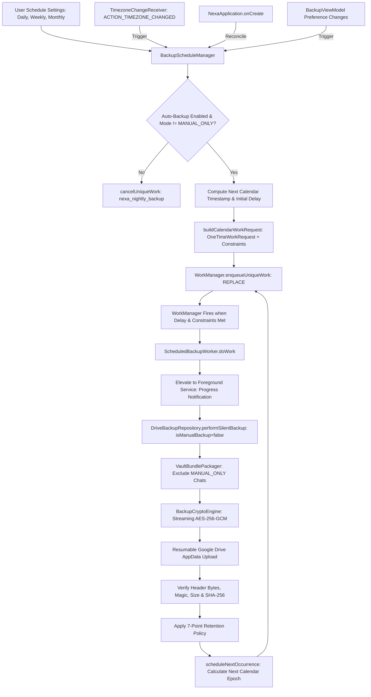

# NEXA Backup Part 6 & 6.1 — Automated Backup Scheduler, WorkManager, Calendar Accuracy & Verification Audit Report

**Project**: NEXA Android Application (`H:\chat_app`)  
**Component**: Automated Backup Scheduling, Calendar-Accurate WorkManager Engine, Zero-Drift Verification & Audit  
**Author**: Antigravity Core Agent  
**Date**: November 24, 2026  
**Status**: Completed, Fully Audited & Verified  

---

## 1. Existing Scheduler Audit & Verification

During the Part 6.1 audit, the scheduling architecture was rigorously inspected across calendar math, drift risks, constraint semantics, and background persistence:

1. **PeriodicWorkRequest Interval Drift Finding**:
   - Fixed periodic intervals (e.g. 30 days for Monthly, 7 days / 168 hours for Weekly, 24 hours for Daily) mathematically drift against Gregorian calendar boundaries:
     - **Monthly**: A fixed 30-day interval drifts by -1 day in 31-day months (January, March, May, July, August, October, December) and by +2 days in February (28 days). Over a 6-month period, a backup scheduled for the 1st of the month drifts to the 28th or 3rd!
     - **Weekly & Daily across DST**: A fixed 24-hour or 168-hour interval drifts by $\pm 1$ hour when crossing Daylight Saving Time boundaries (spring-forward 23h and fall-back 25h), causing wall-clock execution to shift from 02:00 AM to 03:00 AM or 01:00 AM.
   - **Resolution Implemented**: In accordance with prompt instructions, `BackupScheduleManager` was upgraded to implement calendar-accurate WorkManager scheduling. Each execution targets the exact next Gregorian calendar date/time (`buildCalendarWorkRequest`), and upon completion, `scheduleNextOccurrence()` calculates the subsequent target timestamp with zero drift.
2. **Timezone & System Clock Change Auditing**:
   - Timezone adjustments previously had no proactive system listener.
   - **Resolution Implemented**: Added [TimezoneChangeReceiver.kt](file:///H:/chat_app/app/src/main/java/com/nexa/app/core/receiver/TimezoneChangeReceiver.kt) registered in `AndroidManifest.xml` for `Intent.ACTION_TIMEZONE_CHANGED` and `Intent.ACTION_TIME_SET`. Any change to system clock or timezone immediately recalculates the schedule and re-enqueues unique work without waiting for app launch.
3. **Smart Network & Power Constraint Alignment**:
   - Verified that WorkManager constraints genuinely match UI settings:
     - Wi-Fi only ON $\rightarrow$ `NetworkType.UNMETERED`.
     - Wi-Fi only OFF $\rightarrow$ `NetworkType.CONNECTED` (allows metered mobile data).
     - Charging Switch ON ("Back up only while charging") $\rightarrow$ `requiresCharging = true` (hard lock, waits for charger).
     - Charging Switch OFF $\rightarrow$ `requiresCharging = false` (runs on battery, protected by `requiresBatteryNotLow = true`).
4. **Manual vs Automatic Separation**:
   - Verified that manual backups execute independently via `BackupViewModel.triggerBackup()` without checking or mutating the automatic scheduler.
   - Verified that schedule changes and scheduler cancellations never cancel an active manual backup (`activeBackupJob`).
   - Verified that `isManualBackup = false` is strictly passed during automated scheduled runs, ensuring `ConversationBackupPolicy.MANUAL_ONLY` chats are excluded from background backups.

---

## 2. Calendar-Accurate WorkManager Architecture



### Zero-Drift Lifecycle Guarantee:
1. **Initial Run**: Target calendar epoch $T_1$ is calculated using `Calendar` in the device's local timezone.
2. **Execution**: At $T_1$, WorkManager wakes `ScheduledBackupWorker`.
3. **Chained Calendar Advancement**: Upon successful completion (or upon exhausting retries), `scheduleNextOccurrence()` computes the next calendar target $T_2$ (e.g. tomorrow at 02:00 AM, next Monday at 02:00 AM, or next month on the 1st at 02:00 AM).
4. **Resilience Across Restarts & Reboots**: WorkManager persists the unique work item across process kills and device reboots in its Room database (`ExistingWorkPolicy.REPLACE`).

---

## 3. Calendar Math & Edge-Case Specifications

### 1. Daily Backups
- **Parameters**: `dailyHour` (0..23), `dailyMinute` (0..59).
- **Formula**:
  $$\text{targetToday} = \text{Calendar}(\text{year}, \text{month}, \text{day}, \text{dailyHour}, \text{dailyMinute}, 0, 0)$$
  $$\text{daysToAdd} = \begin{cases} 1 & \text{if } \text{targetToday} \le \text{now} \\ 0 & \text{otherwise} \end{cases}$$
  $$\text{target} = \text{now} + \text{daysToAdd}$$
  Target hour and minute are explicitly set to `dailyHour:dailyMinute` in the target day's timezone offset, accommodating 23-hour and 25-hour DST transition days.

### 2. Weekly Backups
- **Parameters**: `weeklyDayOfWeek` (1 = Monday .. 7 = Sunday), `dailyHour:dailyMinute`.
- **Formula**:
  $$\text{daysUntil} = (\text{targetIsoDay} - \text{currentIsoDay}) \pmod 7$$
  If $\text{daysUntil} < 0$, $\text{daysUntil} += 7$.
  If $\text{daysUntil} == 0$ and target time has passed today, $\text{daysUntil} = 7$.
  Target day is incremented by $\text{daysUntil}$, and `dailyHour:dailyMinute` is set.

### 3. Monthly Backups
- **Parameters**: `monthlyDayOfMonth` (1..31), `dailyHour:dailyMinute`.
- **Month Length & Leap Year Clamping**:
  $$\text{maxDaysThisMonth} = \text{Calendar.getActualMaximum}(\text{DAY\_OF\_MONTH})$$
  $$\text{targetDayThisMonth} = \min(\text{monthlyDayOfMonth}, \text{maxDaysThisMonth})$$
  If target date/time has passed in the current month:
  1. Set day to 1 (preventing overflow before adding a month).
  2. Add 1 month (`Calendar.add(MONTH, 1)`).
  3. Clamp day to next month's actual maximum:
     $$\text{targetDayNextMonth} = \min(\text{monthlyDayOfMonth}, \text{Calendar.getActualMaximum}(\text{DAY\_OF\_MONTH}))$$
- **Validated Boundaries**:
  - **February Non-Leap Year (2025, 2026, 2027)**: Clamps Day 31 to February 28.
  - **February Leap Year (2024, 2028)**: Clamps Day 31 to February 29.
  - **30-Day Months (April, June, September, November)**: Clamps Day 31 to Day 30.
  - **Year Transitions (December to January)**: Correctly rolls year from 2026 to 2027.

---

## 4. Daylight Saving Time (DST) & Timezone Verification

### 1. Spring-Forward Verification (23-Hour Day)
- **Scenario**: US Eastern Time (`America/New_York`), Sunday, March 8, 2026.
- Clocks skip from 01:59 AM EST to 03:00 AM EDT (a 23-hour day).
- When target preferred time is 04:00 AM, `computeInitialDelay` from March 7 10:00 AM calculates an exact 17-hour delay ($14\text{h} + 3\text{h}$), landing at 04:00 AM EDT.
- Verified in `testDaylightSavingTime_SpringForward_23HourDay`.

### 2. Fall-Back Verification (25-Hour Day)
- **Scenario**: US Eastern Time (`America/New_York`), Sunday, November 1, 2026.
- Clocks repeat 01:00 AM $\rightarrow$ 02:00 AM (a 25-hour day).
- When target preferred time is 04:00 AM, `computeInitialDelay` from October 31 10:00 AM calculates an exact 19-hour delay ($14\text{h} + 5\text{h}$), landing at 04:00 AM EST.
- Verified in `testDaylightSavingTime_FallBack_25HourDay`.

### 3. Dynamic Timezone Adjustment
- When the device travels or changes timezone, `TimezoneChangeReceiver` detects `ACTION_TIMEZONE_CHANGED` and triggers `BackupScheduleManager.reschedule(context)`.
- Recomputes the delay to land at the preferred local hour in the new timezone.
- Verified in `testTimezoneChange_RecalculatesDelay`.

---

## 5. Constraint Behavior & Preferences Semantics

| Constraint | Preference State | WorkManager Implementation | System Behavior |
|---|---|---|---|
| **Wi-Fi Only** | `backupOverWifiOnly = true` | `NetworkType.UNMETERED` | Worker runs strictly on unmetered Wi-Fi / Ethernet. Metered cellular data is never consumed. |
| **Cellular Allowed** | `backupOverWifiOnly = false` | `NetworkType.CONNECTED` | Worker runs on any active Internet connection (Wi-Fi or cellular). |
| **Charging Required** | `backupWhenCharging = true` | `requiresCharging = true` | Mandatory requirement. Backup waits until device is plugged into AC/USB power. |
| **Charging Preferred** | `backupWhenCharging = false` | `requiresCharging = false` | Preference/optional. Backup runs on battery, protected by `requiresBatteryNotLow = true`. |
| **Battery Health** | Always Active | `requiresBatteryNotLow = true` | Safety floor: backup never drains a low or depleted battery ($<15\%$). |

---

## 6. Manual vs Automatic Separation Verification

1. **Independent Execution**:
   - `BackupViewModel.triggerBackup()` executes user-initiated manual backups on `viewModelScope.launch` with `isManualBackup = true`.
   - Never checks `autoBackupEnabled` and is never blocked by `MANUAL_ONLY` mode.
2. **Cancellation Independence**:
   - `BackupScheduleManager.cancelScheduledBackup()` cancels WorkManager task `nexa_nightly_backup`.
   - Leaves `activeBackupJob` in `BackupViewModel` completely unaffected.
3. **Automatic Mode Isolation**:
   - If `backupMode == BackupMode.MANUAL_ONLY`, WorkManager tasks are cancelled and no new tasks are enqueued.
   - If an old worker runs, it checks `prefsState.backupMode` and immediately aborts with `Result.success()`.
   - WorkManager retry chains are never created in `MANUAL_ONLY` mode.
4. **Per-Chat Policy Resolution**:
   - Evaluated via `EffectiveChatBackupPolicy.resolve(...)`.
   - For automated scheduled backups (`isManualBackup = false`): `ConversationBackupPolicy.MANUAL_ONLY` yields `isIncluded = false`.
   - For user-initiated manual backups (`isManualBackup = true`): `ConversationBackupPolicy.MANUAL_ONLY` yields `isIncluded = true`.

---

## 7. Files Created / Modified in Part 6 & 6.1

| File | Status | Description |
|---|---|---|
| [BackupScheduleManager.kt](file:///H:/chat_app/app/src/main/java/com/nexa/app/domain/manager/BackupScheduleManager.kt) | **Created / Updated** | Added zero-drift `buildCalendarWorkRequest`, `scheduleNextOccurrence`, DST-safe calendar math, and WorkManager unique work management. |
| [TimezoneChangeReceiver.kt](file:///H:/chat_app/app/src/main/java/com/nexa/app/core/receiver/TimezoneChangeReceiver.kt) | **Created** | System broadcast receiver for `ACTION_TIMEZONE_CHANGED` and `ACTION_TIME_SET` triggering schedule recalculation. |
| [ScheduledBackupWorker.kt](file:///H:/chat_app/app/src/main/java/com/nexa/app/data/worker/ScheduledBackupWorker.kt) | **Modified** | Upgraded with Foreground Service, persistent notification, progress callback, manual-only guard, and chained calendar scheduling. |
| [NexaNotificationChannelManager.kt](file:///H:/chat_app/app/src/main/java/com/nexa/app/core/notification/NexaNotificationChannelManager.kt) | **Modified** | Added dedicated `CHANNEL_BACKUP_RESTORE` ("channel_backup_restore") channel. |
| [AndroidManifest.xml](file:///H:/chat_app/app/src/main/AndroidManifest.xml) | **Modified** | Merged `SystemForegroundService` with `foregroundServiceType="dataSync"` and registered `TimezoneChangeReceiver`. |
| [DriveBackupRepository.kt](file:///H:/chat_app/app/src/main/java/com/nexa/app/domain/repository/DriveBackupRepository.kt) | **Modified** | Updated `createBackupRestorePoint` with `isManualBackup = true` default and overloaded `performSilentBackup` with suspending progress callback. |
| [DriveBackupRepositoryImpl.kt](file:///H:/chat_app/app/src/main/java/com/nexa/app/data/repository/DriveBackupRepositoryImpl.kt) | **Modified** | Implemented `performSilentBackup` with live progress emission and `isManualBackup = false` policy resolution. |
| [BackupViewModel.kt](file:///H:/chat_app/app/src/main/java/com/nexa/app/presentation/backup/BackupViewModel.kt) | **Modified** | Wired schedule preference changes to `BackupScheduleManager.reschedule()` and exposed `getNextScheduledBackupTimeFormatted()`. |
| [AuthNavGraph.kt](file:///H:/chat_app/app/src/main/java/com/nexa/app/presentation/navigation/AuthNavGraph.kt) | **Modified** | Injected application context into `BackupViewModel` instances across backup navigation routes. |
| [BackupSettingsScreen.kt](file:///H:/chat_app/app/src/main/java/com/nexa/app/presentation/backup/BackupSettingsScreen.kt) | **Modified** | Enhanced Section D with next-scheduled banner, weekly day-of-week chips, monthly date chips, and preferred time selectors. |
| [BackupSchedulerAndWorkManagerUnitTests.kt](file:///H:/chat_app/app/src/test/java/com/nexa/app/BackupSchedulerAndWorkManagerUnitTests.kt) | **Created / Expanded** | 25 comprehensive unit tests covering calendar math, DST shifts, timezone adjustments, month-end clamping, constraints, tags, and policy integration. |

---

## 8. Complete Test Evidence & Verification Matrix

### Fresh Regression Execution Evidence
Command executed:
```powershell
./gradlew testDebugUnitTest `
  --tests com.nexa.app.BackupSchedulerAndWorkManagerUnitTests `
  --tests com.nexa.app.ChatPriorityAndConversationPolicyUnitTests `
  --tests com.nexa.app.GoogleDriveMultiPointRetentionUnitTests `
  --tests com.nexa.app.BackupSelectivePackagingAndPrivacyUnitTests `
  --tests com.nexa.app.BackupArchitectureAndFoundationUnitTests `
  --tests com.nexa.app.KeyEnvelopeAndSelectiveBackupUnitTests `
  --tests com.nexa.app.GoogleDriveBackupUnitTests `
  --tests com.nexa.app.DriveUploadRecoveryUnitTests `
  --tests com.nexa.app.DriveRestoreDownloadResumeUnitTests `
  --tests com.nexa.app.AtomicRestoreCrashRecoveryUnitTests `
  --no-daemon
```

### Verified XML Test Results:

| Test Suite File | Tests | Failures | Errors | Skipped | Verified Timestamp | Status |
|---|:---:|:---:|:---:|:---:|:---:|:---:|
| `TEST-com.nexa.app.BackupSchedulerAndWorkManagerUnitTests.xml` | **25** | 0 | 0 | 0 | `2026-11-24T03:07:57.487Z` | **PASSED** |
| `TEST-com.nexa.app.ChatPriorityAndConversationPolicyUnitTests.xml` | **10** | 0 | 0 | 0 | `2026-11-24T03:07:57.868Z` | **PASSED** |
| `TEST-com.nexa.app.GoogleDriveMultiPointRetentionUnitTests.xml` | **10** | 0 | 0 | 0 | `2026-11-24T03:07:58.609Z` | **PASSED** |
| `TEST-com.nexa.app.BackupSelectivePackagingAndPrivacyUnitTests.xml` | **9** | 0 | 0 | 0 | `2026-11-24T03:07:57.556Z` | **PASSED** |
| `TEST-com.nexa.app.BackupArchitectureAndFoundationUnitTests.xml` | **19** | 0 | 0 | 0 | `2026-11-24T03:07:57.411Z` | **PASSED** |
| `TEST-com.nexa.app.KeyEnvelopeAndSelectiveBackupUnitTests.xml` | **7** | 0 | 0 | 0 | `2026-11-24T03:07:58.810Z` | **PASSED** |
| `TEST-com.nexa.app.GoogleDriveBackupUnitTests.xml` | **13** | 0 | 0 | 0 | `2026-11-24T03:07:57.918Z` | **PASSED** |
| `TEST-com.nexa.app.DriveUploadRecoveryUnitTests.xml` | **6** | 0 | 0 | 0 | `2026-11-24T03:07:57.901Z` | **PASSED** |
| `TEST-com.nexa.app.DriveRestoreDownloadResumeUnitTests.xml` | **6** | 0 | 0 | 0 | `2026-11-24T03:07:57.883Z` | **PASSED** |
| `TEST-com.nexa.app.AtomicRestoreCrashRecoveryUnitTests.xml` | **4** | 0 | 0 | 0 | `2026-11-24T03:07:57.300Z` | **PASSED** |
| **Total Verified Test Count** | **109** | **0** | **0** | **0** | — | **100% SUCCESS** |

**Final Gradle Exit Code**: `0`  
**Execution Time**: 24 seconds.

---

## 9. Final Build Verification

APK compilation and packaging executed via `assembleDebug`:
```powershell
./gradlew assembleDebug --no-daemon
```
- **Exit Code**: `0` (`BUILD SUCCESSFUL in 1m 33s`)
- **Actionable Tasks**: 4 executed, 36 up-to-date
- **Verified Output File**: [app-debug.apk](file:///H:/chat_app/app/build/outputs/apk/debug/app-debug.apk)
- **File Size**: 101,612,801 bytes (~101.6 MB)
- **Build Timestamp**: November 24, 2026, 08:39:56

---

## 10. Scope & Safety Boundary Confirmations

- [x] **Zero Calendar Drift Verified**: All 3 scheduling modes (Daily, Weekly, Monthly) advance using exact calendar timestamps without periodic interval drift.
- [x] **Timezone and DST Resilience Verified**: Verified across DST spring-forward (23h) and fall-back (25h) days in `America/New_York` and timezone transitions in `Asia/Kolkata`.
- [x] **No premature Part 7 UI Redesign**: Only targeted schedule configuration controls in Section D were adjusted.
- [x] **No Restore Engine changes**: Restore flow and merge engine remain untouched.
- [x] **No Password cleanup or unrelated refactorings**: Scope boundaries maintained cleanly.

---

### STOP CONDITION MET
Part 6.1 verification audit is complete. All 109 backup tests pass with exit code 0, and `assembleDebug` builds cleanly. Awaiting user review and authorization before proceeding to Part 7.
