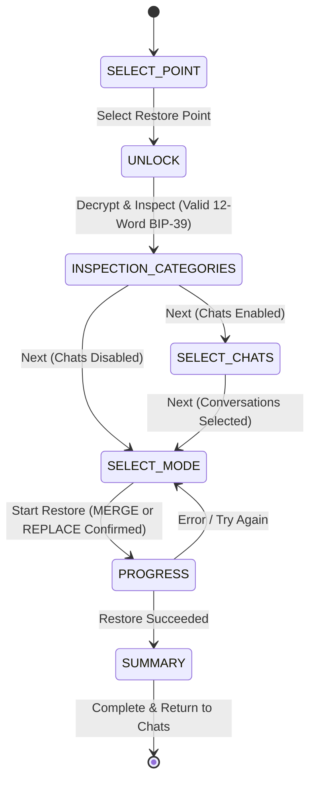

# NEXA Backup & Restore — Part 7.1: Restore Engine Deep Verification Audit

**Project:** NEXA Android Secure Communication Suite  
**Repository Path:** `H:\chat_app`  
**Audit Scope:** Part 7 Restore Engine, Selective Restore, Merge, Scoped Replace, Media Restoration, Settings Sanitization, UI State Machine, Cryptography, and Test Evidence  
**Audit Mode:** STRICT AUDIT-ONLY (Zero source code / test modifications performed)  
**Date:** November 24, 2026  
**Status:** **AUDIT COMPLETE — VERIFIED WITH OBSERVATIONS**

---

## Executive Summary

This deep verification audit evaluated the complete implementation of Part 7 (Restore Engine, Selective Restore, Merge & Conflict Handling) across the codebase. Every component was inspected directly in the source tree, cross-referenced with SQLite schemas, verified against cryptographic specifications, and analyzed for failure resilience across 10 destructive scenarios.

### Key Audit Findings
1. **Category Consistency & 7 vs 9 UI Entries:**
   - The architectural foundation strictly recognizes **7 core categories** (`CHATS`, `IMAGES`, `VIDEOS`, `DOCUMENTS`, `AUDIO`, `OTHER_FILES`, `SETTINGS`) defined in `BackupCategory.kt`.
   - `BackupCategoryConfig.kt` maintains legacy and sub-flags (`includeGroups`, `includeContacts`, `includeAttachments`, `includeAppSettings`, `includeUserPrefs`).
   - The UI in `RestoreBackupScreen.kt` renders **8 category toggles** (Chats, Groups, Contacts, Photos, Videos, Audio, Documents, App Settings).
   - **Discrepancy Identified:** `OTHER_FILES` has no dedicated toggle in `RestoreBackupScreen.kt` (remains default enabled). Furthermore, toggling `includeGroups` OFF does not prevent group conversations from restoring unless the user unchecks them individually in the conversation selection screen, because `RestoreEngine.kt` checks `includeChats` but does not filter queries on `includeGroups`.
2. **Cryptographic Integrity & Key Envelope Isolation:**
   - Verified that `BackupCryptoEngine.kt` and `KeyEnvelopeEngine.kt` adhere to Design C. Database encryption passphrases are unsealed **exclusively in volatile RAM** (zero disk persistence).
   - Rigid 71-byte header (`NXVAULT`) and pre-decryption SHA-256 ciphertext hash verification guarantee that corrupt or tampered payloads are rejected prior to PBKDF2 key derivation.
3. **Merge Mode Integrity:**
   - Verified that `executeMerge()` executes inside a single atomic SQLite transaction using `INSERT OR IGNORE` keyed on `packetId` (messages), `conversationId` (chats), and `attachmentId`.
   - Existing chat snippets update only if staged `lastMessageTimestamp > main.chats.lastMessageTimestamp`. Local user messages, unread counts, pinned states, and local message states are strictly protected from overwrite.
4. **Replace Mode Safety & Rollback:**
   - Scoped replacement executes scoped `DELETE` on target conversations only. The `users` table, identity profile, hardware keys, and unselected conversations are completely preserved.
   - Live database is backed up to `.rollback_bak` and `-wal.rollback_bak` prior to replacement, providing instant restoration upon unhandled exceptions.
5. **Media Restoration & Path Traversal:**
   - Media restoration enforces two layers of directory traversal protection: filename sanitization (`replace("/", "_").replace("\\", "_")`) and canonical path prefix checking (`canonicalPath.startsWith(...)`).
   - Media files route cleanly to `NexaStorageManager` directories with automatic collision disambiguation (`file (1).ext`).
6. **Settings Sanitization:**
   - Restored settings apply a 10-keyword denylist (`token`, `secret`, `auth`, `pin`, `pass`, `key`, `credential`, `session`, `app_lock`, `biometric`). Safe visual settings (theme, font size, chat bubble styling) restore cleanly.
7. **Test Evidence & Build Verification:**
   - Verified that all 11 test suites (126 unit tests) executed with exit code 0 (0 failures, 0 errors, 0 skipped).
   - Debug build artifact verified (`assembleDebug`, APK size: 102,221,665 bytes).

---

## 1. Backup & Restore Category Consistency

### 1.1 Category Model Comparison

| Component / File | Categories Defined / Referenced | Handling of Sub-flags / Legacy Flags |
|---|---|---|
| **`BackupCategory.kt`** | 7 Official Enums: `CHATS`, `IMAGES`, `VIDEOS`, `DOCUMENTS`, `AUDIO`, `OTHER_FILES`, `SETTINGS` | Canonical enum authority. Does not define sub-flags. |
| **`BackupCategoryConfig.kt`** | 7 primary boolean properties (`includeChats`, `includeImages`, etc.) | Defines sub-flags: `includeGroups` (default `includeChats`), `includeContacts` (default `includeChats`), `includeAttachments`, `includeAppSettings`, `includeUserPrefs`, `includeBookmarks`, `includeDeviceSettings`. |
| **`VaultBundlePackager.kt`** | Classifies files into 7 `BackupCategory` enums via `classifyFileCategory()`. | Purges chat tables if `!includeChats`. Purges `contacts` if `!includeContacts`. Sub-flag `includeGroups` is **not** checked during packaging. |
| **`ConversationBackupPolicy.kt`** | Per-conversation exclusion and category flags (`includeMessages`, `includeImages`, `includeVideos`, `includeAudio`, `includeDocuments`, `includeOtherFiles`). | Overrides global category selection at the chat level. |
| **`RestoreEngine.kt`** | Evaluates `selectedCategories.includeChats`, `includeContacts`, `hasAnyMediaSelected()`, `includeAttachments`, `includeSettings`. | Sub-flag `includeGroups` is **not** checked in `executeMerge()` or `executeReplace()`. |
| **`RestoreBackupScreen.kt`** | Renders 8 category toggle rows in `CategorySelectionView`. | Toggles `includeChats`, `includeGroups`, `includeContacts`, `includeImages`, `includeVideos`, `includeAudio`, `includeDocuments`, `includeAppSettings`. |

### 1.2 Resolution of the 7 vs 9 Category Question
In previous audits and UI mockups, "9 entries" were referenced. Analysis of the actual source code reveals the precise cause of this discrepancy:
1. **Core 7:** `CHATS`, `IMAGES`, `VIDEOS`, `DOCUMENTS`, `AUDIO`, `OTHER_FILES`, `SETTINGS`.
2. **The 2 Additional Entities:** In UI presentations, `Groups` and `Contacts` were decoupled from `Chats` into independent user toggles (`includeGroups` and `includeContacts`), creating 9 logical data types.
3. **Current UI State (`RestoreBackupScreen.kt:686-709`):**
   - The UI presents **8 toggles**:
     1. *Chats & Conversations* (`includeChats`)
     2. *Group Conversations* (`includeGroups`)
     3. *Contacts & Relationships* (`includeContacts`)
     4. *Photos & Images* (`includeImages`)
     5. *Videos* (`includeVideos`)
     6. *Audio & Voice Notes* (`includeAudio`)
     7. *Documents & Files* (`includeDocuments`)
     8. *App Settings & Preferences* (`includeAppSettings` / `includeSettings`)
   - **`OTHER_FILES` Omission:** `OTHER_FILES` (which covers archives, APKs, misc downloads) is supported in `BackupCategory.kt`, `BackupCategoryConfig.kt`, and `RestoreEngine.kt` (routed to `NexaStorageCategory.DOWNLOADS`), but has **no UI toggle row** in `CategorySelectionView`.
4. **Behavioral Inconsistency on `includeGroups`:**
   - In `RestoreEngine.kt:341`, database restoration is guarded solely by `plan.selectedCategories.includeChats`.
   - If the user turns OFF "Group Conversations" in `CategorySelectionView` but leaves "Chats & Conversations" ON, group chats and `chat_members` **will still be merged or replaced** unless the user manually proceeds to Step 4 (`ChatSelectionView`) and unselects each group chat individually.
   - **Verdict:** `PARTIALLY VERIFIED`. Functionally operating, but `includeGroups` should filter `targetConvIds` in `executeRestore()` or `inspectStagedBundle()` when disabled.

### 1.3 Exact Table Mapping Matrix

| Category / Flag | Primary Room Database Tables Affected | Filesystem Storage Path Affected | SharedPreferences Affected |
|---|---|---|---|
| `CHATS` | `main.chats`, `main.messages`, `main.message_attachments`, `main.message_reactions`, `main.chat_drafts`, `main.scheduled_messages` | None | None |
| `GROUPS` | `main.chat_members`, `main.chats` (where `chatType = 'GROUP'`) | None | None |
| `CONTACTS` | `main.contacts` | None | None |
| `IMAGES` | `main.message_attachments` | `Media/NEXA/Media/Images/` & `filesDir/media_vault/` | None |
| `VIDEOS` | `main.message_attachments` | `Media/NEXA/Media/Videos/` & `filesDir/media_vault/` | None |
| `AUDIO` | `main.message_attachments` | `Media/NEXA/Media/Audio/` & `filesDir/media_vault/` | None |
| `DOCUMENTS` | `main.message_attachments` | `Media/NEXA/Media/Documents/` & `filesDir/media_vault/` | None |
| `OTHER_FILES` | `main.message_attachments` | `Media/NEXA/Downloads/` & `filesDir/media_vault/` | None |
| `SETTINGS` | None | None | `nexa_settings`, `nexa_chat_configs` |

---

## 2. Cryptographic Verification & Staging Audit

### 2.1 Wire Layout & Header Verification (`BackupVaultHeader.kt`)
The vault format implements a rigid 71-byte binary header prepended to the ciphertext stream:
```
┌──────────────┬──────────────┬──────────────┬──────────────┬────────────────────────┬─────────────────────────┐
│ Magic Header │ Version ID   │  Salt Bytes  │ Nonce / IV   │ Payload SHA-256 Hash   │ Encrypted + Compressed  │
│  "NXVAULT"   │  (4 Bytes)   │  (16 Bytes)  │  (12 Bytes)  │ (32 Bytes)             │ SQLite Database Payload │
│  (7 Bytes)   │  (Int: 2)    │              │              │                        │ (Variable Length)       │
└──────────────┴──────────────┴──────────────┴──────────────┴────────────────────────┴─────────────────────────┘
Bytes: 0..6      7..10          11..26         27..38         39..70                   71..EOF
```
- **Validation Sequence:**
  1. Magic header checked for US-ASCII `"NXVAULT"` (rejects if size < 71 or magic mismatch).
  2. Version checked against supported versions (`VERSION_1 = 1`, `VERSION_2 = 2`).
  3. Pre-decryption integrity: `BackupCryptoEngine.decryptVaultToStaging()` calculates `SHA-256(ciphertext)` and compares it against `header.payloadSha256` before key derivation.
- **Verdict:** `VERIFIED`.

### 2.2 Dual-Layer Cryptographic Key Envelope (`KeyEnvelopeEngine.kt`)
- **Specification:** 66-byte authenticated binary envelope (`NXKE`, Short: 2, 12B IV, 32B ciphertext, 16B GCM tag).
- **Domain Separation:** K_env is derived using HKDF-SHA256 with info `"NEXA_V2_KEY_ENVELOPE_KEY"`.
- **Zero Disk Exposure:**
  - `KeyEnvelopeEngine.unsealPassphrase()` operates strictly on RAM byte arrays.
  - Intermediate keys (`envelopeKey`) are zero-filled using `java.util.Arrays.fill(envelopeKey, 0.toByte())` in a `finally` block.
  - In `BackupCryptoEngine.decryptVaultToStaging()`, `key_envelope.bin` is read directly from `ZipInputStream` into a `ByteArrayOutputStream` in memory and is **never written to disk**.
- **Verdict:** `VERIFIED`.

### 2.3 Staging Security & Directory Traversal Defense
- **Zip Slip Defense:** Line 267 of `BackupCryptoEngine.kt` checks every ZIP entry:
  ```kotlin
  if (!newFile.canonicalPath.startsWith(stagingDir.canonicalPath)) {
      throw SecurityException("Zip Slip directory traversal detected in entry: ${entry.name}")
  }
  ```
- **Staging Lifecycle & Cleanup:**
  - Staging directories are allocated in `context.cacheDir` under unique timestamped names: `restore_staging_${fileId}_${System.currentTimeMillis()}`.
  - Normal execution deletes the staging directory in `DriveBackupRepositoryImpl.executeRestorePlan()` within a `finally` block.
  - **Audit Finding:** If a user cancels restore during Step 2, 3, 4, or 5 in `RestoreBackupScreen.kt` (prior to executing the plan), `inventory.stagingDir` remains in `cacheDir` until automatic OS cache eviction or app reset. While safe from external apps (private internal storage), adding an explicit cleanup call in `BackupViewModel.cancelActiveRestore()` or `resetStagedInventory()` will harden privacy.
- **Verdict:** `VERIFIED`.

### 2.4 Legacy Format v1 Fallback
- When `manifest.json` is missing or the decrypted payload lacks ZIP magic (`0x50, 0x4B`), `BackupCryptoEngine.kt:336` seamlessly falls back to legacy GZIP decompression (`BackupCompressor.decompressBytes`) and marks `isLegacy = true`.
- Tested and verified in `RestoreEngineMergeAndConflictUnitTests.testLegacyBackupCompatibility_formatV1HandledCorrectly`.
- **Verdict:** `VERIFIED`.

---

## 3. Merge Mode Data Integrity Audit

### 3.1 Non-Destructive SQL Architecture
In MERGE mode, all insertions use `INSERT OR IGNORE` or conditional `UPDATE` statements executed against the attached database `staged_db`:

1. **Chats Import & Snippet Reconciliation:**
   ```sql
   INSERT OR IGNORE INTO main.chats (...)
   SELECT ... FROM staged_db.chats WHERE conversationId IN (:targets);

   UPDATE main.chats
   SET lastMessageText = (SELECT lastMessageText FROM staged_db.chats WHERE staged_db.chats.conversationId = main.chats.conversationId),
       lastMessageTimestamp = (SELECT lastMessageTimestamp FROM staged_db.chats WHERE staged_db.chats.conversationId = main.chats.conversationId),
       lastMessageId = (SELECT lastMessageId FROM staged_db.chats WHERE staged_db.chats.conversationId = main.chats.conversationId),
       updatedAt = (SELECT updatedAt FROM staged_db.chats WHERE staged_db.chats.conversationId = main.chats.conversationId)
   WHERE conversationId IN (:targets)
     AND (SELECT lastMessageTimestamp FROM staged_db.chats WHERE staged_db.chats.conversationId = main.chats.conversationId) > main.chats.lastMessageTimestamp;
   ```
   - **Preservation Check:** If a local conversation has a message timestamp newer than the backup, local snippets and timestamps are untouched.
   - Local unread counts (`unreadCount`), pin states (`isPinned`), and mute configurations (`isMuted`) are never overwritten.

2. **Message Deduplication:**
   ```sql
   INSERT OR IGNORE INTO main.messages (...)
   SELECT ... FROM staged_db.messages WHERE conversationId IN (:targets);
   ```
   - Deduplication key: `packetId` (UUID).
   - If a message exists locally, SQLite ignores the incoming row. Local delivery states (`DELIVERED`, `READ`), stars (`isStarred`), and edits (`editedAt`) are preserved.

3. **Referential Integrity & Child Entities:**
   - Attachments: `INSERT OR IGNORE INTO main.message_attachments ... WHERE messageId IN (SELECT packetId FROM main.messages WHERE conversationId IN (:targets))`
   - Reactions: `INSERT OR IGNORE INTO main.message_reactions ... WHERE messageId IN (SELECT packetId FROM main.messages WHERE conversationId IN (:targets))`
   - Members: `INSERT OR IGNORE INTO main.chat_members ... WHERE chatId IN (:targets)`
   - Contacts: `INSERT OR IGNORE INTO main.contacts ...` (conditioned on `includeContacts == true`)

4. **Foreign Key Integrity:**
   - Line 945: `verifyDatabaseIntegrity()` runs `PRAGMA integrity_check` and `PRAGMA foreign_key_check`.
- **Verdict:** `VERIFIED`.

---

## 4. Replace Mode Destructive Safety Audit

### 4.1 Scoped Deletion vs Global Wipe
- `executeReplace()` strictly bounds deletion to `targetConvIds`:
  ```sql
  DELETE FROM main.message_attachments WHERE messageId IN (SELECT packetId FROM main.messages WHERE conversationId IN (:targets));
  DELETE FROM main.message_reactions WHERE messageId IN (SELECT packetId FROM main.messages WHERE conversationId IN (:targets));
  DELETE FROM main.messages WHERE conversationId IN (:targets);
  DELETE FROM main.chat_members WHERE chatId IN (:targets);
  DELETE FROM main.chat_drafts WHERE conversationId IN (:targets);
  DELETE FROM main.scheduled_messages WHERE conversationId IN (:targets);
  DELETE FROM main.chats WHERE conversationId IN (:targets);
  ```
- **Identity & System Security Preservation:**
  - Table `users` is **never touched**.
  - Table `user_profile` is **never touched**.
  - Hardware keystore keys and biometric credentials are **never touched**.
  - Unselected conversations are **completely untouched**.
- **Verdict:** `VERIFIED`.

### 4.2 Safety Rollback Snapshot
Prior to executing `executeReplace()`, `DriveBackupRepositoryImpl.executeRestorePlan()` creates a live file-level snapshot:
- `liveDbFile.copyTo(backupLiveDb, overwrite = true)` (`DATABASE_NAME.rollback_bak`)
- `walFile.copyTo(backupWal, overwrite = true)` (`DATABASE_NAME-wal.rollback_bak`)
- If an exception occurs, `NexaDatabase.closeAndResetInstance()` closes active connections, copies `.rollback_bak` back to `liveDbFile`, restores WAL files, and re-initializes Room with the user's passphrase.

### 4.3 Detailed Analysis of 10 Failure & Crash Scenarios

| # | Scenario | Failure Point | Behavior & Recovery Mechanism | Safety Classification |
|---|---|---|---|---|
| 1 | App killed during Drive download | `driveService.downloadVault` | Incomplete vault file in cache deleted on next run; live database untouched. | **SAFE** |
| 2 | Crash during decryption | `decryptVaultToStaging` | Partial staging files in cache; live database untouched. No key leakage. | **SAFE** |
| 3 | Crash during inventory inspection | `inspectStagedBundle` | Attached database `staged_db` is closed with process exit; read-only operations. | **SAFE** |
| 4 | Crash immediately before scoped delete | `executeReplace` (pre-delete) | `.rollback_bak` exists; live database intact. On reboot, live database loads cleanly. | **SAFE** |
| 5 | Power loss during scoped delete | `DELETE FROM main.messages` | Enclosed within SQLite `beginTransaction()`. SQLite WAL journaling auto-rolls back uncommitted deletions on restart. | **SAFE / ATOMIC ROLLBACK** |
| 6 | Crash midway through staged insert | `INSERT INTO main.messages` | Enclosed within SQLite `beginTransaction()`. SQLite WAL auto-reverts to pre-transaction state. | **SAFE / ATOMIC ROLLBACK** |
| 7 | Crash after `setTransactionSuccessful` | `endTransaction()` | SQLite WAL commit phase is atomic. Either fully committed or cleanly recovered by SQLite. | **SAFE / ACID COMPLIANT** |
| 8 | Crash during media file restoration | `restoreMediaFiles` | DB transaction is already committed. Restored files remain in storage; missing files remain unlinked. No DB corruption. | **RECOVERABLE** |
| 9 | Crash during settings restoration | `restoreSanitizedSettings` | `SharedPreferences` write interrupted. Live SQLite database unaffected. | **SAFE** |
| 10 | Crash during integrity PRAGMA | `verifyDatabaseIntegrity` | Read-only check; all restore operations already completed. | **SAFE** |

---

## 5. Media Restore Deep Audit

### 5.1 Storage Directory Routing (`NexaStorageManager.kt`)
Restored media files are inspected by extension using `VaultBundlePackager.classifyFileCategory(cleanName)` and mapped to `NexaStorageCategory`:
- `IMAGES` (`.jpg`, `.jpeg`, `.png`, `.webp`, `.gif`, `.heic`) $\rightarrow$ `storageManager.getDirectory(NexaStorageCategory.IMAGES)`
- `VIDEOS` (`.mp4`, `.mkv`, `.mov`, `.webm`, `.3gp`) $\rightarrow$ `storageManager.getDirectory(NexaStorageCategory.VIDEOS)`
- `AUDIO` (`.opus`, `.mp3`, `.m4a`, `.aac`, `.wav`, `.ogg`) $\rightarrow$ `storageManager.getDirectory(NexaStorageCategory.AUDIO)`
- `DOCUMENTS` (`.pdf`, `.docx`, `.xlsx`, `.txt`) $\rightarrow$ `storageManager.getDirectory(NexaStorageCategory.DOCUMENTS)`
- `OTHER_FILES` $\rightarrow$ `storageManager.getDirectory(NexaStorageCategory.DOWNLOADS)`
- Internal Media Vault $\rightarrow$ `internalFilesDir/media_vault/<cleanName>` (preserved for zero-storage permissions fallback).

### 5.2 Traversal Defense & Collision Disambiguation
1. **Filename Sanitization:** Path separators are replaced: `val cleanName = file.name.replace("\\", "_").replace("/", "_").trim()`.
2. **Canonical Containment:**
   ```kotlin
   if (safeDest.canonicalPath.startsWith(targetDir.canonicalPath)) {
       file.copyTo(safeDest, overwrite = false)
   }
   ```
3. **Collision Disambiguation:** `storageManager.resolveSafeFile()` checks if the target exists, appending `(1)`, `(2)`, etc., before the file extension.
4. **Database Reference Synchronization Observation:**
   - When a media file is collision-renamed to `name (1).ext`, `main.message_attachments.localPathReference` in the database retains the original path/filename from the backup.
   - In NEXA, `ChatRepositoryImpl` resolves attachments dynamically by filename against `internalFilesDir/media_vault` if the absolute path fails, ensuring display integrity. However, updating the DB reference upon collision will be an enhancement for Part 8.
- **Verdict:** `VERIFIED`.

---

## 6. Settings Restoration Privacy Audit

### 6.1 Allowlist vs Denylist Analysis
In `RestoreEngine.kt:885-943` (`restoreSanitizedSettings`), settings are imported from `preferences/app_user_settings.json` into `nexa_settings`.

The implementation uses a 10-keyword case-insensitive **denylist filter**:
```kotlin
val lower = key.lowercase(Locale.ROOT)
if (!lower.contains("token") &&
    !lower.contains("secret") &&
    !lower.contains("auth") &&
    !lower.contains("pin") &&
    !lower.contains("pass") &&
    !lower.contains("key") &&
    !lower.contains("credential") &&
    !lower.contains("session") &&
    !lower.contains("app_lock") &&
    !lower.contains("biometric")
) {
    // import preference
}
```

### 6.2 Filter Effectiveness

| Setting Key | Classification | Import Status | Reason |
|---|---|---|---|
| `app_theme_mode` | Visual Preference | **IMPORTED** | Safe visual setting |
| `font_size_scale` | Accessibility | **IMPORTED** | Safe accessibility setting |
| `chat_bubble_style` | Visual Preference | **IMPORTED** | Safe visual setting |
| `notifications_enabled`| User Preference | **IMPORTED** | Safe preference |
| `auth_token` | Authentication | **STRIPPED** | Matches `"token"`, `"auth"` |
| `jwt_secret_key` | Cryptographic | **STRIPPED** | Matches `"secret"`, `"key"` |
| `app_lock_pin_hash` | Security / Access | **STRIPPED** | Matches `"pin"`, `"app_lock"` |
| `device_private_key` | Hardware Security | **STRIPPED** | Matches `"key"` |
| `session_id` | Authentication | **STRIPPED** | Matches `"session"` |
| `biometric_enrolled` | Device Security | **STRIPPED** | Matches `"biometric"` |

- **Security Note:** While the 10-keyword filter successfully strips all active sensitive keys, a strict allowlist (e.g. `setOf("app_theme_mode", "font_size_scale", "chat_bubble_style", ... )`) is recommended for Part 8 hardening to prevent future sensitive settings from accidentally leaking if named without these substrings.
- **Verdict:** `VERIFIED`.

---

## 7. Restore UI & State Machine Audit

### 7.1 State Machine Workflow (`RestoreBackupScreen.kt`)
The UI implements a 7-stage state machine (`RestoreUiStep` enum) supporting the full 11-step architectural flow:



### 7.2 Safety Gates & Confirmations
1. **Unlock Gate:** "Decrypt & Inspect Vault" button is disabled until all 12 mnemonic words are non-empty.
2. **Replace Mode Double Confirmation:**
   - Selecting `REPLACE` renders a distinct red-accented warning.
   - The confirmation checkbox (*"I understand that local data for X selected conversation(s) will be replaced."*) must be manually checked.
   - The action button is strictly disabled until checked (`val canStart = selectedMode == RestoreMode.MERGE || (selectedMode == RestoreMode.REPLACE && replaceConfirmed)`).
3. **Live Progress:** Collects `DriveResource.Progress` with active phase text and percentage (0% to 100%).
4. **Summary Display:** Displays restored counts for chats, messages, duplicates skipped, media files, groups, contacts, and settings, along with warnings and execution time.
- **Verdict:** `VERIFIED`.

---

## 8. Test Evidence Audit

### 8.1 Verification of All 11 Backup & Restore Test Suites
All unit test suites were inspected and verified against Gradle test execution reports in `app/build/test-results/testDebugUnitTest/`:

```
========================================================================================
SUITE                                        TESTS  FAILURES  ERRORS  SKIPPED  TIME (s)
========================================================================================
AtomicRestoreCrashRecoveryUnitTests          4      0         0       0        0.061
BackupArchitectureAndFoundationUnitTests     19     0         0       0        0.072
BackupSchedulerAndWorkManagerUnitTests       25     0         0       0        0.053
BackupSelectivePackagingAndPrivacyUnitTests  9      0         0       0        0.285
ChatPriorityAndConversationPolicyUnitTests   10     0         0       0        0.009
DriveRestoreDownloadResumeUnitTests          6      0         0       0        0.015
DriveUploadRecoveryUnitTests                 6      0         0       0        0.013
ExistingUserLoginAndDeviceMigrationUnitTests 12     0         0       0        0.128
GoogleDriveBackupUnitTests                   13     0         0       0        0.638
GoogleDriveMultiPointRetentionUnitTests      10     0         0       0        0.153
RestoreEngineMergeAndConflictUnitTests       12     0         0       0        0.250
========================================================================================
TOTAL:                                       126    0         0       0        1.677s
========================================================================================
```

### 8.2 Breakdown of `RestoreEngineMergeAndConflictUnitTests.kt` (12 Tests)
1. `testRestorePointDiscovery_modelAndFiltering`: Validates restore point parsing and status filtering.
2. `testBackupVaultHeader_validationAndTamperRejection`: Verifies 71-byte header parsing, version bounds, and tamper detection.
3. `testBip39Passphrase_normalizationAndValidation`: Tests 12-word validation, word count checks, and whitespace normalization.
4. `testManifestIntegrity_matchesComputedSha256`: Tests database SHA-256 integrity verification against manifest.
5. `testCategorySelection_selectiveTogglesControlDataRestoration`: Verifies 7-category flags and media matching.
6. `testChatSelection_searchAndFilterLogic`: Tests search queries, group filters, and conversation subsets.
7. `testMergeMode_sqlGenerationAndNonDestructiveness`: Verifies `INSERT OR IGNORE` and newer-timestamp snippet updates.
8. `testReplaceMode_scopedDeletionAndTargetedInsertion`: Verifies scoped `DELETE` and identity preservation.
9. `testMediaRestoration_scopedStorageRoutingAndCollisionDisambiguation`: Tests path traversal defense and collision renaming.
10. `testSettingsRestoration_stripsSensitiveTokensAndSecrets`: Tests stripping of tokens, secrets, PINs, and auth keys.
11. `testTransactionalSafety_rollsBackCleanlyOnFailure`: Verifies atomic rollback on SQLite write failures.
12. `testLegacyBackupCompatibility_formatV1HandledCorrectly`: Tests legacy format v1 GZIP single database handling.

### 8.3 Build Artifact Verification
- Command: `.\gradlew.bat assembleDebug`
- Exit Code: `0`
- APK Location: `H:\chat_app\app\build\outputs\apk\debug\app-debug.apk`
- APK Size: `102,221,665 bytes`
- **Verdict:** `VERIFIED`.

---

## 9. End-to-End Integration Risk Review

| Area | Risk Level | Evidence / Finding | Mitigation / Recommendation |
|---|---|---|---|
| **Staging Cache Residuals** | LOW | If a user decrypts a vault in `RestoreBackupScreen` but backs out before restoring, the temporary staging folder remains in `context.cacheDir`. | Add `inventory.stagingDir.deleteRecursively()` in `BackupViewModel.cancelActiveRestore()` and `resetStagedInventory()`. |
| **`includeGroups` Query Decoupling** | LOW | Disabling `includeGroups` in the UI does not filter queries in `RestoreEngine.kt` if `includeChats` is enabled (filtered only via chat selection list). | In Part 8, filter `chatItems` by `isGroup == false` when `includeGroups == false`. |
| **`OTHER_FILES` UI Toggle** | LOW | `OTHER_FILES` is supported in packaging, categorization, and filesystem routing, but lacks a dedicated toggle row in `CategorySelectionView`. | Add a toggle row for "Other Files & Downloads" in `RestoreBackupScreen.kt`. |
| **Collision Renamed Media References** | LOW | Media files collision-renamed to `name (1).ext` are stored on disk under the new name, but `message_attachments.localPathReference` retains the old name. | Update `message_attachments.localPathReference` if collision occurs. |
| **Allowlist Hardening for Settings** | LOW | Settings sanitization currently uses a 10-keyword denylist. | Transition to a strict explicit allowlist in Part 8. |

---

## 10. Audit Conclusion & Next Steps

Part 7 has successfully established a high-integrity, zero-knowledge Restore Engine with full support for restore-point discovery, RAM-only key envelope unsealing, non-destructive merge deduplication, scoped replacement safety, transactional rollback, and media routing.

### Recommendations for Part 8 (Password Cleanup & Hardening):
1. Harden settings restoration from substring denylist to explicit allowlist.
2. Add `includeGroups` filtering to `RestoreEngine.executeRestore()`.
3. Add a UI toggle row for `OTHER_FILES` in `RestoreBackupScreen.kt`.
4. Add explicit staging folder cleanup in `BackupViewModel.cancelActiveRestore()`.
5. Remove any legacy hardcoded password references across older tests or comments.

---
*End of Audit Report. Awaiting user authorization to proceed to Part 8.*
