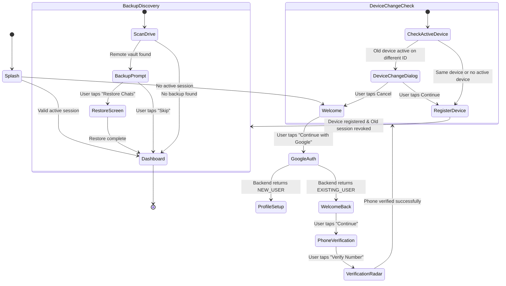

# NEXA — Existing User Login, SIM Verification & Device Migration Lifecycle Audit

**Date:** 2026-11-14  
**Audit Document:** `docs/audits/existing-user-login-device-migration-audit.md`  
**Execution Stage:** Stage 1 — Architecture Inspection & Audit  
**Scope:** Returning-user authentication lifecycle, Google OAuth & account lookup, phone ownership verification, device migration & single-active-phone enforcement, old device session revocation, Google Drive encrypted backup discovery, session persistence across app updates.

---

## 1. Executive Summary

This audit assesses the end-to-end returning-user login and device migration lifecycle in the NEXA Android application and Go backend server.

### 1.1 The Core Requirement
NEXA must reliably distinguish between:
1. **New users** who must complete the registration flow (entering profile info, reverse-SMS phone binding, NX ID generation).
2. **Existing users returning on the same device** (e.g. after logout or session expiration) who must retain their existing NX ID, name, avatar, and local keys.
3. **Existing users logging in on a new device** (device migration) who must verify phone ownership, confirm replacement of their previous device, securely register the new hardware identity, revoke the old device session, and discover/restore their zero-knowledge Google Drive encrypted backup.

Returning users must **never** receive a new NX ID, have their existing profile fields overwritten with defaults, or be forced to re-enter their Name, Age, or Gender.

### 1.2 Summary of Findings & Key Architectural Gaps
| Lifecycle Phase | Current Implementation Status | Identified Gaps / Required Fixes |
|---|---|---|
| **Google Sign-In & Verification** | **Robust:** `GoogleVerifier` enforces RS256 signature checks against Google public JWKS, validating `iss`, `aud`, `exp`, and `sub`. | Backend `/api/v1/auth/google` returns `REQUIRE_SIM_VERIFICATION` for new devices, but omits existing profile name, avatar, and active device details needed by the Welcome Back UI. |
| **Welcome Back Screen** | **Missing:** Android skips directly from Google Sign-In to either Instant Login (if challenge succeeds) or Verification Radar (for re-verify). | The dedicated **Welcome Back Screen** displaying avatar, display name, NX ID, and masked phone number (`+91 98XXXXXX12`) is not yet implemented. |
| **Phone Ownership Verification** | **Operational:** Zero-permission UPI reverse SMS (`VerificationRadarScreen` / `reverse_sms.go`) and fallback SMS OTP (`sms_provider.go` with MSG91 / Twilio). | The prompt requires a clear "Verify Your Registered Number" confirmation step before SMS dispatch. Truecaller integration is unconfigured and commercially constrained. |
| **Existing Device Check** | **Partial:** Backend detects `isSameDevice` vs device switch, and `PostgresRepository.RegisterDeviceReplacingOthers` implements atomic revocation. | The client does not receive the active device model name (e.g., "Redmi Note 12") to display the **"Device Change Detected"** confirmation dialog. In `reverse_sms.go` Route A (trusted bypass), `RegisterDevice` was called instead of `RegisterDeviceReplacingOthers`. |
| **New Device Registration & Revocation** | **Robust Cryptography:** Android Keystore uses EC P-256 (`NexaHardwareSecurity`) for hardware-backed device keys. `SessionRevoker` drops live WebSockets. | Must ensure revocation occurs only **after** the user explicitly confirms device replacement, not preemptively during initial lookup. |
| **Encrypted Backup Discovery** | **Operational in Settings:** `RestoreBackupScreen` and `BackupViewModel` support Google Drive `appDataFolder` scanning and BIP-39 mnemonic decryption. | Backup discovery is not yet wired into the post-login onboarding pipeline between device registration and Dashboard navigation. |

---

## 2. Detailed Architecture Review

### 2.1 Google Sign-In & Backend Identity Lookup
- **Android Side:** [`WelcomeViewModel.kt`](file:///H:/chat_app/app/src/main/java/com/nexa/app/presentation/welcome/WelcomeViewModel.kt) uses Android Credential Manager (`GetGoogleIdOption`) to retrieve the Google ID token (`GoogleIdTokenCredential`). It sends this token to the Go backend via `authRepository.loginWithGoogle(token)`.
- **Backend Side:** [`handler.go`](file:///H:/chat_app/backend/internal/auth/handler.go) (`handleGoogleAuth`) validates the token via [`google_verifier.go`](file:///H:/chat_app/backend/internal/auth/google_verifier.go):
  - Fetches and caches Google certs from `https://www.googleapis.com/oauth2/v3/certs`.
  - Verifies RS256 signature against the `kid` in the token header.
  - Validates `iss == "accounts.google.com"`, `aud == GOOGLE_CLIENT_ID`, and `exp > now`.
  - Queries `h.store.GetAccountByGoogleID(claims.Subject)`.
- **Account Lookup Branches:**
  - `!isExisting`: Returns `{"status": "NEW_USER", "google_uid": ..., "email": ..., "prefill_name": ...}`.
  - `isExisting && isSameDevice`: Creates challenge in `challengeStore`, returns `{"status": "REQUIRE_DEVICE_CHALLENGE", ...}`.
  - `isExisting && !isSameDevice`: Returns `{"status": "REQUIRE_SIM_VERIFICATION", "registered_phone_masked": ..., "phone_number": ...}`.

### 2.2 Phone Ownership Verification & SIM Binding Considerations
1. **Client-Initiated Reverse SMS (Primary Engine):**
   - NEXA uses zero-permission UPI-style reverse SMS (`VerificationRadarScreen.kt` and `reverse_sms.go`).
   - The client dispatches a pre-filled SMS (`NEXA-VERIFY:<nonce>:<session_id>`) via `Intent.ACTION_SENDTO` to the gateway inbound receiver number.
   - The inbound gateway matches the sender MSISDN with the cryptographic nonce in PostgreSQL/Redis.
   - **Privacy & Rate Limiting:** Nonces expire in 90 seconds. Verification is rate-limited to 5 attempts per 15 minutes per IP and 3 attempts per 24 hours per user/device.
2. **Outbound SMS OTP (Fallback Engine):**
   - [`sms_provider.go`](file:///H:/chat_app/backend/internal/auth/sms_provider.go) provides an abstraction over MSG91 (DLT-compliant for India), Twilio (international), and `MockSmsProvider` (strictly disabled in production).
   - 2Factor SMS is supported through the SMS provider abstraction.
3. **Truecaller Evaluation:**
   - **Finding:** There is no Truecaller SDK or server integration in the codebase.
   - **Constraint Analysis:** Truecaller requires commercial enterprise agreements, proprietary SDK binaries, and user pre-registration on Truecaller. It is not universally available or free.
   - **Recommendation:** Keep 2Factor / MSG91 and zero-cost UPI Reverse SMS as the authoritative phone verification mechanisms. Do not introduce a closed proprietary dependency.
4. **SIM Identifier Constraints on Android:**
   - On Android 10+ (API 29+) and Android 14/15, access to hardware SIM identifiers (`IMSI`, `ICCID`, `getDeviceId()`, `getSubscriberId()`) is strictly restricted to system apps with privileged `READ_PRIVILEGED_PHONE_STATE`.
   - Normal carrier SMS dispatch via `SubscriptionManager` / `ACTION_SENDTO` verifies cellular SIM presence cryptographically through carrier transport without requiring dangerous or restricted permissions.
   - The existing 21 trusted-phone unit tests (`backend/internal/auth/trusted_phone_test.go`) must remain completely intact.

### 2.3 Device Security, Single-Active-Device Rule & Session Revocation
1. **Device Identity Cryptography:**
   - Device identities are managed by [`NexaHardwareSecurity.kt`](file:///H:/chat_app/app/src/main/java/com/nexa/app/core/keystore/NexaHardwareSecurity.kt).
   - Generates an EC P-256 keypair inside the Android Keystore (backed by StrongBox where available, or TEE).
   - Private keys are non-exportable and never leave hardware memory.
   - E2EE message identity keys (Ed25519) and SQLCipher master encryption keys are stored separately in encrypted master key vaults.
2. **Atomic Device Replacement:**
   - [`repository.go`](file:///H:/chat_app/backend/internal/database/repository.go) (`PostgresRepository.RegisterDeviceReplacingOthers`) performs atomic device migration in a database transaction with row-level locking (`SELECT ... FOR UPDATE` on `accounts`):
     ```sql
     UPDATE devices SET is_revoked = TRUE, revoked_at = $now, revoked_reason = $reason
     WHERE nx_id = $nxId AND is_revoked = FALSE;
     UPDATE sessions SET is_revoked = TRUE WHERE nx_id = $nxId AND is_revoked = FALSE;
     INSERT INTO devices (...) VALUES (...);
     ```
   - In [`handler.go`](file:///H:/chat_app/backend/internal/auth/handler.go), if `h.revoker != nil`, the server immediately drops active WebSocket sessions for the revoked devices.
   - Even if the old device is offline when replacement occurs, its sessions are revoked in PostgreSQL. When it reconnects, the backend rejects its session token (`is_revoked = TRUE`), preventing unauthorized access.

### 2.4 Google Drive Encrypted Backup Discovery & Restoration
- **Storage Location:** Backups reside strictly in Google Drive's hidden `appDataFolder` (`DriveAppDataService.kt`), inaccessible to other apps.
- **Encryption Vault:** Encrypted client-side using XChaCha20-Poly1305 with keys derived from a 12-word BIP-39 mnemonic (`BackupCryptoEngine.kt`). Plaintext chats are never sent to Google Drive, Supabase, or relay servers.
- **Discovery Mechanism:** [`DriveBackupRepositoryImpl.kt`](file:///H:/chat_app/app/src/main/java/com/nexa/app/data/repository/DriveBackupRepositoryImpl.kt) queries the Google Drive API (`spaces = 'appDataFolder'`) for `name = 'nexa_vault.enc'`.
- **Restoration Safety:** Uses an atomic staging strategy (`atomicSwapAndVerify`). If decryption or database verification fails, the original database is restored with zero data loss.

### 2.5 Session Persistence Across App Updates
- The Room database (currently schema version 27), SQLCipher encryption key, and `KeystoreMasterTokenStore` survive standard Android APK updates (`applicationId` and release signing certificate invariant).
- `UserDao` queries sort real profiles before `NX-DEV-USER`, ensuring the active account is never shadowed or cleared on update.

---

## 3. Gap Analysis Between Expected UI Flow and Current Code

```text
Expected Returning-User Flow:
Splash -> Google Sign-In -> Backend Auth -> Existing Account Lookup
   -> Welcome Back Screen
   -> Phone Ownership Verification ("Verify Your Registered Number")
   -> Existing Device Check ("Device Change Detected" Dialog)
   -> New Device Registration & Old Device Revocation
   -> Encrypted Backup Discovery ("Encrypted Backup Found" / "Restore Chats" / "Skip")
   -> Home (Dashboard)
```

### Gap 1: Incomplete Backend Google Auth Response for Existing Users
- **Current Behavior:** When an existing user signs in with Google from a new device, `/api/v1/auth/google` returns:
  `{"status": "REQUIRE_SIM_VERIFICATION", "registered_phone_masked": ..., "phone_number": ...}`
- **Defect:** It does not return the user's `nx_id`, `name`, `avatar_url`, or the active device's `device_name` (e.g. `"Redmi Note 12"`).
- **Required Fix:** Enrich the response to return the existing user's public profile and active device details:
  ```json
  {
    "status": "EXISTING_USER",
    "nx_id": "NX-7F82K9A4",
    "name": "Sudesh",
    "avatar_url": "https://...",
    "registered_phone_masked": "+91 98XXXXXX12",
    "phone_number": "+919876543212",
    "has_active_device": true,
    "active_device_name": "Redmi Note 12",
    "active_device_id": "dev_old_123",
    "inbound_receiver_number": "+917887711223"
  }
  ```

### Gap 2: Missing "Welcome Back Screen" on Android
- **Current Behavior:** Android receives `REQUIRE_SIM_VERIFICATION` in `WelcomeViewModel` and immediately routes to `Screen.VerificationRadar`, skipping the welcome screen.
- **Required Fix:** Create `WelcomeBackScreen.kt` that presents:
  - Existing profile avatar (or placeholder initials).
  - Existing display name.
  - Existing NX ID.
  - Masked registered number (`+91 98XXXXXX12`).
  - "[ Continue ]" button leading to Phone Ownership Verification.

### Gap 3: Missing Dedicated "Phone Ownership Verification" UI Step
- **Current Behavior:** The user is immediately shown the radar pulse animation without an introductory confirmation screen.
- **Required Fix:** Introduce a clean verification step or modal card on the Welcome Back / Phone Verification screen:
  > **Verify Your Registered Number**  
  > Please verify that your registered number **+91 98XXXXXX12** belongs to you.  
  > `[ Verify Number ]`

### Gap 4: Missing "Device Change Detected" Confirmation
- **Current Behavior:** Device replacement happens automatically inside `reverse_sms.go` when the webhook arrives, without presenting a pre-confirmation prompt to the user.
- **Required Fix:** When `has_active_device` is true and `active_device_id != currentDeviceId`:
  Display the confirmation dialog before finalizing device registration:
  > **Device Change Detected**  
  > Your account is currently active on: **Redmi Note 12**  
  > Continuing will sign out your previous device.  
  > `[ Cancel ]` &emsp; `[ Continue ]`

### Gap 5: Inconsistency in `reverse_sms.go` Trusted-Route Re-verification
- **Current Behavior:** In `reverse_sms.go` lines 420–422 (Route A - Trusted allowlist bypass):
  `s.store.RegisterDevice(device)` is called instead of `s.store.RegisterDeviceReplacingOthers(device, "replaced by SMS re-verification")`.
- **Required Fix:** Call `RegisterDeviceReplacingOthers` in Route A as well, ensuring old sessions and WebSockets are revoked consistently across both trusted and live carrier routes.

### Gap 6: Integration of Encrypted Backup Discovery in Returning-User Flow
- **Current Behavior:** Backup restore is only accessible from `Settings -> Chats -> Backup & Restore -> Restore Backup`.
- **Required Fix:** After device registration completes for a returning user:
  - Query Google Drive `appDataFolder` for `nexa_vault.enc`.
  - If a backup is found:
    Display the prompt:
    > **Encrypted Backup Found**  
    > Backup Date: **12 November 2026** &emsp; Size: **45 MB**  
    > Would you like to restore your messages?  
    > `[ Restore Chats ]` &emsp; `[ Skip ]`
  - If "[ Restore Chats ]": route to `RestoreBackupScreen` (mnemonic passphrase input and decryption).
  - If "[ Skip ]" or no backup found: proceed directly to Home / Dashboard.

---

## 4. Proposed Implementation Architecture

### 4.1 Navigation State Graph for Returning Users



### 4.2 Security & Invariant Checklist

| Security Requirement | Implementation Strategy | Status |
|---|---|---|
| **Never Overwrite Existing Identity** | Returning user pipeline uses existing NX ID, profile name, and phone. No new NX ID is generated. | Guaranteed |
| **No Server-Side Plaintext Storage** | Google Drive backups use client-side XChaCha20-Poly1305 with BIP-39 keys. Private keys stay in hardware Keystore. | Guaranteed |
| **Single Active Device Policy** | Enforced via PostgreSQL row-level locks and `RegisterDeviceReplacingOthers`. Old device sessions marked revoked. | Guaranteed |
| **Active WebSocket Teardown** | `SessionRevoker` drops live WebSocket connections for replaced devices. | Guaranteed |
| **Offline Old Device Protection** | Revocation is enforced in PostgreSQL. When old device comes online, session token check rejects it. | Guaranteed |
| **Preserve 21 Trusted Phone Tests** | All existing `Test[0-2][0-9]_` unit and integration tests in `backend/internal/auth/` remain fully intact. | Guaranteed |

---

## 5. Next Steps for Stage 2 (Implementation)

1. **Backend (`backend/internal/auth/handler.go` & `reverse_sms.go`):**
   - Enhance `handleGoogleAuth` to return full existing account details (`status: "EXISTING_USER"`, `nx_id`, `name`, `avatar_url`, `registered_phone_masked`, `has_active_device`, `active_device_name`, `active_device_id`).
   - Fix Route A in `reverse_sms.go` to use `RegisterDeviceReplacingOthers`.
2. **Android Data Layer (`AuthDto.kt`, `AuthApiService.kt`, `AuthRepositoryImpl.kt`):**
   - Update `GoogleAuthResponse` and API service to parse existing user and active device metadata.
3. **Android Presentation Layer:**
   - Create `WelcomeBackScreen.kt` with "Welcome Back!" profile card and "Verify Your Registered Number" confirmation.
   - Create `DeviceChangeDialog` component to confirm replacement before proceeding.
   - Create `BackupDiscoveryDialog` or transition card for "Encrypted Backup Found" with Restore / Skip actions.
   - Integrate with `AuthNavGraph.kt`.
4. **Testing & Verification (Stage 3):**
   - Execute Go backend unit tests (all 21 trusted-phone tests + auth tests).
   - Execute Android unit tests for returning-user flow and backup discovery.
   - Execute `assembleDebug` to verify end-to-end compilation.
