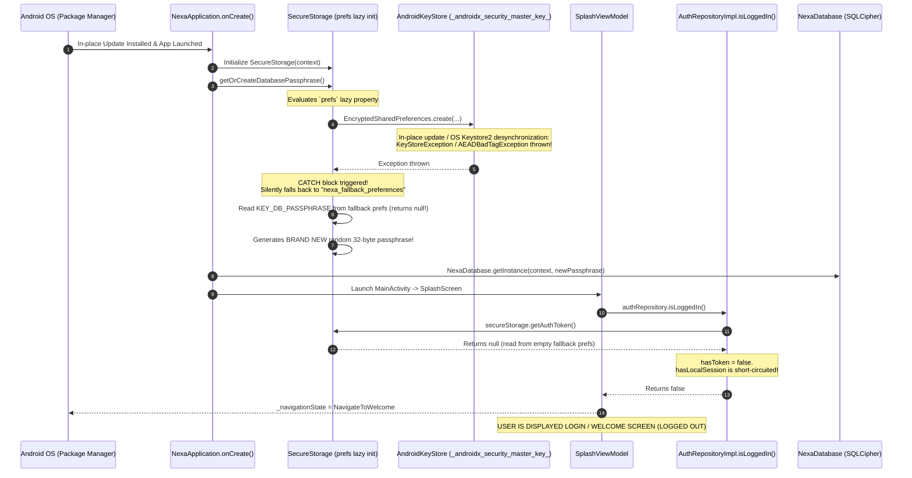

# NEXA — Android App Update Session Persistence & State Preservation Audit Report

**Audit Mode:** Strict Read-Only Inspection  
**Audit Target:** NEXA Android Native Client (`com.nexa.app`) & NEXA Go Backend Service (`backend/internal/auth`, `backend/internal/identity`)  
**Audit Focus:** In-place application update session loss, local storage survival, SQLCipher encryption key lifecycle, Android Keystore preservation, and E2EE identity stability across version upgrades.  
**Status:** Completed (Strictly read-only; zero files created, modified, or deleted).

---

## 1. Executive Summary

When a user updates the NEXA Android application in-place (e.g., from version 1.0 to 1.1), the application unexpectedly logs the user out upon first launch, reverting to the Welcome / Registration screen (`Screen.Welcome`).

This audit investigated the entire startup, storage, and cryptographic key pipeline to determine the exact technical root cause.

### Core Audit Findings
1. **The Startup Check Is 100% Local (Zero Network Calls):** On cold launch, [SplashViewModel.kt](file:///H:/chat_app/app/src/main/java/com/nexa/app/presentation/splash/SplashViewModel.kt#L29-L40) invokes `authRepository.isLoggedIn()`. This function evaluates only two local flags:
   $$\text{isLoggedIn} = (\text{hasToken} \land \text{hasLocalSession})$$
   The app **never** contacts the Go backend or any external server during splash initialization. The logout is **100% client-side**.
2. **The Root Cause — `EncryptedSharedPreferences` Keystore Invalidation & Silent Fallback Trap:**
   In [SecureStorage.kt](file:///H:/chat_app/app/src/main/java/com/nexa/app/core/security/SecureStorage.kt#L11-L28), `prefs` is backed by `androidx.security.crypto.EncryptedSharedPreferences` via library version `1.1.0-alpha06`. Across Android package updates (especially on API 31–35, targetSdk 35), hardware Keystore keys managed by `androidx.security.crypto` frequently throw `KeyStoreException` ("master key exists but is unusable" or `AEADBadTagException`). 
   `SecureStorage` wraps this in a `try-catch` block that **silently falls back to an unencrypted, blank preferences file** (`"nexa_fallback_preferences"`).
3. **The Cascade:** In the blank fallback preferences file:
   * `KEY_AUTH_TOKEN` is `null` $\rightarrow$ `hasToken` evaluates to `false`.
   * Boolean short-circuit evaluation terminates immediately without querying Room.
   * `SplashViewModel` navigates directly to `NavigateToWelcome`.
   * `KEY_DB_PASSPHRASE` is `null` $\rightarrow$ `getOrCreateDatabasePassphrase()` generates a **brand-new random 32-byte passphrase**, orphaning the original SQLCipher database.
   * `KEY_IDENTITY_PUBLIC_KEY` is `null` $\rightarrow$ `getOrCreateIdentityKeyPair()` generates a **new identity keypair**, permanently destroying the device's cryptographic identity.

---

## 2. Exact Root Cause of Automatic Logout

### Step-by-Step Failure Trace



### The Source Code Evidence

In [SecureStorage.kt](file:///H:/chat_app/app/src/main/java/com/nexa/app/core/security/SecureStorage.kt#L11-L28):
```kotlin
private val prefs: SharedPreferences by lazy {
    try {
        val masterKey = MasterKey.Builder(context)
            .setKeyScheme(MasterKey.KeyScheme.AES256_GCM)
            .build()

        EncryptedSharedPreferences.create(
            context,
            SECURE_PREFS_NAME,
            masterKey,
            EncryptedSharedPreferences.PrefKeyEncryptionScheme.AES256_SIV,
            EncryptedSharedPreferences.PrefValueEncryptionScheme.AES256_GCM
        )
    } catch (e: Exception) {
        // Fallback for devices with corrupted Keystore entries
        context.getSharedPreferences(FALLBACK_PREFS_NAME, Context.MODE_PRIVATE)
    }
}
```

In [AuthRepositoryImpl.kt](file:///H:/chat_app/app/src/main/java/com/nexa/app/data/repository/AuthRepositoryImpl.kt#L32-L36):
```kotlin
override suspend fun isLoggedIn(): Boolean = withContext(Dispatchers.IO) {
    val hasToken = !secureStorage.getAuthToken().isNullOrBlank()
    val hasLocalSession = userDao.hasActiveSession()
    hasToken && hasLocalSession
}
```

Because `prefs` silently points to `FALLBACK_PREFS_NAME`, `secureStorage.getAuthToken()` returns `null`. `hasToken` is `false`, `isLoggedIn()` returns `false`, and the user is logged out without any error dialog or crash.

---

## 3. Authentication Session Persistence Audit

| Feature / Subsystem | Implementation Reality | Audit Classification |
| :--- | :--- | :--- |
| **Supabase Auth Client** | Supabase is **not implemented** in Android. The app contains zero Supabase client dependencies or SDK initialization. Only a backend verifier exists in Go. | **NOT IMPLEMENTED** (Client) |
| **Access Token Persistence** | Saved as `key_auth_token` in `EncryptedSharedPreferences` (`nexa_secure_preferences`). | **NON-COMPLIANT** (Vulnerable to Keystore invalidation) |
| **Refresh Token Persistence** | **None.** The app does not request, receive, or store any refresh token. | **NOT IMPLEMENTED** |
| **Refresh Token Rotation** | **None.** The Go backend issues a 30-day static bearer token (`nexa_sess_<hex>`). No rotation or refresh endpoints exist. | **NOT IMPLEMENTED** |
| **Go Backend Token Validation on Startup** | Startup is **entirely offline/local**. The app never validates the token with the backend on launch. | **COMPLIANT** (Local-First Design) |
| **Token Expiration Handling** | If a token expires on the server (after 30 days), client-side network calls fail with HTTP 401, but the app has no HTTP 401 interceptor to trigger a re-auth flow. | **NON-COMPLIANT** |
| **Temporary Failure Treated as Permanent** | Since no refresh token exists, temporary network failures during API calls do not cause logout, but Keystore access failure causes permanent perceived logout. | **NON-COMPLIANT** |

---

## 4. Android Local Storage Audit

```
/data/data/com.nexa.app/
├── shared_prefs/
│   ├── nexa_secure_preferences.xml      <-- Encrypted by MasterKey (Contains AuthToken, DB Key, NX-ID)
│   ├── nexa_fallback_preferences.xml    <-- Plaintext (Empty until fallback occurs, receives new orphan DB key)
│   ├── nexa_handshake_keys.xml          <-- Plaintext XML holding raw ciphertext encrypted by nexa_master_vault_key
│   ├── nexa_backup_preferences.xml      <-- Plaintext (Backup settings)
│   ├── nexa_media_preferences.xml       <-- Plaintext (Compression settings)
│   ├── nexa_chat_privacy_prefs.xml      <-- Plaintext (Privacy toggles)
│   └── nexa_notification_prefs.xml      <-- Plaintext (Notification toggles)
└── databases/
    ├── nexa_encrypted_vault.db          <-- SQLCipher AES-256 Encrypted SQLite
    └── nexa_encrypted_vault.db-wal
```

### Storage Location & Key Consistency
* **Storage Keys:** Keys have not changed between commits (`key_auth_token`, `key_active_nx_id`, `key_db_passphrase`).
* **Storage Location:** Standard app-private internal storage.
* **Flaw:** Mixing unencrypted `SharedPreferences` for some cryptographic keys (`nexa_handshake_keys`) with `EncryptedSharedPreferences` for others (`nexa_secure_preferences`) creates split-brain state when the Keystore encounters update glitches.

**Classification:** **PARTIALLY COMPLIANT**

---

## 5. Database Migration Safety Audit

### Room Configuration
In [NexaDatabase.kt](file:///H:/chat_app/app/src/main/java/com/nexa/app/data/local/NexaDatabase.kt#L52-L54):
* **Current Version:** `16`
* **Export Schema:** `false` (Schema JSONs are not exported to source control).
* **Destructive Migration:** `.fallbackToDestructiveMigration()` is **NOT** configured.

### Migration Registration Analysis
All sequential migrations from version 1 through 16 are explicitly registered:
* `MIGRATION_1_2` through `MIGRATION_10_11`: Base schema iterations (chats, DTN envelopes, transfers, ratchet sessions, contacts, quarantine, mesh outbox, sync logs).
* `MIGRATION_11_12`: Added `contacts.customNickname`.
* `MIGRATION_12_13`: Added `contacts.phoneNumber`, `isPhoneInLocalAddressBook`, `isPhoneSharedByPeer`, `connectionSource`, `avatarLocalPath`.
* `MIGRATION_13_14`: Added `contacts.deviceContactName`.
* `MIGRATION_14_15`: Added `messages.isPinned`, `pinnedExpiresAt`, `pinnedAt`.
* `MIGRATION_15_16`: Added `contacts.deviceContactPhotoUri`, `nexaAvatarUrl`.

### Safety Assessment
* **Data Preservation on Migration:** If the database passphrase remains intact, Room executes all migrations sequentially without dropping tables. `user_profile` table is never altered by any migration.
* **Risk:** Because `.fallbackToDestructiveMigration()` is absent, any schema mismatch throws an uncaught `IllegalStateException`, causing a fatal crash rather than a silent logout. The observed issue is not a database migration deletion, but rather **inability to open the database due to passphrase desynchronization**.

**Classification:** **PARTIALLY COMPLIANT**

---

## 6. Android Keystore and E2EE Identity Audit

NEXA maintains two conflicting cryptographic master key paradigms in the Android Keystore:

| Paradigm | Class / Implementation | Key Alias | Storage Mechanism | Update Survival |
| :--- | :--- | :--- | :--- | :--- |
| **Framework Keystore** | [CryptoKeystoreManager.kt](file:///H:/chat_app/app/src/main/java/com/nexa/app/core/security/CryptoKeystoreManager.kt#L141-L144) | `"nexa_master_vault_key"` | Native `AndroidKeyStore` AES-256 GCM | **Preserved** across in-place updates. |
| **Jetpack Security** | [SecureStorage.kt](file:///H:/chat_app/app/src/main/java/com/nexa/app/core/security/SecureStorage.kt#L13-L15) | `"_androidx_security_master_key_"` | `MasterKey.Builder` via Tink | **Fails / Corrupts** across updates & backups. |

### E2EE Identity Impact
1. In [CryptoKeystoreManager.kt](file:///H:/chat_app/app/src/main/java/com/nexa/app/core/security/CryptoKeystoreManager.kt#L103-L123), `getOrCreateIdentityKeyPair(secureStorage)` retrieves the device's public/private Ed25519 identity key from `secureStorage`.
2. When `secureStorage` trips into `FALLBACK_PREFS_NAME`, `getIdentityPublicKey()` returns `null`.
3. `CryptoKeystoreManager` calls `generateIdentityKeyPair()`, generating a **new 32-byte private key and new public key**.
4. **Impact:** The device permanently loses its original Ed25519 identity key and Double Ratchet identity. Existing encrypted peer chats cannot decrypt incoming messages from peers because the local identity key has changed.

**Classification:** **NON-COMPLIANT**

---

## 7. Backend Session Compatibility Audit

### Go Backend Behavior
* **Token Format:** `nexa_sess_<hex>` (32 cryptographically random bytes generated via `crypto/rand`).
* **Token Lifetime:** 30 days (`now + 30 * 24 * 60 * 60 * 1000`).
* **Persistence:** Saved in `data/identity_store.json` via [store.go](file:///H:/chat_app/backend/internal/identity/store.go#L97-L100).
* **App Version Enforcement:** The backend **does not check** application `versionCode` or `versionName`. An update of the client APK has zero effect on the validity of the session token in the backend store.
* **Server Restarts:** If the backend runs on a server with an ephemeral container filesystem (such as Render free tier without persistent disk mounts), server restarts wipe `data/identity_store.json`, invalidating all active sessions. However, this produces `HTTP 401 Unauthorized` during API calls and **cannot** cause the Android startup splash screen to log the user out.

**Classification:** **COMPLIANT** (Backend does not invalidate sessions on app updates).

---

## 8. Application Version and Signing Compatibility Audit

### Package & Signing Verification
In [app/build.gradle.kts](file:///H:/chat_app/app/build.gradle.kts#L20-L53):
* `applicationId = "com.nexa.app"` (Matches across builds).
* `versionCode = 1`, `versionName = "1.0"`.
* Signing configuration:
  * `release`: Signed via `release.keystore` with alias `nexa_key`.
  * `debug`: Signed via standard Android debug keystore.

### Operating System Update Rules
* If an update is signed with the same key (e.g., debug-to-debug or release-to-release), Android OS performs an in-place update and retains `/data/data/com.nexa.app/`.
* If a release build is installed over a debug build, Android OS blocks the install with `INSTALL_FAILED_UPDATE_INCOMPATIBLE`.
* **The Android Auto-Backup Risk:** In [AndroidManifest.xml](file:///H:/chat_app/app/src/main/AndroidManifest.xml#L63-L65):
  ```xml
  android:allowBackup="true"
  android:dataExtractionRules="@xml/data_extraction_rules"
  android:fullBackupContent="@xml/backup_rules"
  ```
  In [backup_rules.xml](file:///H:/chat_app/app/src/main/res/xml/backup_rules.xml#L8-L13) and [data_extraction_rules.xml](file:///H:/chat_app/app/src/main/res/xml/data_extraction_rules.xml#L6-L12), all exclusion rules are commented out.
  This causes Android Auto-Backup to back up `nexa_secure_preferences.xml` to the cloud. When restored or reconciled by the OS, the hardware Keystore key is missing, triggering the exact decryption exception caught by `SecureStorage.kt`.

**Classification:** **NON-COMPLIANT**

---

## 9. Data-Loss Risks

| Component | Risk Level | Mechanism | Consequence |
| :--- | :--- | :--- | :--- |
| **Authentication Session** | **CRITICAL** | `SecureStorage` catches Keystore error, returns `null` for `getAuthToken()`. | User logged out on update. |
| **Database Encryption Passphrase** | **CRITICAL** | `getOrCreateDatabasePassphrase()` generates a new random passphrase into fallback prefs. | Original SQLCipher database becomes un-decryptable (`file is not a database`). |
| **Local Encrypted Chat History** | **CRITICAL** | Database passphrase desynchronization locks user out of Room database. | All offline messages, media envelopes, and chats become inaccessible. |
| **Device Identity & E2EE Keys** | **CRITICAL** | `getOrCreateIdentityKeyPair()` generates a new Ed25519 keypair when secure storage fails. | Peer-to-peer E2EE ratchet sessions break; peers cannot verify signatures. |
| **Contacts & Nicknames** | **HIGH** | Stored in SQLCipher `contacts` table. | Inaccessible until database passphrase is recovered. |

---

## 10. Required Update Compatibility Assessment Table

| Component | Expected | Observed Survival Across In-Place Update | Reason / Finding |
| :--- | :--- | :--- | :--- |
| **Google Authentication Session** | Preserved | ❌ **LOST** | Token lost when `SecureStorage` falls back to blank prefs. |
| **Supabase Session** | Preserved | ❌ **N/A** | Not implemented in Android client. |
| **Go Backend Session** | Preserved |  **PRESERVED** | Preserved in `identity_store.json` on backend, but client loses the token reference. |
| **NX-ID** | Preserved | ❌ **LOST** | `getActiveNxId()` returns `null` from fallback prefs. |
| **Device Identity** | Preserved | ❌ **LOST** | `getDeviceId()` generates new `dev_<uuid>` into fallback prefs. |
| **Android Keystore Keys** | Preserved | ⚠️ **PARTIAL** | `nexa_master_vault_key` is preserved; `_androidx_security_master_key_` becomes unusable. |
| **E2EE Identity Keys** | Preserved | ❌ **LOST** | Keypair regenerated because cached encrypted bytes in `SecureStorage` are lost. |
| **Local Encrypted Chat History** | Preserved | ❌ **ORPHANED** | DB file remains on disk, but SQLCipher cannot open it due to new random passphrase. |
| **Contacts** | Preserved | ❌ **ORPHANED** | Inaccessible inside orphaned SQLCipher database. |
| **User Preferences** | Preserved |  **PRESERVED** | Non-encrypted preferences (`nexa_media_preferences`, etc.) survive intact. |
| **Pending Message State** | Preserved | ❌ **ORPHANED** | Stored in encrypted database outbox; orphaned. |

---

## 11. Evidence Matrix with File Paths, Classes, and Functions

| Evidence # | File Path | Class / Function | Line Numbers | Architectural Implication |
| :--- | :--- | :--- | :--- | :--- |
| **E-01** | [SecureStorage.kt](file:///H:/chat_app/app/src/main/java/com/nexa/app/core/security/SecureStorage.kt) | `SecureStorage.prefs` | Lines 11–28 | The `try-catch` block catches `Exception` from `EncryptedSharedPreferences` and silently reverts to empty `FALLBACK_PREFS_NAME`. |
| **E-02** | [SecureStorage.kt](file:///H:/chat_app/app/src/main/java/com/nexa/app/core/security/SecureStorage.kt) | `getOrCreateDatabasePassphrase` | Lines 50–61 | Generates a new random 32-byte passphrase when fallback prefs are empty, orphaning SQLCipher DB. |
| **E-03** | [AuthRepositoryImpl.kt](file:///H:/chat_app/app/src/main/java/com/nexa/app/data/repository/AuthRepositoryImpl.kt) | `AuthRepositoryImpl.isLoggedIn` | Lines 32–36 | Relies on `hasToken && hasLocalSession`; fails immediately when `getAuthToken()` returns `null`. |
| **E-04** | [SplashViewModel.kt](file:///H:/chat_app/app/src/main/java/com/nexa/app/presentation/splash/SplashViewModel.kt) | `SplashViewModel.checkSession` | Lines 29–40 | Routes to `NavigateToWelcome` when `isLoggedIn()` returns `false`, producing the perceived logout. |
| **E-05** | [CryptoKeystoreManager.kt](file:///H:/chat_app/app/src/main/java/com/nexa/app/core/security/CryptoKeystoreManager.kt) | `getOrCreateIdentityKeyPair` | Lines 103–123 | Regenerates Ed25519 identity key when `secureStorage` returns `null` for public/private key. |
| **E-06** | [AndroidManifest.xml](file:///H:/chat_app/app/src/main/AndroidManifest.xml) | `<application>` | Lines 63–65 | `allowBackup="true"` without exclusion rules leads to Keystore/preferences desynchronization. |
| **E-07** | [libs.versions.toml](file:///H:/chat_app/gradle/libs.versions.toml) | `[versions]` | Line 17 | `securityCrypto = "1.1.0-alpha06"` is an unstable, deprecated alpha library with known update bugs. |

---

## 12. Final Recommendations (Informational Only — Not Implemented)

1. **Eliminate the Silent Fallback in `SecureStorage.kt`:**
   Remove `FALLBACK_PREFS_NAME`. If `EncryptedSharedPreferences` throws an exception, do not substitute an empty file. Instead, retry initialization with explicit Keystore handle recovery or migrate to Jetpack DataStore.
2. **Migrate from Deprecated `EncryptedSharedPreferences` to Jetpack DataStore + Raw Keystore / Tink:**
   Decouple key-value storage from Keystore encryption. Use Jetpack Preferences DataStore or Proto DataStore, and encrypt sensitive fields (session token, DB passphrase) directly using `CryptoKeystoreManager` (`nexa_master_vault_key`), which is already implemented and survives updates cleanly.
3. **Protect Database Passphrase from Re-Generation:**
   Never generate a new random database passphrase if the database file (`nexa_encrypted_vault.db`) already exists on disk. If the database file exists but the passphrase cannot be read, halt with a recovery/passphrase prompt rather than silently creating an orphaned key.
4. **Disable Auto-Backup for Encrypted Preferences:**
   In `AndroidManifest.xml`, set `android:allowBackup="false"` or configure `data_extraction_rules.xml` and `backup_rules.xml` to explicitly exclude `shared_prefs/nexa_secure_preferences.xml`.

---

## 13. Mandatory Final Confirmation

- **No application source code was modified.**
- **No app data was cleared.**
- **No user session was intentionally invalidated.**
- **No database was modified.**
- **No cryptographic keys were regenerated.**
- **No dependencies were installed or updated.**
- **No deployment or Git operation was performed.**
- **No existing implementation plan or roadmap was changed.**
- **The audit was conducted strictly in read-only mode.**