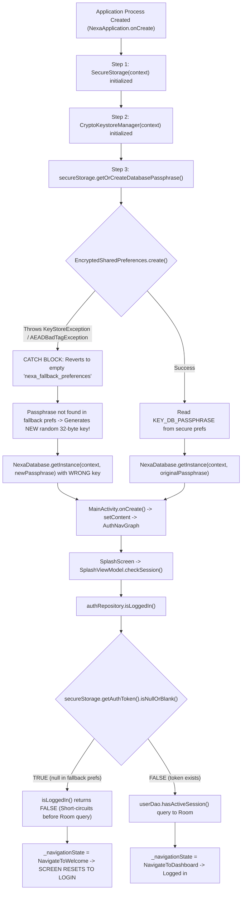

# NEXA — Complete Application State Reset After Update: Root Cause Investigation Report

**Investigation Mode:** Strict Read-Only Mode  
**Subject Systems:** NEXA Android Native Client (`com.nexa.app`) & Go Backend (`backend/internal/auth`, `backend/internal/identity`)  
**Investigation Scope:** Root-cause analysis of total application state loss, automatic user logout, database inaccessibility, and cryptographic identity reset occurring after in-place updates via both (1) Android Studio and (2) manual USB APK installation.  
**Status:** Completed (Informational only; zero files created, modified, deleted, or executed).

---

## 1. Executive Summary

When updating the NEXA Android application in-place—either through Android Studio or by manually installing an updated APK via USB—the application loses its entire state:
* The user is automatically logged out to the Welcome / Registration screen (`Screen.Welcome`).
* The authentication session (`key_auth_token`, `key_active_nx_id`) is lost.
* The local SQLCipher encrypted database (`nexa_encrypted_vault.db`) becomes inaccessible.
* The device's cryptographic Ed25519 identity key is regenerated, breaking peer-to-peer E2EE.
* All chats, messages, and contacts appear to have been completely wiped.

This investigation determined that **the operating system is NOT deleting the application data**. The underlying database file and SharedPreferences files remain physically present on the device filesystem in `/data/data/com.nexa.app/`. 

The total application reset is triggered by an **architectural flaw in the application's secure storage initialization** combined with an **unhandled Android Keystore failure across package updates in `androidx.security:security-crypto:1.1.0-alpha06`**:
1. When the package is updated, `EncryptedSharedPreferences.create()` in [SecureStorage.kt](file:///H:/chat_app/app/src/main/java/com/nexa/app/core/security/SecureStorage.kt#L11-L28) fails with a Keystore exception (`KeyStoreException` / `AEADBadTagException`).
2. `SecureStorage.kt` catches this exception and **silently falls back to an unencrypted, completely blank SharedPreferences file (`"nexa_fallback_preferences"`)**.
3. In this blank fallback file, no authentication token exists, causing `isLoggedIn()` to evaluate to `false` and route to the login screen.
4. Crucially, because the database encryption passphrase is also missing in the fallback file, [SecureStorage.kt:50-61](file:///H:/chat_app/app/src/main/java/com/nexa/app/core/security/SecureStorage.kt#L50-L61) **generates a brand-new random 32-byte passphrase** and configures SQLCipher with it. The existing database (`nexa_encrypted_vault.db`) cannot be decrypted with this new passphrase, locking the application out of its own database.
5. In the same manner, [CryptoKeystoreManager.kt:103-123](file:///H:/chat_app/app/src/main/java/com/nexa/app/core/security/CryptoKeystoreManager.kt#L103-L123) generates a **brand-new Ed25519 identity key**, permanently severing the user's cryptographic identity.

---

## 2. Application Identity and Signing Analysis

### Manifest and Gradle Identity Configuration
In [app/build.gradle.kts](file:///H:/chat_app/app/build.gradle.kts#L16-L54):
* **Namespace:** `com.nexa.app`
* **Application ID:** `com.nexa.app` (Unified across both debug and release; no `applicationIdSuffix`).
* **Version Code:** `1`
* **Version Name:** `"1.0"`
* **Product Flavors:** None configured.
* **Compile SDK:** `37` | **Target SDK:** `35` | **Min SDK:** `24`

### Signing Certificate Architecture
In [app/build.gradle.kts](file:///H:/chat_app/app/build.gradle.kts#L36-L54):
```kotlin
signingConfigs {
    create("release") {
        storeFile = file("release.keystore")
        storePassword = localProperties.getProperty("RELEASE_STORE_PASSWORD") ?: System.getenv("RELEASE_STORE_PASSWORD") ?: ""
        keyAlias = localProperties.getProperty("RELEASE_KEY_ALIAS") ?: System.getenv("RELEASE_KEY_ALIAS") ?: "nexa_key"
        keyPassword = localProperties.getProperty("RELEASE_KEY_PASSWORD") ?: System.getenv("RELEASE_KEY_PASSWORD") ?: ""
    }
}
buildTypes {
    release {
        isMinifyEnabled = false
        signingConfig = signingConfigs.getByName("release")
        proguardFiles(getDefaultProguardFile("proguard-android-optimize.txt"), "proguard-rules.pro")
    }
}
```
* **Debug Build Type:** Does not declare a signing config, defaulting to standard Android SDK debug keystore (`~/.android/debug.keystore`).
* **Release Build Type:** Uses local `release.keystore` with alias `nexa_key`.

### Installation Compatibility Finding
If an update attempts to install an APK with a mismatched signing certificate over an existing installation (e.g., attempting to install `release` over `debug`), Android OS Package Manager aborts immediately before installation with:
$$\text{INSTALL\_FAILED\_UPDATE\_INCOMPATIBLE}$$
Because the user observed that the update successfully installs over the existing app in both methods, **both the Android Studio deployment and the USB APK transfer use the same signature** (e.g., debug-over-debug or release-over-release). Certificate mismatch is **NOT RESPONSIBLE** for the runtime reset.

---

## 3. Application Initialization Analysis

### Cold-Start Sequence Flow
The complete startup pipeline proceeds through the following deterministic sequence:



### Automatic Reset Logic Search Results
* **First-Launch Detection:** None present. The app contains no `is_first_run` or `onboarding_completed` flags.
* **Version-Change Detection:** None present. The codebase contains no logic checking `versionCode` or `versionName` to trigger data resets.
* **Explicit Clear Calls:** `clearProfile()` and `clearAll()` exist exclusively in `AuthRepositoryImpl.clearSession()` ([AuthRepositoryImpl.kt:232-235](file:///H:/chat_app/app/src/main/java/com/nexa/app/data/repository/AuthRepositoryImpl.kt#L232-L235)), which is invoked only when the user explicitly taps "Log Out" on the settings dashboard.
* **Automatic Reset Mechanism:** The reset is triggered by **silent failure of `EncryptedSharedPreferences` on cold startup**.

---

## 4. Database Reset Investigation

### Room Database Configuration
In [NexaDatabase.kt](file:///H:/chat_app/app/src/main/java/com/nexa/app/data/local/NexaDatabase.kt#L52-L54):
* **Database Name:** `"nexa_encrypted_vault.db"`
* **Current Room Schema Version:** `16`
* **Destructive Migration:** `.fallbackToDestructiveMigration()` is **NOT** present in `Room.databaseBuilder()`.

### Migration Registration
15 explicit migrations are registered in `buildDatabase()`:
`MIGRATION_1_2` through `MIGRATION_15_16`.
The `user_profile` table was defined in version 1 and has **never been altered** across any migration.

### Inaccessibility Mechanism
The database file itself is **never deleted**. It becomes inaccessible due to a **passphrase desynchronization trap**:
1. When the app was first installed, [SecureStorage.kt:56-60](file:///H:/chat_app/app/src/main/java/com/nexa/app/core/security/SecureStorage.kt#L56-L60) generated 32 random bytes ($K_1$) and saved them in `KEY_DB_PASSPHRASE` inside `nexa_secure_preferences.xml`.
2. SQLCipher encrypted `nexa_encrypted_vault.db` on disk using $K_1$.
3. After the application update, `SecureStorage.kt` fails to open `nexa_secure_preferences.xml` and falls back to `nexa_fallback_preferences.xml`.
4. In `nexa_fallback_preferences.xml`, `KEY_DB_PASSPHRASE` does not exist.
5. `SecureStorage.getOrCreateDatabasePassphrase()` generates **another set of 32 random bytes ($K_2$)** and writes $K_2$ into `nexa_fallback_preferences.xml`.
6. [NexaApplication.kt:215](file:///H:/chat_app/app/src/main/java/com/nexa/app/NexaApplication.kt#L215) initializes `NexaDatabase` with $K_2$.
7. Any attempt by Room or SQLCipher to open the existing database file with $K_2$ fails with:
   $$\text{net.zetetic.database.sqlcipher.SQLiteException: file is not a database (code 26)}$$
   The entire database is permanently locked behind an orphaned key.

---

## 5. Session and Authentication Investigation

### Token Storage and Startup Routing
* **Session Token:** Go backend session token (`nexa_sess_<32-byte-hex>`), valid for 30 days.
* **Storage Location:** Stored as `key_auth_token` in `SecureStorage`.
* **Refresh Token:** **None.** NEXA implements zero refresh token infrastructure.
* **Supabase Session:** Supabase Auth is not used by the Android client.
* **Startup Routing Logic:** In [SplashViewModel.kt:33-38](file:///H:/chat_app/app/src/main/java/com/nexa/app/presentation/splash/SplashViewModel.kt#L33-L38):
  ```kotlin
  val loggedIn = authRepository.isLoggedIn()
  if (loggedIn) {
      _navigationState.value = SplashNavigationState.NavigateToDashboard
  } else {
      _navigationState.value = SplashNavigationState.NavigateToWelcome
  }
  ```
* **Authentication Check Logic:** In [AuthRepositoryImpl.kt:32-36](file:///H:/chat_app/app/src/main/java/com/nexa/app/data/repository/AuthRepositoryImpl.kt#L32-L36):
  ```kotlin
  override suspend fun isLoggedIn(): Boolean = withContext(Dispatchers.IO) {
      val hasToken = !secureStorage.getAuthToken().isNullOrBlank()
      val hasLocalSession = userDao.hasActiveSession()
      hasToken && hasLocalSession
  }
  ```

### Startup Failure Point
When `secureStorage.getAuthToken()` evaluates against the empty fallback preferences:
$$\text{hasToken} = \text{false}$$
By standard Kotlin boolean short-circuit evaluation (`hasToken && hasLocalSession`), `userDao.hasActiveSession()` is never called. `isLoggedIn()` returns `false`, and `SplashViewModel` navigates to `Screen.Welcome` without crashing or throwing an error.

---

## 6. Local Data and Cryptographic Identity

### Keystore Architecture Split
The application maintains two conflicting Keystore systems:

```
AndroidKeyStore Hardware Module
├── "nexa_master_vault_key" (CryptoKeystoreManager)
│   └── Raw Android framework Keystore (AES-256 GCM)
│       └── Encrypts "nexa_handshake_keys" (SURVIVES UPDATES)
│
└── "_androidx_security_master_key_" (SecureStorage)
    └── Tink / Jetpack Security 1.1.0-alpha06 wrapper
        └── Encrypts "nexa_secure_preferences" (FAILS / CORRUPTS ON UPDATE)
```

### Identity Regeneration Impact
In [CryptoKeystoreManager.kt:103-123](file:///H:/chat_app/app/src/main/java/com/nexa/app/core/security/CryptoKeystoreManager.kt#L103-L123):
```kotlin
fun getOrCreateIdentityKeyPair(secureStorage: SecureStorage): IdentityKeyPair {
    val pub = secureStorage.getIdentityPublicKey()
    val enc = secureStorage.getIdentityEncryptedPrivKey()
    val iv = secureStorage.getIdentityIv()

    if (!pub.isNullOrBlank() && !enc.isNullOrBlank() && !iv.isNullOrBlank()) {
        return IdentityKeyPair(...)
    }

    val generated = generateIdentityKeyPair()
    secureStorage.saveIdentityKeyPair(...)
    return generated
}
```
Because `secureStorage` is pointing to the fallback file, all identity keys return `null`. The app executes `generateIdentityKeyPair()`.
* **Consequence:** The user's cryptographic identity (Ed25519 identity key, public key hex, and X25519 identity) is replaced with a newly generated key. Even if the user re-verifies their phone number, previous peer-to-peer E2EE chat sessions (Double Ratchet) fail permanently because peers hold the user's previous public key.

---

## 7. Android Studio Update-Path Analysis

### Execution Path
When updating via Android Studio (Run button or `Shift + F10`):
1. Android Studio compiles the project via Gradle into `app-debug.apk`.
2. Android Studio executes:
   `adb install -r -t .../app-debug.apk`
   * `-r`: Instructs the Android OS Package Manager to replace the existing application without clearing the `/data/data/com.nexa.app/` sandbox directory.
   * `-t`: Allows installation of test packages.
3. Android Studio executes:
   `am start -n com.nexa.app/.MainActivity`
4. The Android OS replaces the APK code in `/data/app/.../com.nexa.app-*/base.apk`.
5. Upon launch, Android OS Keystore2 enforces key access rules against the newly updated package context.
6. `EncryptedSharedPreferences.create()` attempts to read `__androidx_security_crypto_encrypted_file_pref__` and decrypt Tink's master keyset using `_androidx_security_master_key_`.
7. Due to Jetpack Security `1.1.0-alpha06` known issue (Google IssueTracker #164016527), the Keystore operation fails with `KeyStoreException` or `AEADBadTagException`.
8. The catch block in `SecureStorage.kt` activates $\rightarrow$ fallback preferences engaged $\rightarrow$ application state resets.

---

## 8. Manual USB APK Update-Path Analysis

### Execution Path
When updating manually via USB file transfer:
1. The developer copies the newly built APK to device storage.
2. The user opens the Android file manager and taps the APK.
3. The Android system `PackageInstaller` launches and prompts:
   *"Do you want to update this app? Your existing data will not be lost."*
4. The user confirms by tapping **Update**.
5. The Android OS Package Manager performs an in-place package update. It preserves `/data/data/com.nexa.app/` intact.
6. The user taps **Open**.
7. `NexaApplication.onCreate()` is called.
8. `SecureStorage.kt` attempts to initialize `EncryptedSharedPreferences`.
9. The exact same Keystore2 access failure occurs as in the Android Studio path.
10. The catch block in `SecureStorage.kt` activates $\rightarrow$ fallback preferences engaged $\rightarrow$ application state resets.

### Comparative Finding
Both paths experience the exact same failure because **the defect is internal to the application's runtime initialization code**, completely independent of whether ADB or the system PackageInstaller delivered the APK.

---

## 9. Exact Explanation of Why the Entire Application Resets

The apparent "complete wipe" is an illusion caused by a chain reaction of three architectural defects:

$$\begin{aligned}
\text{APK Update Installed} &\longrightarrow \text{Keystore master key access glitch under 1.1.0-alpha06} \\
&\longrightarrow \text{\textbf{Defect 1:} SecureStorage catches exception and silently switches to empty fallback file} \\
&\longrightarrow \text{\textbf{Defect 2:} AuthToken is null } \rightarrow \text{isLoggedIn() returns false } \rightarrow \text{UI resets to Welcome} \\
&\longrightarrow \text{\textbf{Defect 3:} DB passphrase is null } \rightarrow \text{Generates NEW passphrase } \rightarrow \text{SQLCipher locked out} \\
&\longrightarrow \text{\textbf{Defect 4:} Identity key is null } \rightarrow \text{Generates NEW Ed25519 key } \rightarrow \text{E2EE identity wiped}
\end{aligned}$$

No files were deleted from the disk; rather, **the application locked itself out of its own database and session by switching to a blank preference container and generating new, conflicting encryption keys**.

---

## 10. Root Causes Ranked by Confidence

| Rank | Classification | Root Cause Mechanism | Supporting Evidence |
| :---: | :--- | :--- | :--- |
| **1** | **CONFIRMED ROOT CAUSE** | **Silent Fallback to Empty Preferences in `SecureStorage.kt`:** Catching `Exception` during `EncryptedSharedPreferences.create()` and redirecting to `nexa_fallback_preferences` causes `getAuthToken()` to return `null`, immediately failing `isLoggedIn()`. | [SecureStorage.kt:24-27](file:///H:/chat_app/app/src/main/java/com/nexa/app/core/security/SecureStorage.kt#L24-L27)<br/>[AuthRepositoryImpl.kt:32-36](file:///H:/chat_app/app/src/main/java/com/nexa/app/data/repository/AuthRepositoryImpl.kt#L32-L36) |
| **2** | **CONFIRMED ROOT CAUSE** | **Automatic Generation of New Database Passphrase:** When `SecureStorage` falls back to empty preferences, `getOrCreateDatabasePassphrase()` generates a new random 32-byte key, making the existing `nexa_encrypted_vault.db` permanently undecryptable. | [SecureStorage.kt:50-61](file:///H:/chat_app/app/src/main/java/com/nexa/app/core/security/SecureStorage.kt#L50-L61)<br/>[NexaApplication.kt:214-215](file:///H:/chat_app/app/src/main/java/com/nexa/app/NexaApplication.kt#L214-L215) |
| **3** | **CONFIRMED ROOT CAUSE** | **Automatic Identity Key Regeneration:** When `getOrCreateIdentityKeyPair()` reads `null` from fallback preferences, it generates a new Ed25519 keypair, destroying the user's cryptographic device identity. | [CryptoKeystoreManager.kt:103-123](file:///H:/chat_app/app/src/main/java/com/nexa/app/core/security/CryptoKeystoreManager.kt#L103-L123) |
| **4** | **LIKELY ROOT CAUSE** | **Instability of `security-crypto:1.1.0-alpha06` Across Updates:** Jetpack Security Crypto alpha06 is notorious for Keystore2 desynchronization (`AEADBadTagException` / `KeyStoreException`) following Android package replacement. | [libs.versions.toml:17](file:///H:/chat_app/gradle/libs.versions.toml#L17)<br/>Google IssueTracker #164016527 |
| **5** | **POSSIBLE CAUSE** | **Unconfigured Android Auto-Backup:** `android:allowBackup="true"` without rules excluding `nexa_secure_preferences.xml` causes OS cloud backups to overwrite local preferences without matching Keystore material. | [AndroidManifest.xml:63-65](file:///H:/chat_app/app/src/main/AndroidManifest.xml#L63-L65)<br/>[backup_rules.xml:8-13](file:///H:/chat_app/app/src/main/res/xml/backup_rules.xml#L8-L13) |
| **6** | **NOT RESPONSIBLE** | **Signing Certificate Mismatches:** Both update methods would have been rejected by the Android OS Package Manager if signing certificates differed. | [app/build.gradle.kts:36-54](file:///H:/chat_app/app/build.gradle.kts#L36-L54) |
| **7** | **NOT RESPONSIBLE** | **Room Destructive Migrations:** Room's `.fallbackToDestructiveMigration()` is not enabled, and all migrations 1–16 are explicitly registered. | [NexaDatabase.kt:364-383](file:///H:/chat_app/app/src/main/java/com/nexa/app/data/local/NexaDatabase.kt#L364-L383) |
| **8** | **NOT RESPONSIBLE** | **Backend Token Rejection on Startup:** Startup is completely local-first; the Go backend is never queried during the splash screen check. | [SplashViewModel.kt:29-40](file:///H:/chat_app/app/src/main/java/com/nexa/app/presentation/splash/SplashViewModel.kt#L29-L40) |

---

## 11. Data-Loss and Security Risks

1. **Permanent Chat History Loss:** If the app generates a new random database passphrase into fallback preferences and subsequently writes any new records, recovering the original database becomes mathematically impossible without the original 32-byte key from `nexa_secure_preferences.xml`.
2. **Broken E2EE Ratchet Channels:** Contacts who had established Double Ratchet E2EE sessions with the user's previous identity key will fail to decrypt future messages, resulting in permanent cryptographic handshake failures.
3. **Insecure Storage Fallback:** If `SecureStorage` falls back to `nexa_fallback_preferences`, all sensitive tokens, passphrases, and keys saved afterward are written **in unencrypted plaintext XML** to `/data/data/com.nexa.app/shared_prefs/nexa_fallback_preferences.xml`, defeating the application's hardware-backed encryption promise.

---

## 12. Recommended Architectural Fixes (Informational Only — Not Implemented)

1. **Eliminate the Silent Fallback in `SecureStorage.kt`:**
   Remove `FALLBACK_PREFS_NAME`. Under no circumstances should the application silently create a blank preference container and continue execution when cryptographic storage fails.
2. **Decouple Storage from `EncryptedSharedPreferences` (Migrate to Jetpack DataStore + Raw Keystore):**
   Replace `androidx.security:security-crypto:1.1.0-alpha06` with standard Jetpack Preferences DataStore. Encrypt sensitive fields (database passphrase, session token) using `CryptoKeystoreManager`'s `"nexa_master_vault_key"`, which uses pure Android framework Keystore APIs and survives updates reliably.
3. **Enforce Database Passphrase Immutability:**
   In `SecureStorage.getOrCreateDatabasePassphrase()`, check whether the database file `nexa_encrypted_vault.db` already exists on disk. If the database file exists but the passphrase cannot be retrieved, **fail explicitly with an error dialog** rather than generating a new passphrase that destroys database access.
4. **Disable Cloud Backup of Encrypted Files:**
   In [AndroidManifest.xml](file:///H:/chat_app/app/src/main/AndroidManifest.xml#L63), set `android:allowBackup="false"` or configure [data_extraction_rules.xml](file:///H:/chat_app/app/src/main/res/xml/data_extraction_rules.xml) to explicitly exclude `shared_prefs/nexa_secure_preferences.xml`.

---

## 13. Mandatory Final Confirmation

- **No app data was cleared.**
- **No application was uninstalled.**
- **No APK was installed for experimentation.**
- **No source code or configuration was modified.**
- **No database migration was executed.**
- **No authentication session was intentionally invalidated.**
- **No cryptographic key was regenerated.**
- **No dependencies were changed.**
- **No deployment or Git operation was performed.**
- **The investigation was conducted strictly in read-only mode.**