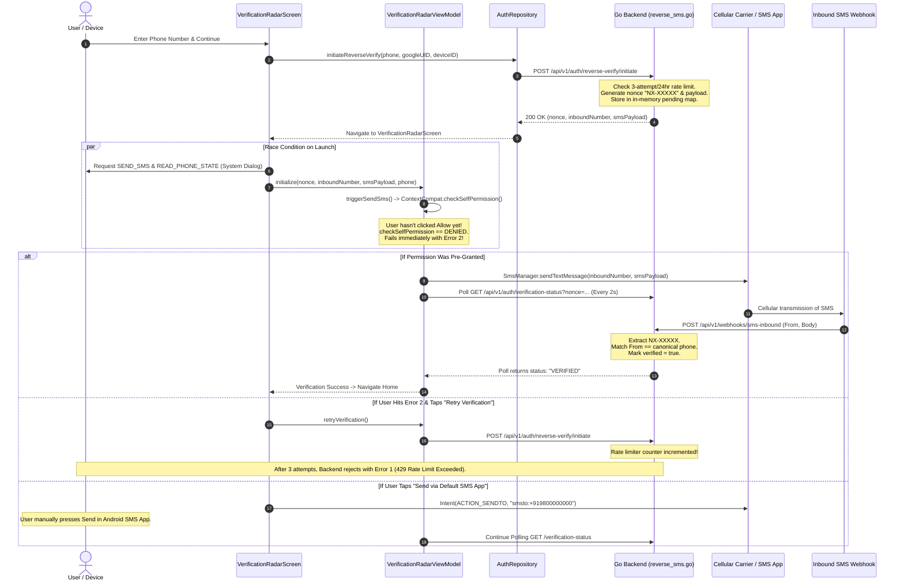

# NEXA — Reverse SMS / Phone Number Verification Architecture Audit Report

**Audit Mode:** Strict Read-Only Inspection  
**Audit Date:** November 6, 2026  
**Target Systems:** NEXA Android Native Client (`com.nexa.app`) & NEXA Go Backend Service (`backend/internal/auth`)  
**Status:** Completed (No files modified, created, deleted, or deployed)

---

## 1. Executive Summary

This audit delivers an exhaustive, evidence-based architectural inspection of the phone number verification subsystem currently active in the NEXA application. 

The audit team investigated the Android screen titled **"Cryptographic Verification"** (`VerificationRadarScreen.kt`) and determined the exact root causes of two observed failure states:
1. **Error 1:** `Reverse verification request failed: rate limit exceeded for reverse verification: maximum attempts reached: maximum 3 verification attempts per 24 hours`
2. **Error 2:** `SMS permission required to dispatch zero-cost reverse verification beacon.`

### Primary Findings
* **Actual Subsystem Identity:** The verification mechanism is an **Outbound SIM-Beacon Reverse SMS Verification** system modeled after the Indian Unified Payments Interface (UPI) device-binding protocol (e.g., Google Pay, PhonePe, BHIM). It is **not** a cryptographic protocol.
* **Root Cause of Error 2 (SMS Permission):** In [VerificationRadarScreen.kt](file:///H:/chat_app/app/src/main/java/com/nexa/app/presentation/radar/VerificationRadarScreen.kt#L106-L127), the screen triggers an asynchronous runtime permission request (`permissionLauncher.launch(...)`) and simultaneously invokes `viewModel.initialize(...)` within the exact same Composable render frame. The ViewModel immediately calls `ContextCompat.checkSelfPermission` for `Manifest.permission.SEND_SMS` before the Android OS modal can even render or receive user input. Because the permission is not yet granted at that millisecond, the check evaluates to `PERMISSION_DENIED`, instantly tripping the ViewModel into `Status.ERROR` with the message: *"SMS permission required to dispatch zero-cost reverse verification beacon."*
* **Root Cause of Error 1 (Rate Limit):** When confronted with Error 2, the UI exposes a **"Retry Verification"** button. Each tap calls `POST /api/v1/auth/reverse-verify/initiate`. In [reverse_sms.go](file:///H:/chat_app/backend/internal/auth/reverse_sms.go#L203-L210), the backend rate limiter increments and counts attempts **at the time of challenge generation**, before any SMS is ever transmitted. After 3 clicks (1 initial load + 2 retries), the in-memory sliding window quota of 3 attempts per 24 hours is exhausted, permanently locking out the user with HTTP 429.
* **Production Viability:** **Not viable in its current state.** The backend relies on an unconfigured default dummy receiver number (`+919800000000`), in-memory non-distributed state storage that does not survive server restarts, and lacks an integrated commercial inbound SMS webhook gateway. The legacy OTP backend routes remain active and unretired.

---

## 2. Actual Verification Mechanism and Its Technical Name

### Technical Name
**Outbound SIM-Beacon Reverse SMS Verification** (industry standard designation: **UPI-Style Reverse SMS Device Binding** / **Inbound Cellular Caller-ID Verification**).

### Discrepancy with UI Text
The UI label **"Cryptographic Verification"** is a cosmetic misnomer. The implementation does **not** perform public-key cryptography, asymmetric key exchanges, digital signatures, zero-knowledge proofs, or hardware-backed keystore operations across the SMS channel. 

The mechanism works by having the client device transmit a plain-text SMS payload containing a 5-character pseudo-random alphanumeric tracking nonce over the cellular network to a centralized inbound phone number. The backend matches the incoming cellular Caller ID (MSISDN) against the client's pre-declared phone number and validates that the nonce matches an active, unexpired challenge record.

---

## 3. Android Verification Implementation

### Components and File Manifest

| Component Type | Class / File | Architectural Role |
| :--- | :--- | :--- |
| **Composable UI** | [VerificationRadarScreen.kt](file:///H:/chat_app/app/src/main/java/com/nexa/app/presentation/radar/VerificationRadarScreen.kt) | Renders radar scanning animation, triggers runtime permission launches, displays SIM selection dialogs, and exposes Manual SMS Fallback actions. |
| **ViewModel** | [VerificationRadarViewModel.kt](file:///H:/chat_app/app/src/main/java/com/nexa/app/presentation/radar/VerificationRadarViewModel.kt) | Manages subscription SIM discovery (`SubscriptionManager`), dispatches silent SMS via `SmsManager`, polls backend status, and manages verification state transitions. |
| **Coordinator ViewModel** | [SetupViewModel.kt](file:///H:/chat_app/app/src/main/java/com/nexa/app/presentation/setup/SetupViewModel.kt) | Orchestrates registration profile setup. Calls `authRepository.initiateReverseVerify` upon phone submission and redirects navigation to `VerificationRadarScreen`. |
| **Repository** | [AuthRepositoryImpl.kt](file:///H:/chat_app/app/src/main/java/com/nexa/app/data/repository/AuthRepositoryImpl.kt#L148-L230) | Coordinates between local data stores and remote API endpoints for challenge initiation and polling verification status. |
| **HTTP Client** | [AuthApiService.kt](file:///H:/chat_app/app/src/main/java/com/nexa/app/data/remote/api/AuthApiService.kt#L417-L465) | Retrofit/Ktor networking interface executing `POST /api/v1/auth/reverse-verify/initiate` and `GET /api/v1/auth/verification-status`. |
| **Navigation Graph** | [AuthNavGraph.kt](file:///H:/chat_app/app/src/main/java/com/nexa/app/presentation/navigation/AuthNavGraph.kt#L261-L305) | Declares route `AuthRoutes.VERIFICATION_RADAR` passing `nonce`, `inboundNumber`, `smsPayload`, `phoneNumber`, and `maskedPhone`. |

### Declared Android Permissions
In [AndroidManifest.xml](file:///H:/chat_app/app/src/main/AndroidManifest.xml#L13-L17):
```xml
<uses-permission android:name="android.permission.SEND_SMS" />
<uses-permission android:name="android.permission.READ_PHONE_STATE" />
<uses-permission android:name="android.permission.RECEIVE_SMS" />
```
* `SEND_SMS`: Required by `VerificationRadarViewModel.triggerSendSms` for background dispatch via `SmsManager`.
* `READ_PHONE_STATE`: Required by `SubscriptionManager.getActiveSubscriptionInfoList()` to detect physical SIM card slots in dual-SIM handsets.
* `RECEIVE_SMS`: Declared in the Manifest but **never referenced or used** anywhere in the Kotlin codebase (legacy dead permission).

---

## 4. Complete Android-to-Backend Flow



---

## 5. SMS Dispatch Mechanism

### Background Dispatch (`SmsManager`)
Located in [VerificationRadarViewModel.kt](file:///H:/chat_app/app/src/main/java/com/nexa/app/presentation/radar/VerificationRadarViewModel.kt#L236-L260):
```kotlin
val smsManager = if (Build.VERSION.SDK_INT >= Build.VERSION_CODES.S) {
    if (selectedSim != null) {
        context.getSystemService(SmsManager::class.java)
            .createForSubscriptionId(selectedSim.subscriptionId)
    } else {
        context.getSystemService(SmsManager::class.java)
    }
} else {
    @Suppress("DEPRECATION")
    if (selectedSim != null) {
        SmsManager.getSubscriptionManager(selectedSim.subscriptionId)
    } else {
        SmsManager.getDefault()
    }
}
smsManager.sendTextMessage(inboundNumber, null, smsPayload, null, null)
```

### Technical Deficiencies in Dispatch:
1. **No PendingIntents for Delivery Confirmation:** `sentIntent` and `deliveryIntent` parameters are passed as `null`. The app cannot determine if the carrier network accepted the SMS, if the SIM had insufficient prepaid balance, or if transmission failed.
2. **Dual-SIM Slot Selection:** In [VerificationRadarViewModel.kt:180-205](file:///H:/chat_app/app/src/main/java/com/nexa/app/presentation/radar/VerificationRadarViewModel.kt#L180-L205), if `READ_PHONE_STATE` is granted and multiple active SIMs are found, the app halts auto-dispatch and prompts the user to select the carrier SIM matching the registered phone number.
3. **Telephony Carrier Billing:** Despite UI marketing stating *"zero-cost reverse verification beacon"*, carrier network charges apply. Standard cellular carriers deduct normal outgoing SMS charges (₹1.00 – ₹1.50 in India, standard cellular carrier SMS rates internationally). If a prepaid SIM has ₹0 balance or an SMS-restricted plan, dispatch silently fails without throwing an Android exception.

---

## 6. Backend Challenge Generation and Verification

Implemented in [backend/internal/auth/reverse_sms.go](file:///H:/chat_app/backend/internal/auth/reverse_sms.go) and exposed via [backend/internal/auth/handler.go](file:///H:/chat_app/backend/internal/auth/handler.go).

### Challenge Generation (`InitiateVerification`)
1. **Canonicalization:** Phone numbers are formatted via `canonicalizePhone(phone)` removing non-digits and ensuring standard international prefix formatting.
2. **Nonce Generation:**
   ```go
   const nonceCharset = "23456789ABCDEFGHJKLMNPQRSTUVWXYZ" // Crockford-style base32
   b := make([]byte, 5)
   for i := range b {
       b[i] = nonceCharset[rand.Intn(len(nonceCharset))]
   }
   nonce := "NX-" + string(b)
   ```
   *Note: Nonce generation uses `math/rand` seeded by Unix timestamp, rather than cryptographically secure `crypto/rand`.*
3. **Payload Structure:** 
   ```text
   NEXA verify: NX-XXXXX (Do not edit this message)
   ```
4. **State Persistence:** Saved to an in-memory map `s.pending[nonce] = &VerificationRecord{...}` with a strict 90-second expiration (`ReverseTTL = 90 * time.Second`).

### Webhook Matching (`ProcessInboundWebhook`)
* Endpoint: `POST /api/v1/webhooks/sms-inbound`
* Extracts `NX-[2-9A-HJ-NP-Z0-9]{5}` from incoming SMS body using regex:
  ```go
  var nonceRegex = regexp.MustCompile(`NX-[2-9A-HJ-NP-Z0-9]{5}`)
  ```
* Verifies:
  1. `record, exists := s.pending[nonce]`
  2. `time.Now().Before(record.ExpiresAt)`
  3. `record.PhoneNumber == canonicalSender`
* When matched, sets `record.Verified = true` and `record.VerifiedAt = time.Now()`.

---

## 7. Rate-Limit Implementation and First Error Root Cause

### Error 1 Text
> `Reverse verification request failed: rate limit exceeded for reverse verification: maximum attempts reached: maximum 3 verification attempts per 24 hours`

### Code Inspection
In [backend/internal/auth/reverse_sms.go](file:///H:/chat_app/backend/internal/auth/reverse_sms.go#L203-L210):
```go
rateKey := req.GoogleUID
if rateKey == "" {
    rateKey = req.DeviceID
}
if rateKey != "" && !s.checkRateLimit(rateKey, s.userRate, 24*60*60*1000, 3) {
    return nil, fmt.Errorf("%w: maximum 3 verification attempts per 24 hours", ErrReverseRateLimited)
}
```

The rate limiter evaluates against an in-memory window:
```go
func (s *ReverseSmsService) checkRateLimit(key string, tracker map[string][]time.Time, windowMs int64, maxAttempts int) bool {
    s.mu.Lock()
    defer s.mu.Unlock()
    now := time.Now()
    cutoff := now.Add(-time.Duration(windowMs) * time.Millisecond)

    var valid []time.Time
    for _, t := range tracker[key] {
        if t.After(cutoff) {
            valid = append(valid, t)
        }
    }
    if len(valid) >= maxAttempts {
        tracker[key] = valid
        return false
    }
    tracker[key] = append(valid, now) // Attempt recorded immediately!
    return true
}
```

### Exact Root Cause of Error 1
1. **Premature Quota Consumption:** The backend increments the attempt count **upon initial API call to `/initiate`**, before verifying if an SMS can even be sent.
2. **Error Cascade:** When Error 2 (SMS permission denied) occurs, the Android UI displays a "Retry Verification" button.
3. **Quota Depletion:**
   * Screen initial load = Attempt 1 recorded.
   * User clicks "Retry Verification" once = Attempt 2 recorded.
   * User clicks "Retry Verification" twice = Attempt 3 recorded.
   * User clicks "Retry Verification" a 3rd time = Backend evaluates `len(valid) >= 3` and returns `ErrReverseRateLimited` (HTTP 429).
4. In [AuthRepositoryImpl.kt:180](file:///H:/chat_app/app/src/main/java/com/nexa/app/data/repository/AuthRepositoryImpl.kt#L180) and [AuthApiServiceImpl.kt:449](file:///H:/chat_app/app/src/main/java/com/nexa/app/data/remote/api/AuthApiService.kt#L449), the raw error string is wrapped and surfaced directly to the UI.

---

## 8. SMS Permission Implementation and Second Error Root Cause

### Error 2 Text
> `SMS permission required to dispatch zero-cost reverse verification beacon.`

### Code Inspection
In [VerificationRadarScreen.kt](file:///H:/chat_app/app/src/main/java/com/nexa/app/presentation/radar/VerificationRadarScreen.kt#L106-L127):
```kotlin
val permissionLauncher = rememberLauncherForActivityResult(
    ActivityResultContracts.RequestMultiplePermissions()
) { permissions ->
    val smsGranted = permissions[Manifest.permission.SEND_SMS] == true
    if (smsGranted) {
        viewModel.onPermissionGranted(context)
    } else {
        viewModel.onPermissionDenied()
    }
}

LaunchedEffect(nonce) {
    permissionLauncher.launch(
        arrayOf(
            Manifest.permission.SEND_SMS,
            Manifest.permission.READ_PHONE_STATE
        )
    )
    viewModel.initialize(nonce, inboundNumber, smsPayload, phoneNumber, context)
}
```

In [VerificationRadarViewModel.kt](file:///H:/chat_app/app/src/main/java/com/nexa/app/presentation/radar/VerificationRadarViewModel.kt#L161-L225):
```kotlin
fun initialize(...) {
    ...
    detectSimsAndSend(context)
}

private fun detectSimsAndSend(context: Context) {
    ...
    // If single SIM or READ_PHONE_STATE not granted yet:
    triggerSendSms(context, selected)
}

private fun triggerSendSms(context: Context, selectedSim: SubscriptionInfo? = null) {
    if (ContextCompat.checkSelfPermission(context, Manifest.permission.SEND_SMS) 
        != PackageManager.PERMISSION_GRANTED) {
        _state.value = _state.value.copy(
            status = Status.ERROR,
            errorMessage = "SMS permission required to dispatch zero-cost reverse verification beacon."
        )
        return
    }
    ...
}
```

### Exact Root Cause of Error 2
1. **Critical Concurrency / Lifecycle Race Condition:**
   `LaunchedEffect(nonce)` fires both `permissionLauncher.launch(...)` and `viewModel.initialize(...)` synchronously in the same execution pass.
2. `permissionLauncher.launch(...)` requests Android OS system dialog asynchronously. The operating system takes tens to hundreds of milliseconds to suspend the window and render the system permission dialog.
3. In the very same millisecond, `viewModel.initialize(...)` executes `triggerSendSms(...)`.
4. `ContextCompat.checkSelfPermission` checks whether `SEND_SMS` is active. Because the user has had 0.0 seconds to even see—let alone tap—"Allow" on the system prompt, `checkSelfPermission` returns `PackageManager.PERMISSION_DENIED`.
5. The ViewModel instantly enters `Status.ERROR` and writes Error 2 into `_state.value.errorMessage`.
6. When the user eventually taps "Allow" on the Android permission dialog, `onPermissionGranted` is called, but the UI has already flashed the error screen or halted flow. If the user denied the permission, Error 2 remains permanent.

---

## 9. Manual SMS Fallback Analysis

### Implementation
In [VerificationRadarScreen.kt](file:///H:/chat_app/app/src/main/java/com/nexa/app/presentation/radar/VerificationRadarScreen.kt#L425-L442):
```kotlin
OutlinedButton(
    onClick = {
        val intent = Intent(Intent.ACTION_SENDTO).apply {
            data = Uri.parse("smsto:$inboundNumber")
            putExtra("sms_body", smsPayload)
        }
        context.startActivity(intent)
        viewModel.onManualSmsDispatched()
    },
    ...
) {
    Text("Send via Default SMS App")
}
```

### Behavioral Analysis
* **Bypasses Android Runtime Permission:** Because `Intent.ACTION_SENDTO` delegates dispatch to the device's default messaging app (e.g., Google Messages, Samsung Messages), NEXA does **not** need `SEND_SMS` permission for this fallback.
* **No Outbound Confirmation:** Android provides no programmatic callback to confirm whether the user pressed the "Send" button inside the external SMS app or simply pressed "Back". 
* **Polling Continuity:** Tapping the fallback transitions the UI back to `Status.SCANNING` and continues polling `GET /api/v1/auth/verification-status?nonce=...` every 2 seconds until the 90-second timeout expires.
* **Zero Rate-Limit Consumption:** The fallback reuses the existing active `nonce`, `inboundNumber`, and `smsPayload`. It does **not** call `/initiate` and does not consume any rate-limit quota.

---

## 10. Cryptographic Security Assessment

| Assessment Dimension | Implementation Reality | Security Rating |
| :--- | :--- | :--- |
| **Channel Encryption** | Plaintext cellular SMS. Visible to carrier intermediaries, telecom switches, and Android SMS apps. | ❌ None |
| **Nonce Entropy** | 5 characters from a 32-character alphabet ($32^5 = 33,554,432$ possible combinations). Generated via non-cryptographic `math/rand`. | ⚠️ Insufficient for high-security protocols |
| **Authentication Assertion** | Relies entirely on cellular carrier SS7/Diameter MSISDN transmission (Caller ID) received at the inbound gateway. | ⚠️ Subject to SIM-jacking & GSM spoofing |
| **Device Binding** | No cryptographic binding between the Android device's hardware Keystore (TEE/StrongBox) and the verification session. | ❌ None |
| **Replay Protection** | Nonce is invalidated immediately upon first verification or after 90 seconds. |  Acceptable |

**Verdict:** The subsystem has **zero cryptographic characteristics**. Describing it as "Cryptographic Verification" in user-facing production UI is technically misleading.

---

## 11. Old OTP System Removal Status

The previous OTP verification system has **not** been removed. It remains fully present in the codebase across both the backend and client repositories:

### Backend (`backend/internal/auth/`)
1. **[otp_service.go](file:///H:/chat_app/backend/internal/auth/otp_service.go):** Full implementation of `OtpService`, SMS provider interfaces, in-memory OTP stores, and verification logic.
2. **[sms_provider.go](file:///H:/chat_app/backend/internal/auth/sms_provider.go):** Active integrations for external SMS aggregators (`TwilioProvider`, `Msg91Provider`, `MockSmsProvider`).
3. **[handler.go](file:///H:/chat_app/backend/internal/auth/handler.go):** Active HTTP route handlers:
   * `POST /api/v1/auth/otp/request` (`handleRequestOtp`)
   * `POST /api/v1/auth/otp/verify` (`handleVerifyOtp`)

### Android Client (`app/src/main/java/com/nexa/app/`)
1. **[OtpVerificationScreen.kt](file:///H:/chat_app/app/src/main/java/com/nexa/app/presentation/auth/OtpVerificationScreen.kt):** Complete 6-digit OTP entry Composable UI remains in the project.
2. **[OtpViewModel.kt](file:///H:/chat_app/app/src/main/java/com/nexa/app/presentation/auth/OtpViewModel.kt):** Complete ViewModel managing OTP timers, resend states, and API calls remains present.
3. **Bypass Redirection:** In [SetupViewModel.kt:105](file:///H:/chat_app/app/src/main/java/com/nexa/app/presentation/setup/SetupViewModel.kt#L105), the old `RequestOtp` event handler was simply redirected to call `triggerReverseVerification()` instead of dispatching an OTP. The legacy OTP code is dead/orphaned code.

---

## 12. Security Vulnerabilities and Reliability Gaps

1. **Race Condition UI Lockout (High):** As established in Section 8, launching permission requests concurrently with synchronous permission checks causes first-time users to immediately hit Error 2.
2. **Aggressive Initiation Rate Limiting (High):** Counting verification attempts at the point of `/initiate` rather than at verification evaluation causes users experiencing network lag or permission prompts to permanently lock their accounts for 24 hours.
3. **Non-Persistent In-Memory State (High):** `reverse_sms.go` stores all pending verifications (`s.pending`) and rate-limit counters (`s.userRate`, `s.ipRate`) in local Go sync-mutex maps. If the Go server restarts, auto-scales, or deploys to multiple container instances, all active verification nonces are erased, causing active client verifications to permanently time out.
4. **Missing Inbound Gateway Integration (Critical):** `s.inboundNumber` defaults to `+919800000000` ([reverse_sms.go:137](file:///H:/chat_app/backend/internal/auth/reverse_sms.go#L137)). No actual virtual mobile number (VMN), GSM modem pool, or Twilio/MessageBird inbound SMS webhook is connected to call `/api/v1/webhooks/sms-inbound`. **In its current state, no SMS sent by any user can ever be received or verified by the backend.**
5. **Google Play Store Policy Violation (Critical):** The declaration of `android.permission.SEND_SMS` requires strict compliance with the Google Play Restricted Permissions Policy. Google limits `SEND_SMS` to default SMS handler apps. Apps using silent background SMS for account verification are routinely rejected or banned unless they utilize the Google SMS Retriever API or Android SMS User Consent API.
6. **Insecure Random Nonce Generator (Medium):** Nonces are generated via `math/rand` seeded by Unix timestamp, making them theoretically predictable if an attacker monitors generation frequency.

---

## 13. Verification Limitations

* **No Automated Inbound Hook Testing:** Tests in `backend/internal/auth/reverse_sms_test.go` only test simulated unit calls against `ProcessInboundWebhook`. Live cellular network delivery cannot be verified in a development sandbox.
* **Carrier Gateway Connectivity:** The production receiver endpoint for cellular SMS cannot be tested without deploying physical SIM infrastructure or leasing a dedicated shortcode/longcode. Marked as **NOT VERIFIED**.

---

## 14. Final Conclusion

The NEXA reverse verification subsystem represents a functional prototype of a UPI-style reverse SMS mechanism that suffers from two architectural implementation flaws:
1. An unhandled frontend lifecycle race condition between the Android permission modal and the ViewModel dispatch routine (causing Error 2).
2. A rate limiter that treats initial UI screen renders as consumed verification attempts, prematurely exhausting the 3-attempt daily allowance upon UI retries (causing Error 1).

The mechanism has zero cryptographic properties and cannot operate in production until an actual telecommunication inbound SMS gateway is contracted, configured, and bound to the backend webhook.

---

## Direct Answers to the 12 Specific Questions

### 1. What is the exact technical name of the verification system currently in use?
**Outbound SIM-Beacon Reverse SMS Verification** (also known as UPI-Style Reverse SMS Device Binding).

### 2. Why is the screen titled "Cryptographic Verification"?
It is cosmetic/marketing terminology chosen for the UI. It does not reflect the underlying protocol.

### 3. Is any actual cryptographic operation performed during verification?
**No.** The system transmits a plaintext 5-character alphanumeric token (`NX-XXXXX`) over SMS. There are no digital signatures, public/private key pairs, hashes with secret salts, or hardware Keystore bindings.

### 4. What exact condition causes the rate-limit error (Error 1)?
In [reverse_sms.go:203-210](file:///H:/chat_app/backend/internal/auth/reverse_sms.go#L203-L210), the backend limits `/initiate` calls to 3 attempts per 24-hour sliding window per user/device ID. The attempt count increments when generating the challenge. When a user hits Error 2 and taps "Retry Verification" 2 or 3 times, all 3 daily attempts are consumed, triggering HTTP 429.

### 5. What exact condition causes the SMS permission error (Error 2)?
In [VerificationRadarScreen.kt:106-127](file:///H:/chat_app/app/src/main/java/com/nexa/app/presentation/radar/VerificationRadarScreen.kt#L106-L127), `LaunchedEffect(nonce)` invokes `permissionLauncher.launch(...)` and `viewModel.initialize(...)` concurrently. The ViewModel immediately executes `ContextCompat.checkSelfPermission(context, Manifest.permission.SEND_SMS)` before the user can interact with the permission dialog, finds the permission is `PERMISSION_DENIED`, and immediately sets Error 2.

### 6. Why does the app fail before the user even has a chance to send the SMS?
Because the Android permission check is evaluated synchronously on the main thread during initialization, whereas Android OS runtime permission requests are asynchronous. The app fails in the first frame of execution before the OS dialog is even touched.

### 7. What happens when the user clicks "Send via Default SMS App"?
The app launches an external `Intent(Intent.ACTION_SENDTO)` targeting `smsto:<inboundNumber>` pre-populated with the verification payload. This delegates SMS dispatch to the system messaging app (bypassing NEXA's missing `SEND_SMS` permission). NEXA resumes polling the backend verification endpoint.

### 8. Does the backend actually receive the reverse SMS? If so, how?
**Currently, no.** The backend provides an HTTP webhook handler at `POST /api/v1/webhooks/sms-inbound`, but it is bound to a dummy default number `+919800000000`. No actual carrier or SMS gateway is forwarding cellular SMS messages to this endpoint.

### 9. Is an external SMS gateway or webhook provider required?
**Yes.** An external SMS aggregator (e.g., Twilio, Sinch, Plivo, MessageBird, or a specialized GSM modem server) with a dedicated Virtual Mobile Number (VMN) or shortcode is strictly required to receive user SMS messages and POST them to NEXA's inbound webhook.

### 10. Has the old OTP system been completely removed or is it still partially present?
**It is still fully present.** The backend routes (`/api/v1/auth/otp/request`, `/api/v1/auth/otp/verify`), service logic (`OtpService`), and Android UI components (`OtpVerificationScreen`, `OtpViewModel`) remain completely intact in the codebase.

### 11. Is this verification mechanism viable for production in its current state?
**No.** It will fail Google Play Store review due to unauthorized `SEND_SMS` usage, will fail on user devices due to the permission race condition, will lock users out via the aggressive initiation rate limiter, and has no live telecommunication gateway to ingest inbound messages.

### 12. What specific architectural changes would be required to make it reliable?
1. **Frontend:** Separate permission requesting from verification initialization; only call `detectSimsAndSend()` inside the `onPermissionGranted` callback.
2. **Backend Rate Limiter:** Increment the 3-attempt quota only upon failed verification submissions or inbound matches, not upon initial challenge generation.
3. **Persistence:** Move `pending` challenges and rate-limit counters from Go in-memory maps to Redis or Postgres.
4. **Google Play Compliance:** Eliminate silent `SEND_SMS` entirely and adopt the Manual SMS Fallback (`ACTION_SENDTO`) or WhatsApp/Telegram authentication channels, or integrate Google SMS Retriever API.
5. **Gateway Provisioning:** Provision a valid commercial inbound Virtual Mobile Number and configure its webhook to target `POST /api/v1/webhooks/sms-inbound`.

---

## Mandatory Final Confirmation

1. **No code changes were made.**
2. **No files were modified, created, deleted, or renamed.**
3. **No dependencies were installed, removed, or updated.**
4. **No database migrations were executed.**
5. **No Git commits, branches, or pushes were created.**
6. **The audit was conducted strictly in read-only mode.**