# NEXA — Master System Architecture Blueprint
## 08. Complete System Data Flow & Sequence Diagrams

---

### 1. Architectural Diagram Index

This document provides complete, rigorous Mermaid technical diagrams modeling every primary data flow, state transition, and cryptographic exchange across the NEXA ecosystem:

1. **Diagram 1:** End-to-End User Registration & Cryptographic Onboarding Flow
2. **Diagram 2:** 1-to-1 Real-Time E2EE Messaging Flow (Online Recipient)
3. **Diagram 3:** 1-to-1 Real-Time E2EE Messaging Flow (Offline Recipient with Redis Buffer & FCM)
4. **Diagram 4:** Multi-Transport Fallback Routing Engine
5. **Diagram 5:** Module 3 Encrypted SMS Fallback (NX1 Protocol & Reassembly)
6. **Diagram 6:** Direct P2P File Transfer Signaling & WebRTC DataChannel Streaming
7. **Diagram 7:** Client-Side Dual-Gate Malware Scanning & Quarantine Pipeline
8. **Diagram 8:** Group Messaging Sender Key Exchange & Tree-KDF Distribution
9. **Diagram 9:** Ephemeral Status Updates Flow (Publishing & View Receipts)
10. **Diagram 10:** Encrypted Google Drive Backup & Exact-State Restoration Flow
11. **Diagram 11:** Existing User Login & Multi-Device Session Migration Flow
12. **Diagram 12:** WebSocket Ed25519 Challenge-Response Authentication Handshake
13. **Diagram 13:** Pairwise Rotating Routing Token Generation & Ingestion
14. **Diagram 14:** Complete Macro System-Wide Data Flow & Subsystem Interaction

---

### Diagram 1: End-to-End User Registration & Onboarding Flow

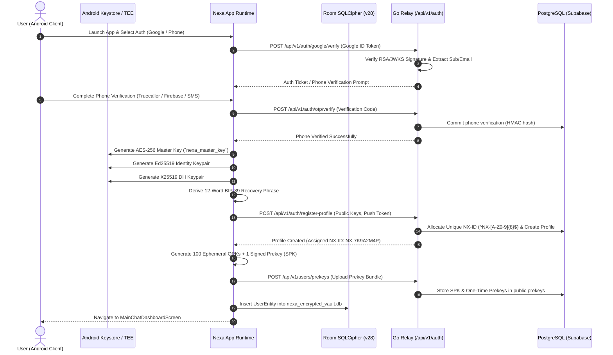

---

### Diagram 2: 1-to-1 Real-Time E2EE Messaging Flow (Online Recipient)

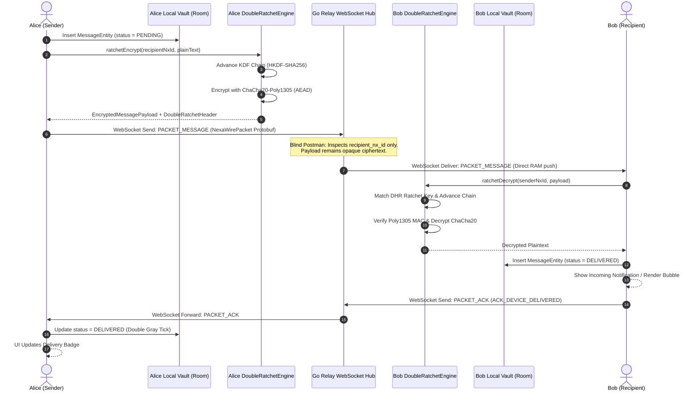

---

### Diagram 3: 1-to-1 Real-Time E2EE Messaging Flow (Offline Recipient with Redis Buffer & FCM)

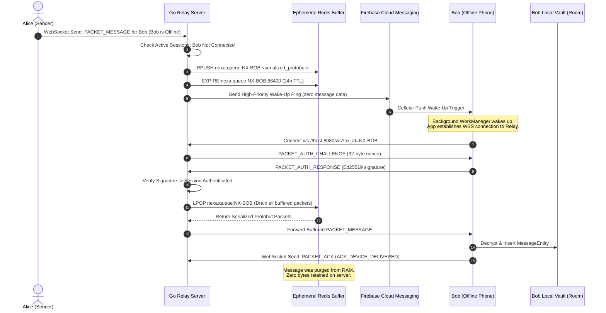

---

### Diagram 4: Multi-Transport Fallback Routing Engine

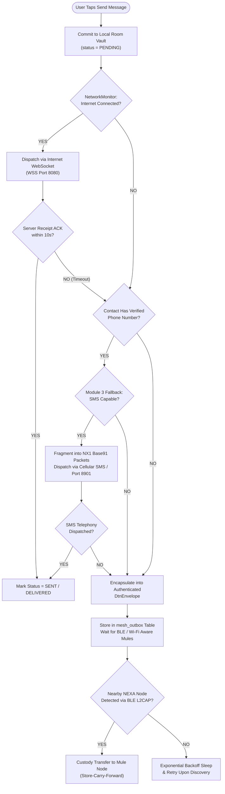

---

### Diagram 5: Module 3 Encrypted SMS Fallback (NX1 Protocol & Reassembly)

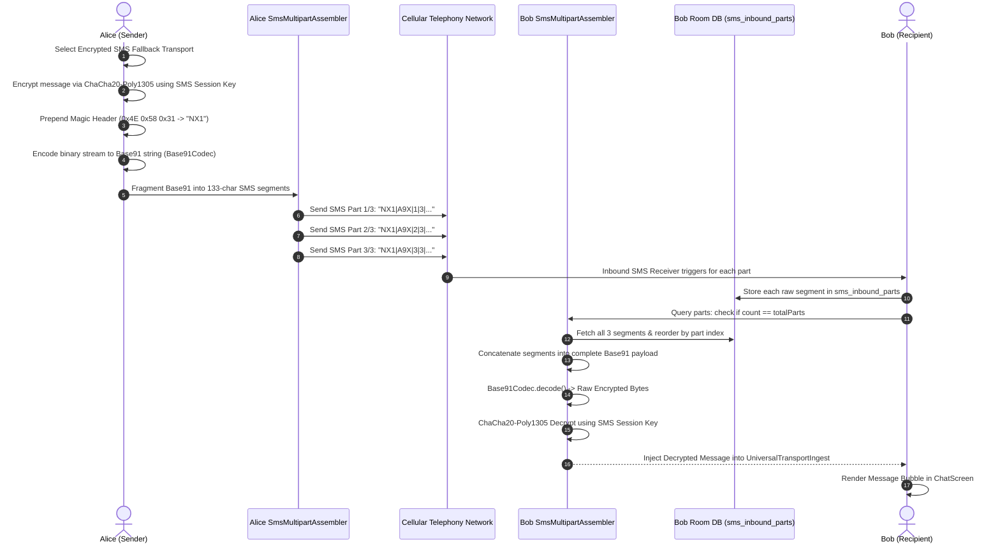

---

### Diagram 6: Direct P2P File Transfer Signaling & WebRTC DataChannel Streaming

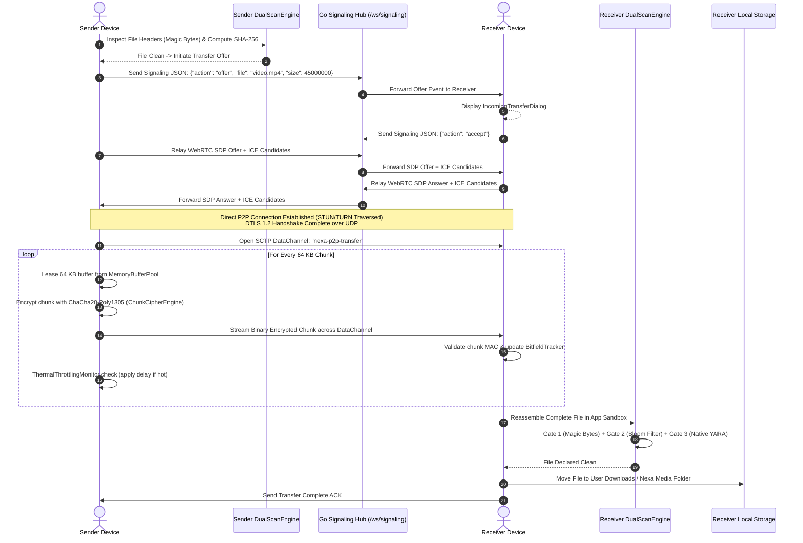

---

### Diagram 7: Client-Side Dual-Gate Malware Scanning & Quarantine Pipeline

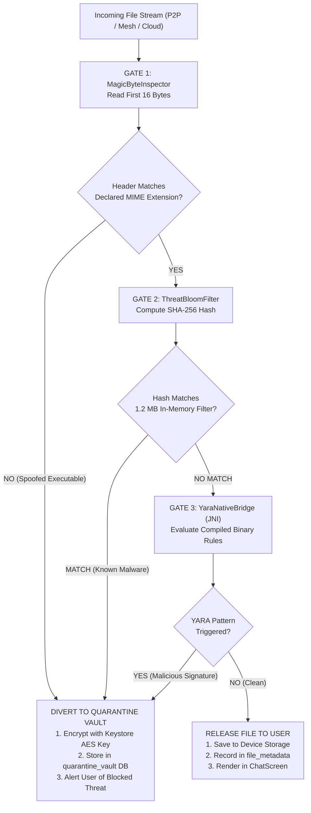

---

### Diagram 8: Group Messaging Sender Key Exchange & Message Distribution

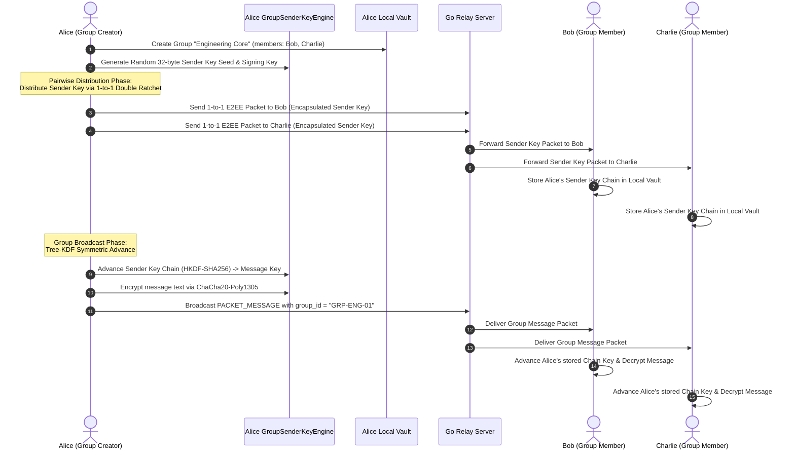

---

### Diagram 9: Ephemeral Status Updates Flow (Publishing & View Receipts)

```mermaid
sequenceDiagram
    autonumber
    actor Author as Status Author
    participant LocalDB as Author Local Vault
    participant Relay as Go Relay Hub
    actor Viewer as Status Viewer
    participant ViewerDB as Viewer Local Vault

    Author->>Author: Record Video / Capture Photo in StatusScreen
    Author->>Author: Sanitize EXIF & Transcode via Media3 Transformer
    Author->>LocalDB: Insert StatusUpdateEntity (expiresAt = now + 24h)
    Author->>Relay: Broadcast Ephemeral Status Metadata Packet to Contacts
    Relay->>Viewer: Push Status Notification Packet
    Viewer->>Viewer: Open NexaSequentialStoryViewer
    Viewer->>Author: Direct P2P Stream / Download Ephemeral Status Media
    Viewer->>ViewerDB: Cache Story Media & Record Local View
    Viewer->>Relay: Send Authenticated View Receipt Packet
    Relay->>Author: Deliver View Receipt Packet
    Author->>LocalDB: Insert Record into status_views Table
    Author->>Author: Author views Viewer list in StatusViewersSheet
    Note over Author,ViewerDB: 24 Hours Elapses:<br/>Background WorkManager executes cleanup:<br/>DELETE FROM status_updates WHERE expiresAt < now;<br/>Media files securely scrubbed from storage.
```

---

### Diagram 10: Encrypted Google Drive Backup & Exact-State Restoration Flow

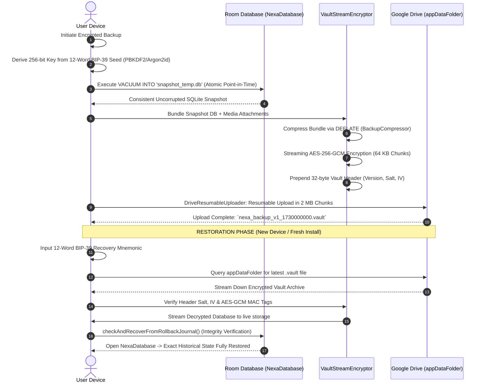

---

### Diagram 11: Existing User Login & Multi-Device Session Migration Flow

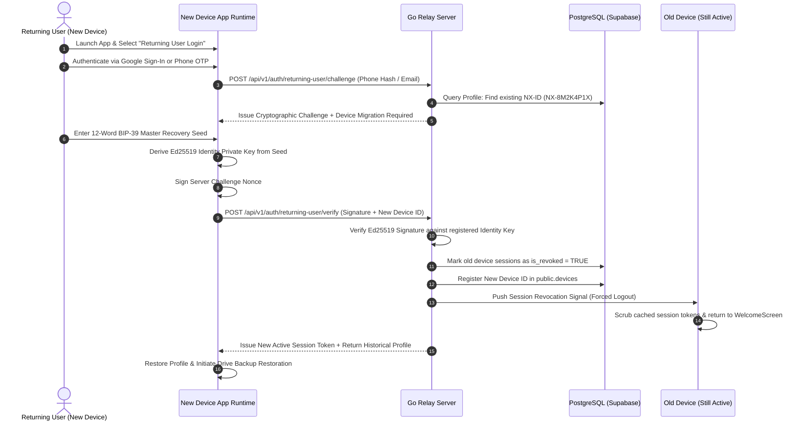

---

### Diagram 12: WebSocket Ed25519 Challenge-Response Authentication Handshake

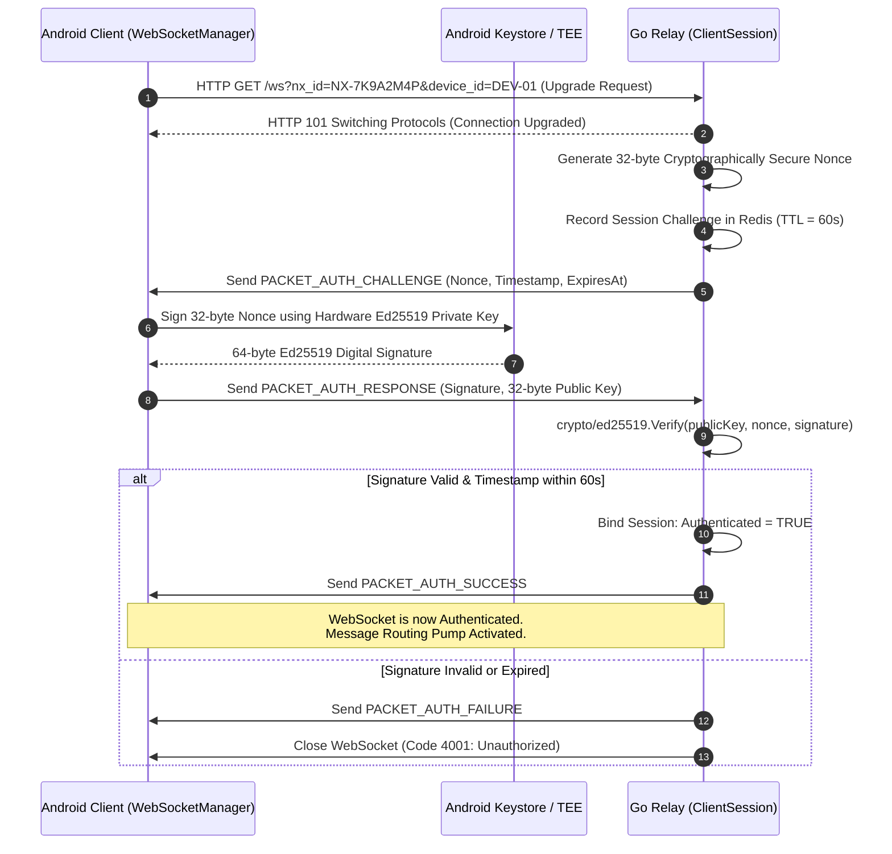

---

### Diagram 13: Pairwise Rotating Routing Token Generation & Ingestion

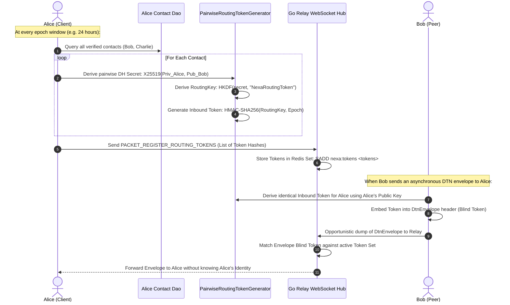

---

### Diagram 14: Complete System-Wide Macro Data Flow & Subsystem Interaction

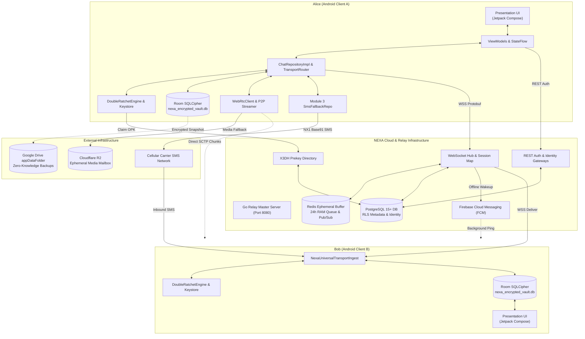
