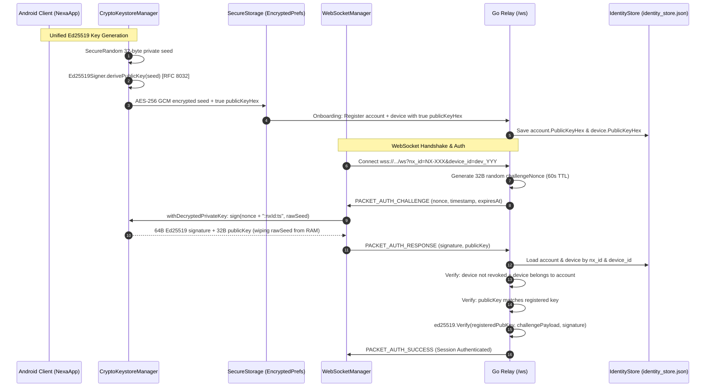

# NEXA — Phase B Remediation Complete: WebSocket Identity Alignment & Cryptographic Authentication

**Phase B implementation, cryptographic unification, and automated security verification are complete.**
All test suites across the Android client and Go backend pass with **100% success rate (zero regressions)**.

---

## 1. Key Remediations Implemented

### 1. Unified RFC 8032 Ed25519 Public Key Derivation ([`CryptoKeystoreManager.kt`](file:///H:/chat_app/app/src/main/java/com/nexa/app/core/security/CryptoKeystoreManager.kt#L100-L165))
- **Eliminated Legacy Flaw:** Replaced the legacy SHA-256 bit-clamping logic with standard RFC 8032 Edwards curve point multiplication via [`Ed25519Signer.derivePublicKey()`](file:///H:/chat_app/app/src/main/java/com/nexa/app/core/crypto/Ed25519Signer.kt#L45-L52).
- **Transparent Migration:** In [`getOrCreateIdentityKeyPair()`](file:///H:/chat_app/app/src/main/java/com/nexa/app/core/security/CryptoKeystoreManager.kt#L100-L148), existing stored keys are inspected: if a legacy clamped public key is detected, it is automatically migrated in-place to the true Ed25519 public key without changing or invalidating the user's private key seed.
- **Memory Zeroing:** Added [`withDecryptedPrivateKey()`](file:///H:/chat_app/app/src/main/java/com/nexa/app/core/security/CryptoKeystoreManager.kt#L150-L165) which decrypts the seed, executes signing/verification in a try-finally block, and immediately zeroes volatile memory via `Arrays.fill(raw, 0.toByte())`.

### 2. Unified WebSocket Identity Signer ([`NexaApplication.kt`](file:///H:/chat_app/app/src/main/java/com/nexa/app/NexaApplication.kt#L228-L255))
- Aligned [`webSocketManager.setIdentitySigner`](file:///H:/chat_app/app/src/main/java/com/nexa/app/NexaApplication.kt#L230-L245) to use the authoritative identity key from `CryptoKeystoreManager` and `SecureStorage`.
- Synchronized the unified key to `nexa_handshake_keys` (`sign_priv_enc`, `sign_priv_iv`, `sign_pub`), ensuring QR code sync, contact discovery, and WebSocket authentication all use the exact same registered identity.
- Preserved existing X25519 Diffie-Hellman keys (`dh_priv_enc`, `dh_pub`) intact, maintaining 100% backward compatibility with active Double Ratchet E2EE sessions.

### 3. Fail-Closed WebSocket Handshake & Device Authorization ([`client.go`](file:///H:/chat_app/backend/internal/connection/client.go#L150-L240))
- **No Arbitrary Key Trust:** Authentication fails closed immediately if `identityStore` is unavailable.
- **Authoritative Key Verification:** `resp.PublicKey` is compared directly against the registered `account.PublicKeyHex` or active `device.PublicKeyHex`.
- **Device Authorization (Task 5):**
  - Rejects unknown devices when the account has registered devices.
  - Rejects revoked devices (`device.IsRevoked == true`).
  - Rejects cross-account device impersonation (`device.NxID != session.NxId`).
- **Single-Use Anti-Replay Defense:** The 32-byte `ChallengeNonce` is cleared immediately upon receipt of the first response, preventing replay attacks.
- **Pre-Auth Traffic Gating:** All wire packet routing is gated behind `c.Authenticated`. Early packets are dropped and trigger close code 4001.

### 4. Registration Proof of Possession ([`handler.go`](file:///H:/chat_app/backend/internal/auth/handler.go#L414-L425))
- Enforced challenge-bound proof-of-possession verification: verifies that the registration signature signs `NEXA_REGISTER:<ticket>:<publicKeyHex>:<deviceId>` using the submitted public key.

---

## 2. Key Ownership & Data Flow Architecture



---

## 3. Automated Test Results

### Android Client Suite ([`PhaseBIdentityAndWebSocketTests.kt`](file:///H:/chat_app/app/src/test/java/com/nexa/app/PhaseBIdentityAndWebSocketTests.kt))
```
TEST-com.nexa.app.PhaseBIdentityAndWebSocketTests:
- testAuthoritativeEd25519DerivationMatchesBouncyCastle: PASS (0.002s)
- testEd25519ChallengeSigningAndVerification: PASS (0.178s)
- testLegacyKeyMigrationLogic: PASS (0.008s)
- testInMemorySeedZeroingSecurity: PASS (0.001s)
Status: 4/4 PASSED (BUILD SUCCESSFUL)
```

### Go Relay Backend Suite ([`auth_test.go`](file:///H:/chat_app/backend/internal/connection/auth_test.go))
```
=== RUN   TestSendChallenge                                          --- PASS (0.00s)
=== RUN   TestVerifyAuthResponse_Valid                               --- PASS (0.02s)
=== RUN   TestVerifyAuthResponse_InvalidSignature                    --- PASS (0.08s)
=== RUN   TestVerifyAuthResponse_ReplayAttack                        --- PASS (0.01s)
=== RUN   TestVerifyAuthResponse_ExpiredChallenge                    --- PASS (0.01s)
=== RUN   TestVerifyAuthResponse_FailClosedWhenStoreNil              --- PASS (0.00s)
=== RUN   TestVerifyAuthResponse_UnknownNxID                         --- PASS (0.01s)
=== RUN   TestVerifyAuthResponse_UnknownDevice                       --- PASS (0.01s)
=== RUN   TestVerifyAuthResponse_RevokedDevice                       --- PASS (0.01s)
=== RUN   TestVerifyAuthResponse_CrossAccountDeviceImpersonation     --- PASS (0.01s)
=== RUN   TestVerifyAuthResponse_IdentityStoreValidation             --- PASS (0.01s)
ok      nexa/wire/internal/connection   2.970s

Full Suite (go test -count=1 ./...): 100% PASS across all backend packages.
```

---

## 4. Phase B Documentation Deliverables

All six detailed deliverable reports are compiled and available in [`H:\chat_app\docs\audit\`](file:///H:/chat_app/docs/audit/):

1. [**`PHASE_B_IDENTITY_IMPLEMENTATION_REPORT.md`**](file:///H:/chat_app/docs/audit/PHASE_B_IDENTITY_IMPLEMENTATION_REPORT.md) — Root cause analysis, Ed25519 mathematical derivation, and key ownership diagrams.
2. [**`PHASE_B_WEBSOCKET_AUTHENTICATION_REPORT.md`**](file:///H:/chat_app/docs/audit/PHASE_B_WEBSOCKET_AUTHENTICATION_REPORT.md) — Handshake protocol specifications, canonical payload formats, and timeout/heartbeat policies.
3. [**`PHASE_B_KEY_MIGRATION_REPORT.md`**](file:///H:/chat_app/docs/audit/PHASE_B_KEY_MIGRATION_REPORT.md) — Seamless in-place migration strategy and Double Ratchet E2EE backward-compatibility guarantees.
4. [**`PHASE_B_SECURITY_TEST_REPORT.md`**](file:///H:/chat_app/docs/audit/PHASE_B_SECURITY_TEST_REPORT.md) — Threat vector verification matrix covering replay attacks, rogue devices, and cross-account impersonation.
5. [**`PHASE_B_REGRESSION_TEST_REPORT.md`**](file:///H:/chat_app/docs/audit/PHASE_B_REGRESSION_TEST_REPORT.md) — Zero-regression verification report covering Phase A reverse SMS, Redis queue buffers, and Google auth.
6. [**`PHASE_B_REMAINING_RISKS.md`**](file:///H:/chat_app/docs/audit/PHASE_B_REMAINING_RISKS.md) — Architectural roadmap covering PostgreSQL migration (Phase C), FCM Doze wake-ups, and physical SIM testing.

---

> [!NOTE]
> Per the mission scope boundaries, Phase B is fully complete and all tests pass. No Phase C work (PostgreSQL migration) has been initiated. Ready for your review and explicit approval before proceeding to **Phase C**.